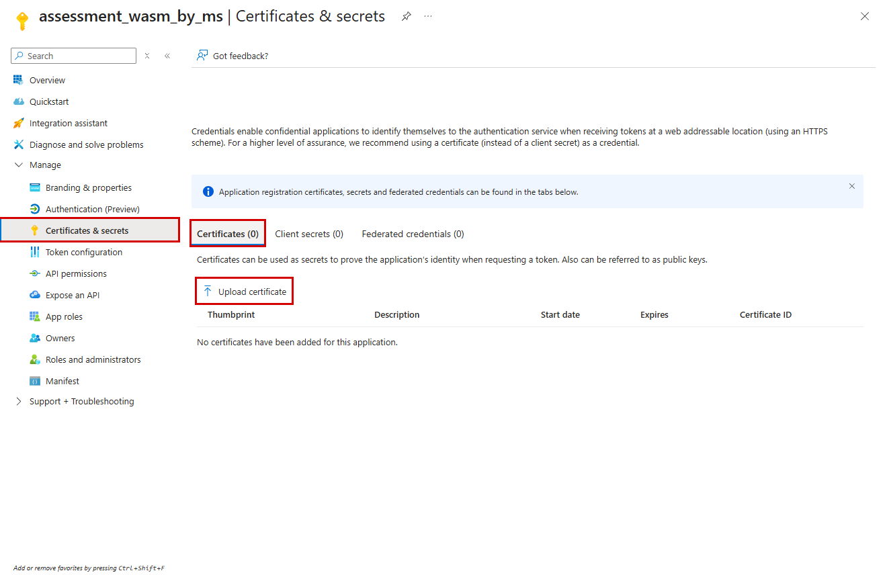

# EASM (Enterprise Agent Service Management) 거버넌스 진단/수집 툴

- **명령어: `wasm-agent`**
- **수집 대상**
  - Microsoft Foundry 계정·프로젝트·Agent·모델 배포·평가 이력.
  - Azure App Service·Functions·Container Apps·AKS의 태그·이름으로 식별되는 자체 호스팅 Agent.
  - Azure Monitor·Log Analytics의 사용량·로그 보관, Cost Management의 비용, Defender for Cloud의 AI 연결 권고.
- **원칙**
  - 별도 Reader 중심 진단 계정으로 읽기만 수행합니다. 관리자 준비와 진단 수집을 분리합니다.
  - 구독 수를 고정하지 않습니다. 페이지 처리·구독별 병렬 실행·재시도·부분 실패를 지원합니다.
  - 확인하지 못한 값은 0이나 낮은 점수로 바꾸지 않고 원인을 표시합니다.

## Codespaces에서 준비

- 저장소의 **Code → Codespaces → Create codespace**를 선택합니다.
- Python 3.11·Azure CLI·가상환경·의존성이 자동 준비됩니다.

```bash
wasm-agent --help
python --version
az version
```

- 재설치가 필요할 때만 `bash .devcontainer/setup.sh`를 실행합니다.
- 고객 데이터 반입·Codespaces 보관 지역을 승인받고 사용하세요.
- 사용 후 Codespace를 중지하고 삭제·보관 만료 전에 결과 ZIP을 내려받으세요.

## 계정·인증 준비

- 고객 테넌트·허용 구독·별도 진단 계정을 [설정 예시](config/setup.example.json)에 맞춰 준비합니다.
- 내부 설정은 결과와 분리한 `.wasm-agent/`에 저장하며 Git에 포함하지 않습니다.
- 기존 설정은 덮어쓰지 마세요. 처음 시작하는 환경에서만 복사합니다.

```bash
mkdir -p .wasm-agent
cp config/setup.example.json .wasm-agent/setup.json
# 고객 값으로 수정 후 관리자 준비
bash scripts/setup/manage.sh login
bash scripts/setup/manage.sh plan --create-principal
bash scripts/setup/manage.sh apply --create-principal
```

- 기존 계정은 `--create-principal`을 생략합니다.
- 공개 인증서 등록·암호화 인증서 생성 명령·연합 인증·최소 권한은 [인증 및 수집 안내](docs/guide.md)에 모았습니다.
- 개인키는 저장소 밖의 보호 경로에 둡니다. 코드·결과·로그에 넣지 마세요.
- 사람은 디바이스 코드로, SP는 인증서/연합 인증으로 로그인합니다.

```bash
export AZURE_TENANT_ID='<고객 tenant_id>'
export AZURE_CLIENT_ID='<진단 앱 client_id>'
export AZURE_CLIENT_CERTIFICATE_PATH="$HOME/.config/wasm-agent/diagnostic.pem"
chmod 600 "$AZURE_CLIENT_CERTIFICATE_PATH"
bash scripts/setup/manage.sh verify \
  --certificate-path "$AZURE_CLIENT_CERTIFICATE_PATH"
```



## 수집

- 먼저 [허용 모델](config/allowed_models.yaml)·[태그 규약](config/tag_conventions.yaml)·[판정 기준](config/criteria.yaml)·[수집 설정](config/config.yaml)을 고객 정책에 맞춥니다.
- 계획 확인은 Azure API를 호출하지 않습니다.

```bash
wasm-agent collect --setup-file .wasm-agent/setup.json --dry-run
```

- 테넌트에서 진단 계정이 접근 가능한 활성 구독 전체를 수집합니다.
  - 설정의 구독 목록을 무시하고 자동 열거합니다.
  - 계정에 권한이 없는 구독까지 발견한다는 뜻은 아닙니다.

```bash
wasm-agent collect --setup-file .wasm-agent/setup.json \
  --all-subscriptions --output-dir output
```

- 특정 구독으로만 제한하려면 `--all-subscriptions` 대신 목록을 지정합니다.

```bash
wasm-agent collect --setup-file .wasm-agent/setup.json \
  --subscriptions '<허용 구독 ID>' '<추가 허용 구독 ID>' \
  --output-dir output
```

- 다른 플랫폼의 수동 등록은 `--manual-agents templates/manual_agents.csv`로 추가합니다.
- 수집 필드·필요 권한·값이 나오지 않는 조건은 [수집 안내](docs/guide.md)에 있습니다.

## 결과 - 세 파일만 확인

- **`output/report.html`**
  - Agent 목록·진단 초안·개선 조치·마스킹된 원본 증거를 한 화면에서 봅니다.
- **`output/report.xlsx`**
  - 체크리스트·검토 상태·메모·Agent/평가/비용 등 원시 데이터의 Excel 테이블입니다.
- **`output/results.zip`**
  - 내려받아 공유할 최종 파일입니다.
  - 압축 안에는 `report.html`·`report.xlsx`·통합 원시 데이터 `data.json`만 있습니다.
  - 중복 CSV·Markdown·개별 JSON은 생성하지 않습니다.
  - 증적 원본·실패 사유·파일 해시는 통합 데이터에 보존합니다.
  - 인증서·개인키·로그인 캐시·환경 설정은 포함하지 않습니다.
- 재실행하면 같은 결과 파일을 갱신합니다. 기존 결과를 보관하려면 먼저 ZIP을 내려받으세요.
- 수집 없이 보고서·ZIP만 다시 만들려면 아래 명령을 사용합니다.

```bash
wasm-agent package --output-dir output
```

- 종료 코드
  - `0`: 기록된 수집 오류 없음. 범위·판정 근거는 별도 확인.
  - `2`: 일부 자료 미확보. 보고서의 원인과 다음 조치를 확인.
  - `1`: 입력·인증·실행 오류. 원인 해결 후 재실행.
- 판정 보류는 0이 아닙니다. 평가 실행 완료와 전체 문항 통과·배포 전 평가도 구분합니다.
- L1~L5는 확인한 범위의 초안입니다. 비용 반영·장기 관측 부족·공유 비용을 추정값으로 채우지 않습니다.

## 참고

- [고객 안내: 인증·권한·수집 항목](docs/guide.md).
- [개발 참고: 설계·API 근거·평가 기준](docs/api-notes.md).
- 코드 검사는 `python -m pytest -q`, `python -m ruff check src scripts samples tests`로 실행합니다.
  - 고객 Azure를 조회하지 않는 개발 테스트입니다.

<details>
<summary>개발용 데모와 함께 통합 실행하려면</summary>

- 일반 고객 진단에는 필요 없는 관리자 전용 실행입니다.
- 데모용 `.wasm-agent/setup.json`과 승인된 배포 권한을 준비합니다.
- 검증·데모 준비·모델 실행·읽기 진단·결과 압축을 통합 실행합니다.
- 배포·모델 호출·유지 비용이 발생합니다.

```bash
bash scripts/demo.sh --apply
```

</details>

<details>
<summary>데모용 인프라와 Agent만 배포하려면 - 수집은 나중에 수동 실행</summary>

- Codespaces 프로젝트 루트에서 실행합니다.
- 데모용 `.wasm-agent/setup.json`과 승인된 관리자 배포 권한이 필요합니다.
- 아래 명령은 인프라·챗봇 Agent 10개와 일부 실제 평가를 준비합니다.
  - 동작 확인용 모델 호출과 비용이 발생합니다.
  - 진단 수집·최종 보고서 생성은 실행하지 않습니다.

```bash
# 관리자 로그인이 만료됐다면
bash scripts/setup/manage.sh login
# 배포 전 검증
python -m scripts.lab.run validate --prepare-providers
# 인프라 배포
python -m scripts.lab.run deploy --apply
# 챗봇 Agent 구성 및 일부 실제 평가
python -m scripts.lab.expand --apply
```

- 기존 데모가 있다면 재배포하지 않고 사용할 수 있습니다.
- 수집은 별도 읽기 진단 계정으로 위의 수집 절차를 따릅니다.
- 데모의 삭제·재배포와 내부 파일은 [데모 운영 안내](docs/demo.md)를 참고하세요.

</details>
