# EASM (Enterprise Agent Service Management) 거버넌스 진단/수집 툴

- **점검 대상:** Microsoft Foundry, Azure 자체 호스팅 Agent, 운영 로그·비용·보안, Entra Agent ID
- **결과:** 실행별 `output/<실행시각-UTC>/` 폴더에 Excel 보고서와 원본 JSON 저장
- **원칙:** 진단 앱은 읽기 권한만 사용하며 리소스를 변경하거나 비밀값을 조회하지 않습니다
- **로그 범위:** Agent 관련 AI 계정·호스트의 실행 로그를 점검합니다.

## 진행 순서

| 순서 | 담당 | 실행 위치 | 할 일 |
| --- | --- | --- | --- |
| 1 | <span style='background-color: #fff5b1'>**MS WASM 관리자**</span> | Codespaces 터미널 | 인증서 준비, 고객용 ZIP·공개 인증서 전달 |
| 2 | <span style='background-color: #dcffe4'>**고객사 담당자**</span> | 고객사 VM의 웹 브라우저 - Azure Portal | 진단 앱 등록, 공개 인증서 업로드 |
| 3 | <span style='background-color: #dcffe4'>**고객사 담당자**</span> | 고객사 VM의 Bash 터미널 | 고객용 ZIP으로 읽기 권한 설정, setup.json 반환 |
| 4 | <span style='background-color: #fff5b1'>**MS WASM 관리자**</span> | Codespaces 터미널 | 반환받은 setup.json과 개인키로 검증·수집, 결과 다운로드 |
| 5 | <span style='background-color: #e5dcf7'>**고객/MS 공동**</span> | Codespaces / 고객사 VM | 결과 공동 검토, 고객은 Portal에서 권한 회수, MS는 개인키·데이터 정리 |

## Step 1. <span style='background-color: #fff5b1'>[MS WASM 관리자]</span> Codespaces와 인증서 준비

- **환경 준비:** 저장소 **Code → Codespaces → Create codespace**에서 엽니다.
- **인증서 생성:** 아래 명령을 실행하고 개인키 암호는 안전하게 보관합니다.

```bash
umask 077
cert_dir="$HOME/.config/wasm-agent/auth-$(date -u +%Y%m%dT%H%M%SZ)-$$"
mkdir -p "$HOME/.config/wasm-agent"
mkdir -m 700 "$cert_dir" || exit 1
openssl req -x509 -newkey rsa:3072 -sha256 -days 90 \
  -subj '/CN=wasmagent-diagnostic' \
  -keyout "$cert_dir/private-key.pem" -out "$cert_dir/public-cert.pem"
cat "$cert_dir/private-key.pem" "$cert_dir/public-cert.pem" > "$cert_dir/diagnostic.pem"
chmod 600 "$cert_dir/private-key.pem" "$cert_dir/diagnostic.pem"
mkdir -p .wasm-agent
printf '%s\n' "$cert_dir/diagnostic.pem" > .wasm-agent/certificate-path
```

- **고객 전달:** 프로젝트에 포함된 [**customer-setup.zip**](docs/downloads/customer-setup.zip) ([바로 다운로드](https://github.com/wonsungso/ms-internal-wasm-project/raw/refs/heads/main/docs/downloads/customer-setup.zip)) 파일과 위에서 만든 **public-cert.pem**을 전달합니다.

## Step 2. <span style='background-color: #dcffe4'>[고객사 담당자]</span> 진단 앱 등록

- **앱 등록:** [Azure Portal](https://portal.azure.com) → **Microsoft Entra ID → 앱 등록 → 새 등록**에서 이름은 `wasmagent-diagnostic`, 계정 유형은 **Single tenant**로 등록합니다.

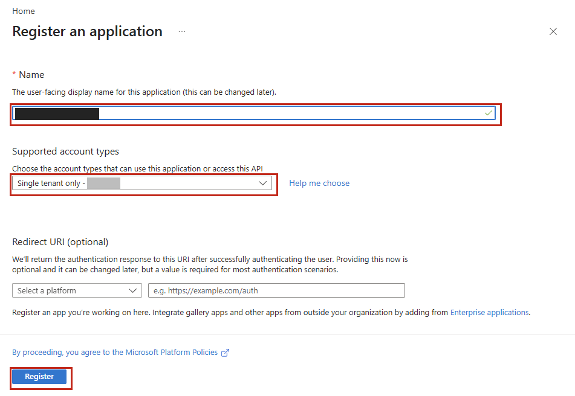

- **ID 확인:** **개요**에서 Tenant ID와 Client ID를 기록합니다. SP 개체 ID는 Step 3 스크립트가 Client ID로 자동 조회하므로 직접 입력하지 않습니다.

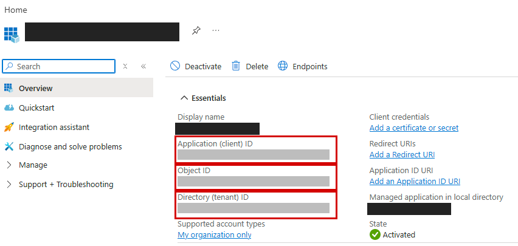

- **인증서 등록:** **인증서 및 암호 → 인증서 → 인증서 업로드**에서 받은 `public-cert.pem`을 등록합니다.

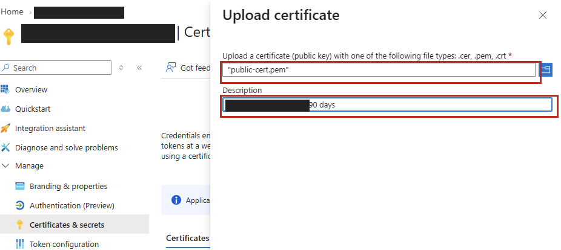

- **MS에 전달:** **Tenant ID, Client ID, 승인 구독 ID 목록**을 전달합니다. 검증된 SP 개체 ID는 Step 3 완료 후 반환하는 `setup.json`에 자동 저장됩니다.

## Step 3. <span style='background-color: #dcffe4'>[고객사 담당자]</span> 전체 진단용 권한 부여

- **부여 대상:** 아래 읽기 권한을 **기본으로 모두 부여**합니다. Azure 역할과 Entra 권한은 서로 달라 둘 다 필요합니다.

| 종류 | 권한 전체 이름 | 부여 범위 |
| --- | --- | --- |
| Azure | `Reader` | 승인 구독 |
| Azure | `Cost Management Reader` | 승인 구독 |
| Azure | `Log Analytics Reader` | 승인 구독 |
| Azure | `Security Reader` | 승인 구독 |
| Foundry 사용자 지정 역할 | `WASMAgent Foundry Evidence Reader v2` | 승인 구독의 프로젝트에 상속 |
| Graph 애플리케이션 권한 | `AgentIdentity.Read.All` | 테넌트, 관리자 동의 필요 |
| Graph 애플리케이션 권한 | `AgentIdentityBlueprint.Read.All` | 테넌트, 관리자 동의 필요 |
| Graph 애플리케이션 권한 | `Application.Read.All` | 테넌트, 관리자 동의 필요 |

- **관리자 권한 확인:** 구독 역할 할당·사용자 지정 역할 생성 권한과 Entra 관리자 동의 권한이 필요합니다.
- **최소 권한 유지:** 진단 앱에는 Owner·Contributor를 부여하지 않습니다.

- **실행 환경 준비:** **Python 3.11 이상과 Azure CLI가 있는 승인된 Bash 환경**을 사용합니다.
- **파일 압축 해제:** MS WASM 관리자로부터 전달받은 [**customer-setup.zip**](docs/downloads/customer-setup.zip) ([바로 다운로드](https://github.com/wonsungso/ms-internal-wasm-project/raw/refs/heads/main/docs/downloads/customer-setup.zip)) 파일을 아래 명령으로 압축 해제합니다.

```bash
python3 -m zipfile -e customer-setup.zip customer-setup
cd customer-setup
```

- **설정값 입력:** 아래 ID를 고객 환경의 값으로 바꾸어 `setup.json`을 생성합니다.

```bash
cat > setup.json <<'EOF'
{
  "tenant_id": "<고객 테넌트 ID>",
  "subscription_ids": [
    "<승인 구독 1 ID>",
    "<승인 구독 2 ID>",
    "<승인 구독 3 ID>"
  ],
  "account_type": "service-principal",
  "account_name": "wasmagent-diagnostic",
  "client_id": "<진단 앱의 애플리케이션(클라이언트) ID>"
}
EOF
```

- **권한 설정 실행:** 로그인 후 부여할 권한을 확인하고 적용합니다.

```bash
bash setup.sh login
bash setup.sh plan     # 부여할 권한 확인, Azure 변경 없음
bash setup.sh apply    # 기본 읽기 권한 전체 부여 및 결과를 setup.json에 저장
```

- **정상 완료 확인:** 승인 구독 3개 기준으로 Azure 역할 15건·Graph 권한 3건이 `확인됨`이고, 마지막에 `setup.json` 저장 메시지가 나오면 Step 3가 완료된 것입니다.

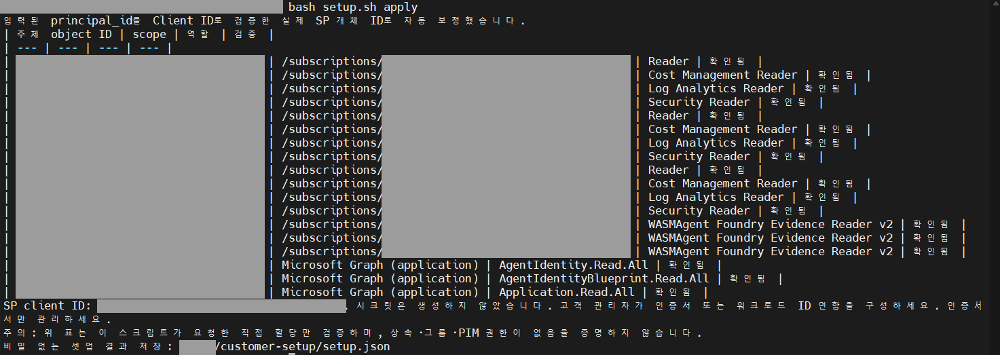

- **적용 범위:** `apply`는 목록의 모든 승인 구독에 기본 Azure 역할 4개·Foundry 사용자 지정 역할을 할당하고 Graph 권한 3개를 추가·동의합니다.
- **Graph 동의 단계에서 중단될 때:** 구독 역할 할당 권한과 Entra 동의 권한은 별개입니다. PIM에서 **Privileged Role Administrator 또는 Global Administrator**를 활성화한 관리자가 아래를 재실행합니다. Global Reader만으로는 동의할 수 없으며, 기존 Azure 역할은 중복 생성하지 않습니다.

```bash
bash setup.sh login --login-resource graph
bash setup.sh apply
```

- **인증 정보 보호:** 고객은 자신의 관리자 계정으로 로그인하며 MS에 관리자 인증 정보를 전달하지 않습니다.

- **결과 반환:** 완료된 **setup.json만 MS 담당자에게 반환**합니다. 고객에게 개인키를 보내거나 수집을 실행하도록 요청하지 않습니다.
- **담당자 분리 시:** Azure 역할 관리자와 Entra 동의 관리자가 다르면 동일 파일로 각 승인 절차를 이어서 진행합니다.

- **권한 확인:** 스크립트 실행 후 아래 화면에서 확인합니다. **포털에서 같은 권한을 다시 부여할 필요는 없습니다.**

<details>
<summary>Azure 역할 설정 (Portal 기준)</summary>


- **Azure 역할:** **구독 → 액세스 제어(IAM) → 역할 할당 추가**에서 역할과 진단 앱을 지정합니다.

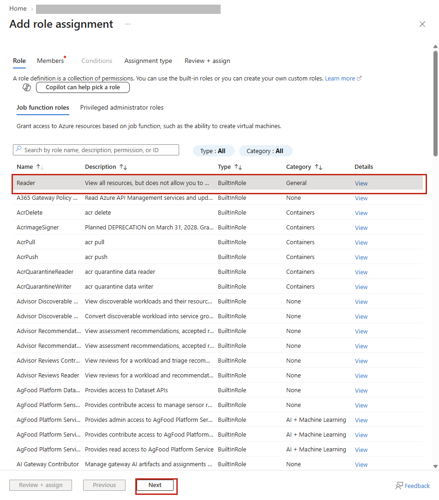

### Foundry 사용자 지정 역할 설정

- **Foundry 역할:** 스크립트로 역할을 생성한 뒤 같은 IAM 화면에서 **WASMAgent Foundry Evidence Reader v2**를 선택합니다.

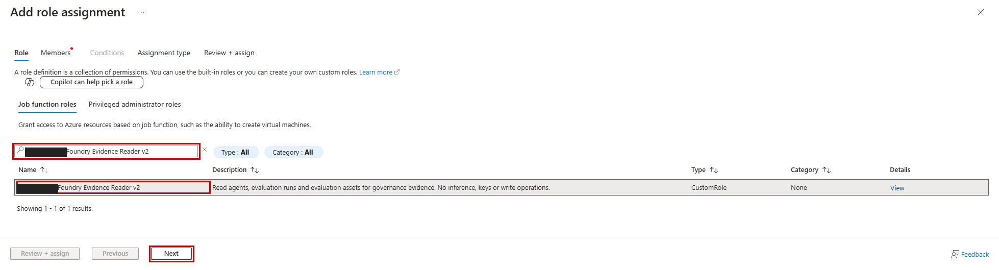

### Graph 애플리케이션 권한 설정

- **Graph 권한:** **Entra → 앱 등록 → 진단 앱 → API 사용 권한**에서 권한 3개를 확인하고 **관리자 동의**합니다.

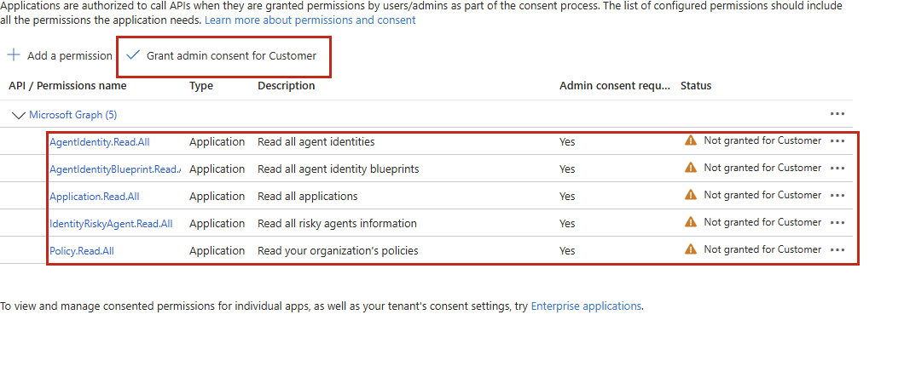

### 나머지 역할·DataActions·승인 완료 화면

- **수동 역할 할당:** **구독 → 액세스 제어(IAM) → 역할 할당 추가**에서 아래 역할을 선택합니다. 각 역할마다 진단 앱을 멤버로 지정하고 **검토 + 할당**합니다.

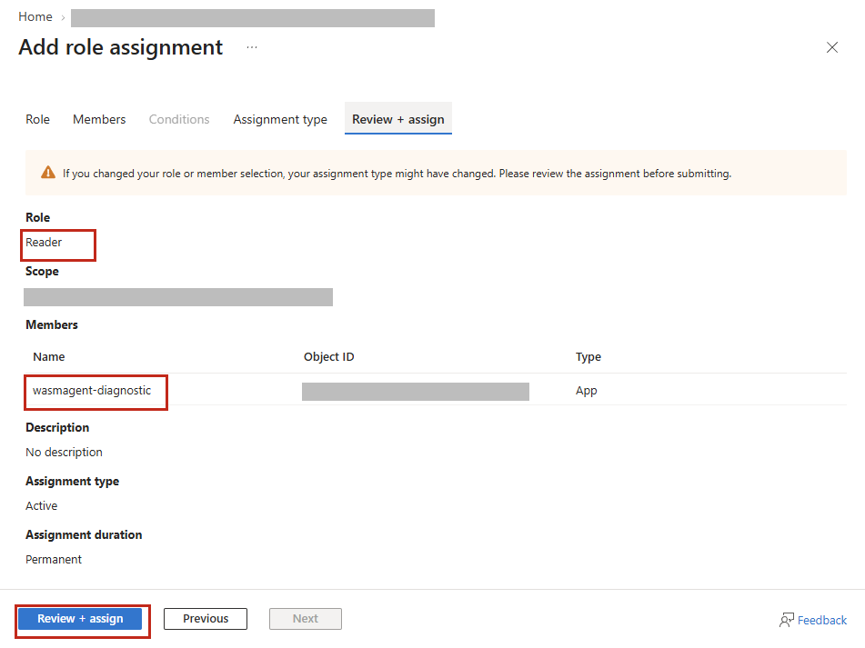

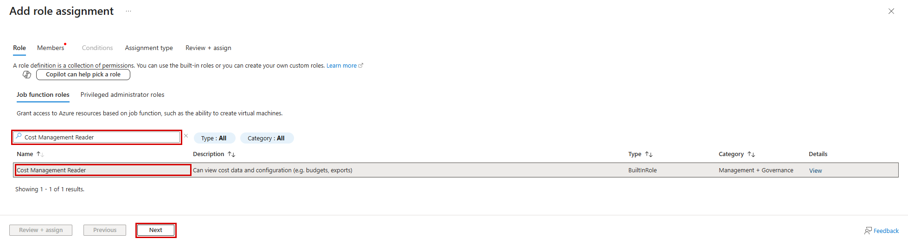

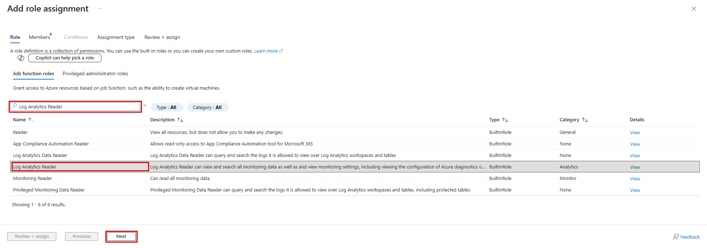

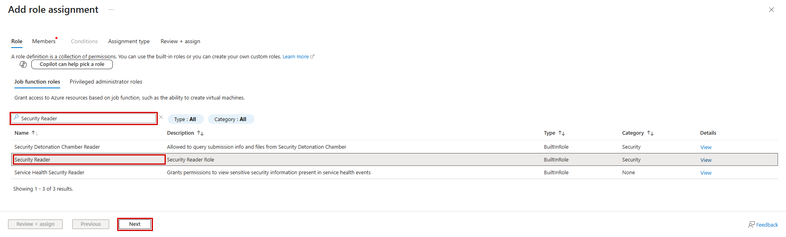

- **Foundry 권한 확인:** 스크립트가 생성한 **WASMAgent Foundry Evidence Reader v2**를 선택하고 **View → JSON** 또는 **Permissions → DataActions**에서 아래 읽기 권한 3개만 있는지 확인합니다.

| Foundry DataActions 전체 이름 |
| --- |
| `Microsoft.CognitiveServices/accounts/AIServices/agents/read` |
| `Microsoft.CognitiveServices/accounts/AIServices/evaluations/read` |
| `Microsoft.CognitiveServices/accounts/AIServices/assets/read` |

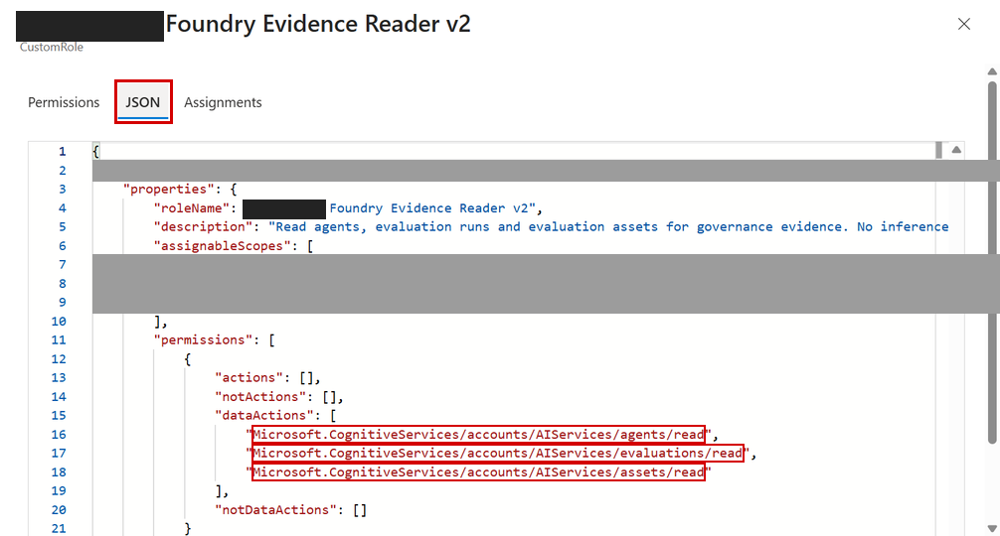

- **Entra 승인 확인:** **앱 등록 → 진단 앱 → API 사용 권한**에서 Graph 권한 3개와 승인 상태를 확인합니다. 수동 동의는 **Global Administrator 또는 Privileged Role Administrator**가 수행하며, PIM을 사용하면 먼저 해당 역할을 활성화합니다.

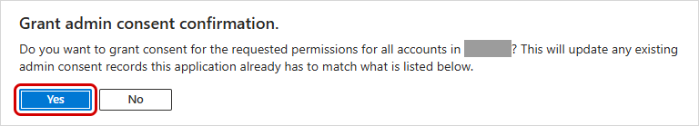

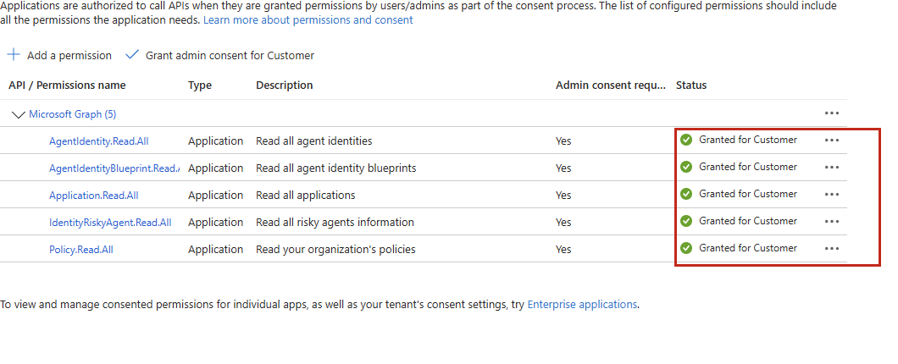

- **권한 누락 시:** **Entra 점검도 필수입니다.** 권한이 빠지면 해당 항목은 **판정 보류**로 표시하며, 권한을 보완한 뒤 다시 수집합니다.
</details>

## Step 4. <span style='background-color: #fff5b1'>[MS WASM 관리자]</span> 점검과 수집

- **준비:** 고객이 반환한 `setup.json`을 저장소의 **.wasm-agent/setup.json**으로 저장합니다.
- **실행:** **Step 1에서 사용한 동일 Codespaces 터미널**에서 아래를 실행합니다. Step 1의 개인키 암호를 재입력합니다.

```bash
cd /workspaces/ms-internal-wasm-project

export AZURE_TENANT_ID='<고객 테넌트 ID>'
export AZURE_CLIENT_ID='<진단 앱의 애플리케이션(클라이언트) ID>'
export AZURE_CLIENT_CERTIFICATE_PATH
read -r -s -p 'Certificate password: ' AZURE_CLIENT_CERTIFICATE_PASSWORD; printf '\n'
export AZURE_CLIENT_CERTIFICATE_PASSWORD
unset AZURE_CLIENT_SECRET AZURE_FEDERATED_TOKEN_FILE

AZURE_CLIENT_CERTIFICATE_PATH="$(python3 scripts/certificate_path.py)" &&
bash scripts/setup.sh verify --certificate-path "$AZURE_CLIENT_CERTIFICATE_PATH" &&
wasm-agent collect --setup-file .wasm-agent/setup.json --output-dir output
```

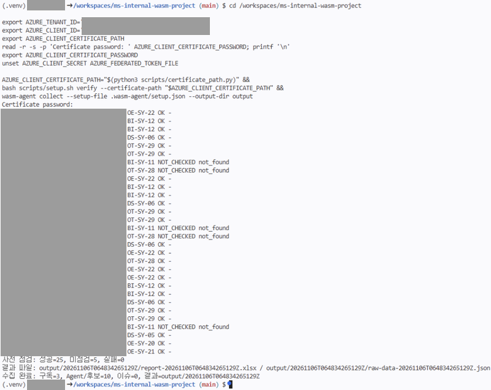

- 결과는 실행별 `output/<실행시각-UTC>/`에 저장됩니다.
- `NOT_CHECKED`는 대상 없음·프로젝트 미지정으로 미점검이며 수집은 계속 진행됩니다.
- 권한·인증 점검이 실패하면 고객 관리자에게 보완을 요청합니다.

## Step 5. <span style='background-color: #e5dcf7'>[고객/MS 공동]</span> 결과 확인과 종료

- **6. 수집 결과**의 G열 **확인상태**에서 수집 여부와 인터뷰 필요 항목을 확인합니다.
- F열 **질문 / 수집 항목**에서 수집 대상 22개의 제목과 글머리표 설명을 확인합니다.
- H열 **지표**에서 실제 확인한 수치·건수를 확인합니다.
- I열 **판정**에서 등급과 해당 평가기준을 함께 읽습니다.
- J열 **근거**에서 수집된 사실과 등급 산정 이유를 확인합니다. 건수·비율·금액 등 핵심 수치는 굵게 표시합니다.
- K열 **수집결과** 링크로 해당 항목의 상세 근거로 이동합니다.
- L열 **다음조치**에서 다음 등급에 필요한 조건을 확인합니다. 현재 Level 5인 항목은 빈칸입니다.
- M열 **평가 점수 (1~5)**는 수집 항목의 Level에 해당하는 점수입니다. 판정이 없는 항목은 빈칸이며 N열 **검토메모**에 공동 검토 내용을 기록합니다.
- **7. 수집결과 근거**와 **8. 수집 Raw 데이터**에서 상세 설정과 원본 값을 확인합니다.
- **9. 수집이슈 Raw 데이터**와 **10. 필드누락사유**에서 조회 실패·자료 부족의 원인을 확인합니다.
- 종료 후 고객은 진단 앱의 권한·인증서를 회수하고, MS는 개인키와 수집 데이터를 승인된 보관 기간에 맞춰 폐기합니다.

### 종료 후 정리

- **고객사 VM에서 실행:** Step 3에서 저장한 `setup.json` 을 기반으로 생성한 리소스를 정리합니다. 먼저 삭제 대상을 확인한 뒤 실행합니다.

```bash
bash setup.sh cleanup-plan   # 삭제 대상 조회만
bash setup.sh cleanup-apply  # 진단 앱·SP·해당 역할 할당 삭제, 미사용 진단 역할만 삭제
```

- 역할 삭제 확인이 지연되면 잠시 후 `cleanup-plan`으로 확인하고 `cleanup-apply`를 재실행합니다. 이미 삭제한 앱·SP는 다시 생성하지 않습니다.

| 담당 | 정리할 항목 | 수행 방법 |
| --- | --- | --- |
| 고객 | 진단 SP의 Azure 역할 할당 | 정리 스크립트가 승인 구독 IAM의 해당 SP 할당을 먼저 회수하고 잔여 여부 확인 |
| 고객 | 진단 앱·SP·등록 인증서·Graph 동의 | Entra → 앱 등록 → `wasmagent-diagnostic` → **Delete** 후 확인. 홈 테넌트 SP도 함께 삭제되며 엔터프라이즈 애플리케이션에서 잔여 여부 확인 |
| 고객 | Foundry 사용자 지정 역할 정의 | 재사용 계획이 없고 다른 활성·적격 할당도 없을 때만 `WASMAgent Foundry Evidence Reader v2` 삭제 |
| 고객 | 고객 VM의 전달 파일·관리자 세션 | 보관할 setup.json을 MS에 전달한 뒤 ZIP·압축 해제 파일·공개 인증서를 정리. 진단용 CLI 세션 로그아웃·임시 PIM 활성화 종료 |
| MS | 개인키·인증서·암호·경로 기록 | Step 1 인증서 폴더와 .wasm-agent/certificate-path 정리, 인증 관련 환경변수 해제. 저장한 암호·임시 인증 설정도 정리 |
| 고객/MS | 보고서·증적·다운로드·공유 사본 | 승인된 보관 기간과 감사 요건에 따라 output·evidence·setup.json·공유 사본 폐기. 전용 Codespaces도 보관 필요가 없으면 삭제 |

## 점검 항목 (System Evidence 31개)

✅ 수집 구현 / ⚠️ 일부 조회 또는 읽기 권한 제한 / ❌ 현재 수집 범위 밖입니다. 22개 수집 항목의 API 지표는 [점검 항목 상세](docs/checklist.md)와 [평가 기준](docs/api-notes.md#심사기준-검토와-점수-반영-2026-11-05)을 따릅니다. 범위 밖 9개는 수집·채점하지 않습니다.

| API 구성·기록 충족률 | Level |
| --- | --- |
| 0% | L1 |
| 0% 초과~80% 미만 | L2 |
| 80% 이상~90% 미만 | L3 |
| 90% 이상~100% 미만 | L4 |
| 100% | L5 |

`config/criteria.yaml`의 `grading_profile: api_configuration_v1`이 기준입니다. 전체 대상과 필수 필드의 조회가 완료된 경우에만 비율을 계산합니다. 권한 거부·조회 실패·필수 필드 미확인·분모 0은 `null`과 사유로 남기며 L1로 바꾸지 않습니다. 구성·기록은 조직 승인·정책 실효성·자동화 동작을 입증하지 않으며 고객 정성 입력은 등급에 반영하지 않습니다.

| 코드 | 영역 | 점검 내용 | 수집 | 신규 추가 |
| --- | --- | --- | --- | --- |
| [DM-SY-01](docs/checklist.md#dm-sy-01-agent-제작-허용-사용자-범위-및-허용-agent-유형-설정) | 1. Demand | Agent 제작 허용 범위 | ❌ | |
| [DM-SY-02](docs/checklist.md#dm-sy-02-copilot-studio-제작-권한-보유자-수-및-환경-현황) | 1. Demand | 제작 권한과 환경 | ❌ | |
| [DM-SY-03](docs/checklist.md#dm-sy-03-최근-6개월-신규-생성-agent-수-추이) | 1. Demand | 신규 Agent 생성 추이 | ❌ | |
| [DS-SY-04](docs/checklist.md#ds-sy-04-커넥터-분류차단-정책데이터-정책-적용-현황) | 2. Design | 커넥터·데이터 정책 | ❌ | |
| [DS-SY-05](docs/checklist.md#ds-sy-05-agent-id의-blueprint-연결) | 2. Design | Agent ID의 Blueprint 연결 | ✅ | |
| [DS-SY-06](docs/checklist.md#ds-sy-06-모델-배포-버전업데이트-구성) | 2. Design | 모델 배포 버전·업데이트 구성 | ✅ | |
| [DS-SY-07](docs/checklist.md#ds-sy-07-ai-리소스-인바운드-경계-구성) | 2. Design | AI 리소스 인바운드 경계 구성 | ✅ | ✓ |
| [DS-SY-08](docs/checklist.md#ds-sy-08-mcp-도구-필수-승인-모드) | 2. Design | MCP 도구 필수 승인 모드 | ✅ | ✓ |
| [DS-SY-09](docs/checklist.md#ds-sy-09-외부-도구-https-연결-구성) | 2. Design | 외부 도구 HTTPS 연결 구성 | ✅ | ✓ |
| [BI-SY-10](docs/checklist.md#bi-sy-10-환경-분리-및-관리형-환경-적용-여부) | 3. Build | 개발·운영 환경 분리 | ❌ | |
| [BI-SY-11](docs/checklist.md#bi-sy-11-foundry-프로젝트-평가-실행-이력) | 3. Build | Foundry 프로젝트 평가 실행 이력 | ✅ | |
| [BI-SY-12](docs/checklist.md#bi-sy-12-ai-리소스-보안-권고-상태) | 3. Build | AI 리소스 보안 권고 상태 | ✅ | |
| [BI-SY-13](docs/checklist.md#bi-sy-13-콘텐츠-필터-정책-연결) | 3. Build | 콘텐츠 필터 정책 연결 | ✅ | ✓ |
| [BI-SY-14](docs/checklist.md#bi-sy-14-agent-버전호스트-런타임-식별) | 3. Build | Agent 버전·호스트 런타임 식별 | ✅ | ✓ |
| [BI-SY-15](docs/checklist.md#bi-sy-15-agent-책임환경비용-메타데이터) | 3. Build | Agent 책임·환경·비용 메타데이터 | ✅ | ✓ |
| [BI-SY-16](docs/checklist.md#bi-sy-16-ai-리소스-정책-평가-준수) | 3. Build | AI 리소스 정책 평가 준수 | ✅ | ✓ |
| [DP-SY-17](docs/checklist.md#dp-sy-17-전체-agent-목록과-배포-범위게시-상태소유자) | 4. Deploy | Agent 등록·배포 현황 | ❌ | |
| [DP-SY-18](docs/checklist.md#dp-sy-18-agent-공유-허용-범위-및-사용자-설치-허용-설정) | 4. Deploy | 공유·설치 허용 범위 | ❌ | |
| [DP-SY-19](docs/checklist.md#dp-sy-19-azure-agent의-entra-blueprint-귀속) | 4. Deploy | Azure Agent의 Entra Blueprint 귀속 | ⚠️ | |
| [OE-SY-20](docs/checklist.md#oe-sy-20-agent-id-소유자후원자-연결) | 5. Operate | Agent ID 소유자·후원자 연결 | ✅ | |
| [OE-SY-21](docs/checklist.md#oe-sy-21-agent-id-앱-역할-읽기-범위) | 5. Operate | Agent ID 앱 역할 읽기 범위 | ✅ | |
| [OE-SY-22](docs/checklist.md#oe-sy-22-agent-리소스-실행-로그-연결) | 5. Operate | Agent 리소스 실행 로그 연결 | ✅ | |
| [OE-SY-23](docs/checklist.md#oe-sy-23-관리-id키-인증직접-arm-역할-구성) | 5. Operate | 관리 ID·키 인증·직접 ARM 역할 구성 | ✅ | ✓ |
| [OE-SY-24](docs/checklist.md#oe-sy-24-ai-리소스-활성-경보-범위) | 5. Operate | AI 리소스 활성 경보 범위 | ✅ | ✓ |
| [OE-SY-25](docs/checklist.md#oe-sy-25-ai-경보의-작업-그룹수신자-연결) | 5. Operate | AI 경보의 작업 그룹·수신자 연결 | ✅ | ✓ |
| [OE-SY-26](docs/checklist.md#oe-sy-26-리소스-지역workspace-보존-구성) | 5. Operate | 리소스 지역·workspace 보존 구성 | ⚠️ | ✓ |
| [OT-SY-27](docs/checklist.md#ot-sy-27-승인되지-않은-agentshadow-ai-탐지-결과) | 6. Optimize | 미승인 Agent 탐지 | ❌ | |
| [OT-SY-28](docs/checklist.md#ot-sy-28-ai-리소스-사용량-관측-범위) | 6. Optimize | AI 리소스 사용량 관측 범위 | ✅ | |
| [OT-SY-29](docs/checklist.md#ot-sy-29-ai-비용의-단일-agent-귀속) | 6. Optimize | AI 비용의 단일 Agent 귀속 | ✅ | |
| [OT-SY-30](docs/checklist.md#ot-sy-30-agent가-접근하는-민감-데이터-노출-현황) | 6. Optimize | 민감 데이터 노출 | ❌ | |
| [OT-SY-31](docs/checklist.md#ot-sy-31-구독-예산실제예측-경보-구성) | 6. Optimize | 구독 예산·실제·예측 경보 구성 | ✅ | ✓ |

## 개발 참고

- [config/criteria.yaml](config/criteria.yaml): API 지표·분모·증거·한계와 Level 1~5 규칙. 기본 기준을 조정할 때 수정
- [config/custom-config.yaml](config/custom-config.yaml): workers·tags·projects 등 수집 기술 설정. 없어도 기본 수집 가능. 과거 Settings의 허용 모델·내부 기준·`policy_facts`는 로딩 호환용이며 등급에 사용하지 않음
- [고객 권한 설정 ZIP](docs/downloads/customer-setup.zip): 권한 설정·정리용 파일 4개. 스크립트 변경 후 `python -m scripts.package_customer_setup`으로 갱신

두 파일은 저장소의 `config/` 폴더에서 관리합니다. 별도 기준 파일은 `wasm-agent collect --criteria <기준.yaml> --config <고객설정.yaml>`로 지정합니다. 수집 기본값은 `config/criteria.yaml`과 `config/custom-config.yaml`이며, 기준 파일이 없는 설치 환경은 배포 패키지에 포함한 기본 기준을 사용합니다. 명시한 기준 파일이 없거나 YAML이 잘못되면 오류로 종료합니다.

Level 문장과 규칙을 변경한 경우 평가 템플릿도 함께 갱신합니다: `python -m scripts.merge_assessment --source docs/assessment-result-template.xlsx --output <갱신할-템플릿.xlsx>`. 검토 후 갱신 파일을 기존 템플릿 대신 사용하세요. 기존 결과의 `package`는 점수를 다시 계산하지 않습니다.
- [docs/api-notes.md](docs/api-notes.md): 권한·API·심사 근거와 기술적 한계
- 검사: `python -m pytest -q`, `python -m ruff check src scripts demo tests`

<details>
<summary>Excel 보고서만 다시 만들기</summary>

`wasm-agent package --output-dir output`을 실행합니다. 최신 실행 폴더의 `raw-data-<타임스탬프>.json`에서 `report-<타임스탬프>.xlsx`를 재생성합니다.

</details>

<details>
<summary>개발용 데모 실행</summary>

고객 진단에는 필요 없습니다. 승인된 테스트 환경에서만 실행합니다.

```bash
bash demo/run.sh --apply
bash demo/run.sh --apply --collect
```

첫 명령의 수집은 나중에 수동 실행합니다. 자세한 내용은 [demo/README.md](demo/README.md)를 참고하세요.

</details>
