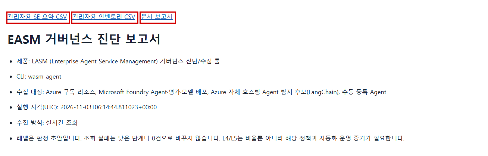

# EASM (Enterprise Agent Service Management) 거버넌스 진단/수집 툴

- **명령어: `wasm-agent`**
- **수집 대상 리소스**
  - Microsoft Foundry 계정·프로젝트·Agent·모델 배포·평가 이력.
  - Azure App Service·Functions·Container Apps·AKS의 태그·이름 규약으로 식별되는 자체 호스팅 Agent.
  - Azure Monitor·Log Analytics의 사용량·로그 보관 설정.
  - Azure Cost Management의 비용, Defender for Cloud의 AI 연결 보안 권고.
- **실행 원칙**
  - 별도 읽기 전용 진단 계정으로 실행합니다. 고객 리소스를 배포·변경·삭제하지 않습니다.
  - 기본 범위는 지정 테넌트에서 진단 계정이 접근 가능한 모든 활성 구독입니다.
  - 구독 수를 고정하지 않습니다. 구독별 병렬 수집·페이지 처리·재시도·부분 실패를 지원합니다.
  - 확인하지 못한 값은 0이나 낮은 점수로 바꾸지 않고 원인과 함께 표시합니다.

## 수집 환경 열기 - GitHub Codespaces

- 이 저장소의 **Code → Codespaces → Create codespace**를 선택합니다.
- Python 3.11·Azure CLI·가상환경·의존성이 자동 준비될 때까지 기다립니다.
- 터미널에서 준비 상태를 확인합니다.

```bash
wasm-agent --help
python --version
az version
```

- 가상환경을 직접 만들 필요는 없습니다.
- 재설치가 필요한 경우만 아래 명령을 실행합니다.

```bash
bash .devcontainer/setup.sh
```

- Codespaces 실행·보관에는 GitHub 사용량 비용이 발생할 수 있습니다.
- Codespaces 보관 지역·고객 정보 반입 정책을 승인받은 뒤 실제 데이터를 수집하세요. Azure 리소스 지역과 같다고 가정하지 않습니다.
- 사용 후 **Stop codespace**를 선택합니다.
- 구독이 많아 실행이 길어지면 유휴 종료 시간을 충분히 설정하고, 중지·삭제 전에 결과 ZIP을 내려받으세요.
- Git에 포함하지 않은 실행 결과는 Codespace 보관 기간이 끝나 삭제되면 복구되지 않을 수 있습니다.
- 고객별 새 Codespace와 별도 결과 폴더를 사용하는 것을 권장합니다.

## 고객 관리자: 읽기 권한 준비

- 필요한 입력
  - 고객 테넌트 ID.
  - 허용할 구독 목록과 별도 진단 계정.
  - 인증서 또는 실행 호스트에 맞는 연합 인증.
  - 고객 승인 모델·버전, 태그 규약, 내부 보존 기준.
- 관리자 준비 절차
  - [설정 예시](config/setup.example.json)를 `output/setup.json`으로 복사합니다.
  - 테넌트·구독·계정 이름을 고객 값으로 수정합니다. 기존 설정을 덮어쓰지 마세요.
  - 관리자 디바이스 코드 로그인 후 변경 계획을 확인하고 필요한 역할만 부여합니다.

```bash
mkdir -p output
cp config/setup.example.json output/setup.json
bash scripts/setup/manage.sh login
bash scripts/setup/manage.sh plan --create-principal
bash scripts/setup/manage.sh apply --create-principal
```

- 기존 계정은 `--create-principal`을 생략합니다.
- 구독 Reader가 기본입니다.
- Foundry 데이터·로그·비용은 실제 거부 사유를 확인한 뒤 필요한 읽기 역할만 추가합니다.
- [권한 요청과 범위](docs/rbac.md)를 참고하세요.
- 위 명령은 관리자 준비용입니다. 관리자 계정으로 진단 수집을 대신하지 않습니다.

## 실행 담당자: 인증 연결

- 공개 인증서는 진단 앱에 등록합니다.
- 개인키 포함 인증서는 Codespace 저장소 밖의 보호 경로에 둡니다.
- 개인키·비밀번호·토큰을 Git에 추가하거나 결과 폴더에 넣지 마세요.
- Codespaces에서는 Linux 경로를 사용합니다.

```bash
export AZURE_TENANT_ID='<고객 tenant_id>'
export AZURE_CLIENT_ID='<진단 앱 client_id>'
export AZURE_CLIENT_CERTIFICATE_PATH="$HOME/.config/wasm-agent/diagnostic.pem"
chmod 600 "$AZURE_CLIENT_CERTIFICATE_PATH"
bash scripts/setup/manage.sh verify \
  --certificate-path "$AZURE_CLIENT_CERTIFICATE_PATH"
```

- [실제 인증 화면과 연합 인증 안내](docs/sp-authentication.md)를 참고하세요.
- 사람의 Azure CLI 로그인은 `--use-device-code` 방식입니다.
- 서비스 주체는 인증서/연합 인증으로 실행하며 디바이스 코드로 로그인하지 않습니다.


## 수집 실행

- 수집 전에 고객 정책을 확인합니다.
  - [허용 모델·버전](config/allowed_models.yaml).
  - [Agent 식별·운영 환경·담당·비용센터 태그](config/tag_conventions.yaml).
  - [판정 기준·내부 보존 기간](config/criteria.yaml).
  - [테넌트·프로젝트 endpoint·정성 정책 증거](config/config.yaml).
- 계획 확인은 Azure API를 호출하지 않습니다.

```bash
wasm-agent collect --setup-file output/setup.json --dry-run
```

- 실제 수집을 시작합니다.

```bash
bash scripts/collect.sh --setup-file output/setup.json --output-dir output
```

- 특정 구독으로만 제한하려면 목록을 지정합니다.

```bash
wasm-agent collect --setup-file output/setup.json \
  --subscriptions '<허용 구독 ID>' '<추가 허용 구독 ID>' \
  --output-dir output
```

- 다른 플랫폼의 수동 등록 정보를 합치려면 `--manual-agents templates/manual_agents.csv`를 추가합니다.
- 수동 입력은 자동 API 실측과 구분합니다.
- 전체 필드·수집원·필요 조건은 [수집 항목 목록](docs/collection-items.md)에 정리했습니다.

## 결과 확인·다운로드

- 먼저 `output/report.html`을 엽니다.
  - Agent 목록, 평가 실행·문항 통과/실패, 판정 근거, 부족한 자료, 다음 조치를 확인합니다.
- Excel에서는 아래 파일을 엽니다.
  - `output/customer_summary.csv`: 한글 진단 요약.
  - `output/customer_inventory.csv`: 한글 Agent 목록.
- **다운로드할 파일은 `output/wasm-agent-results-*.zip`입니다.**
  - Codespaces 파일 탐색기에서 ZIP을 우클릭하고 **Download**를 선택합니다.
  - 압축을 풀고 `report.html`을 열면 마스킹된 원본 증거 링크도 함께 볼 수 있습니다.
  - `manifest.json`에는 포함 파일의 해시와 첨부하지 않은 증거가 표시됩니다.
  - 인증서·개인키·로그인 캐시·환경 설정·이전 실행 결과는 압축에 넣지 않습니다.
- 수집을 반복하지 않고 보고서와 ZIP만 다시 만들 때는 아래 명령을 사용합니다.

```bash
wasm-agent package --output-dir output
```
- JSON과 기존 영문 CSV는 프로그램 연동용으로 유지합니다.
  - `null`: 값을 확인하지 못함. 0이 아닙니다.
  - `N/A`: 자료·권한·관측 기간 등 이유로 판정을 보류함.
- 종료 코드
  - `0`: 기록된 수집 오류 없음. 범위와 판정 근거는 별도 확인.
  - `2`: 일부 자료를 확보하지 못함. 보고서의 원인과 다음 조치를 확인.
  - `1`: 입력·인증·실행 오류. 원인 해결 후 재실행.
- L1~L5는 확인한 범위의 초안입니다. 비율만 높다고 상위 수준으로 확정하지 않습니다.
- 청구 반영 지연·장기 관측 부족·공유 비용은 추정값으로 채우지 않습니다.



## 수집 항목

- Agent 정보
  - 구독·리소스 그룹·플랫폼·ID·이름·버전·호스팅·담당·태그·탐지 근거.
- 모델·평가
  - 모델 이름·버전·배포·SKU·용량·상태·연결된 도구 종류.
  - 평가 실행 ID·상태·Agent/버전 연결·완료 시각·문항 통과/실패/오류 수.
- 사용량·비용
  - 최근 호출·토큰·마지막 사용·장기 관측 가능 여부.
  - 리소스별 비용·통화·월별 합계·Agent 귀속 가능성.
- 로그·보안
  - 진단 로그 전송·워크스페이스 보존 기간·AI 연결 보안 권고.
- 진단 결과
  - 지표·판정 초안·원본 증거·개선 후보·선택 인터뷰 점수와의 차이.

## 참고

- [인증 준비](docs/sp-authentication.md).
- [읽기 권한](docs/rbac.md).
- [수집 항목](docs/collection-items.md).
- [고객과 추가로 확인할 자료](docs/next-steps.md).
- [API 근거·한계](docs/api-notes.md).
- 개발 코드 점검은 `python -m pytest -q`, `python -m ruff check src scripts samples tests`로 수행합니다.
  - 가짜 API 응답으로 검사하는 개발 테스트이며 고객 데이터 수집 명령이 아닙니다.

<details>
<summary>개발용 데모와 함께 통합 실행하려면</summary>

- 일반 고객 진단에는 필요 없는 관리자 전용 실행입니다.
- 데모용 `output/setup.json`과 승인된 배포 권한을 준비합니다.
- 공급자 검증·데모 준비·실제 모델 실행·읽기 진단·결과 압축을 통합 실행합니다.
- 배포·모델 호출·유지 비용이 발생합니다. 실행 전 관리자 승인이 필요합니다.

```bash
bash scripts/demo.sh --apply
```

</details>
