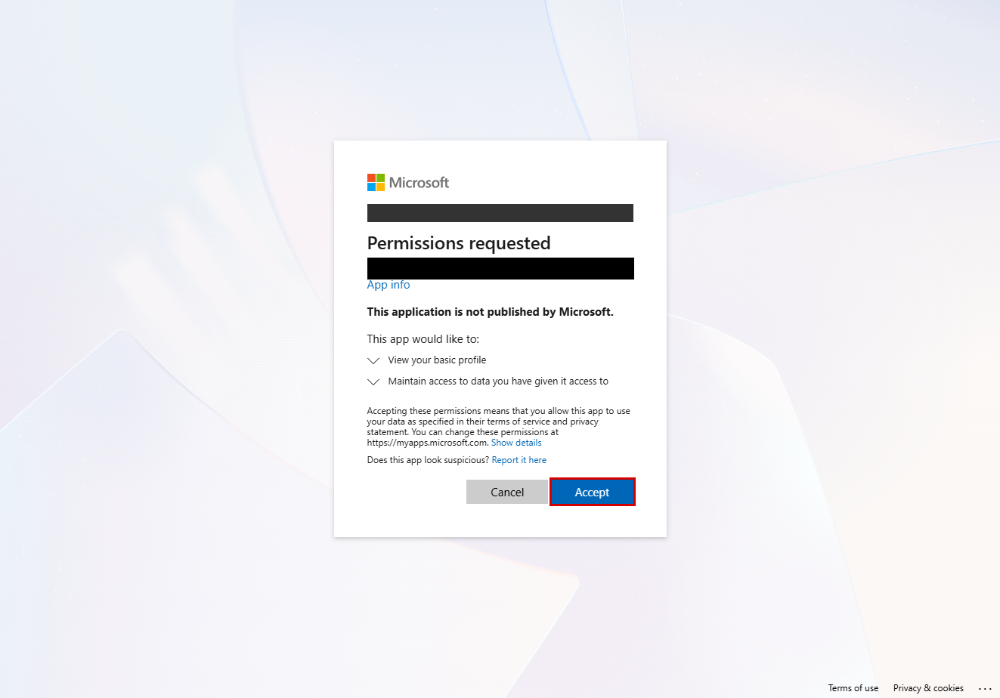
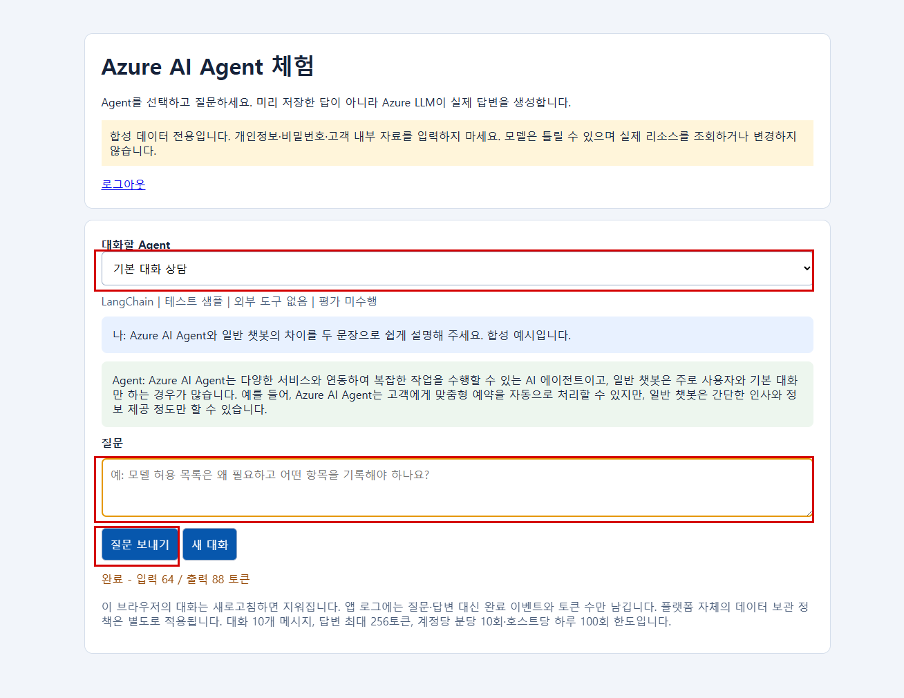
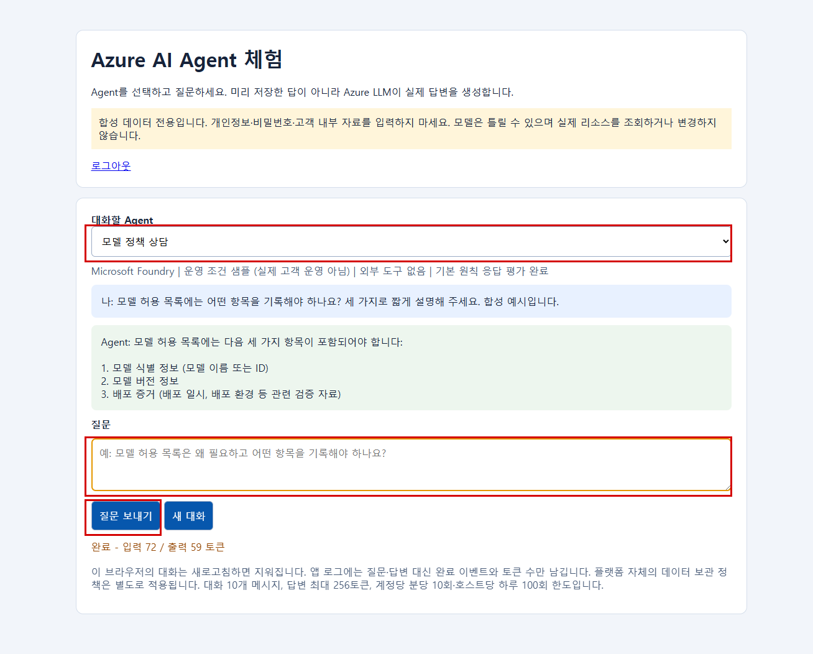

# 개발용 데모

- 실제 고객 수집에는 이 폴더가 필요하지 않습니다. 고객 절차는 [README](../README.md)를 사용합니다.
- 데모 코드·Bicep·설정·챗봇·화면 캡처·테스트를 이 폴더에 모았습니다. API·권한 근거는 [개발 참고](../docs/api-notes.md)에 있습니다.
- 관리자 배포와 Reader SP 수집은 분리합니다. 수집기는 `demo`를 import하지 않습니다.

## 배포와 실행

- 프로젝트 루트에서 실행합니다. 승인된 관리자 권한과 `.easm-agent/setup.json`이 필요합니다.
- 환경 입력은 `tenant_id`, `subscription_ids`, `account_name`과 [config.yaml](config.yaml)입니다. 진단 SP가 없으면 진단용 역할 생성·할당은 생략합니다.
- 기본 데모는 Foundry·모델·웹 앱·로그 리소스를 별도 소유 태그가 있는 그룹에 배포합니다. Agent 구성은 [catalog.json](catalog.json)의 Foundry 8개와 LangChain 2개입니다.
- Korea Central·소형 모델·합성 데이터용 설정입니다. 모델의 GlobalStandard 처리와 필요한 공급자 등록을 승인한 환경에서만 실행합니다.

```bash
bash scripts/setup.sh login
bash demo/run.sh --apply
```

- 위 명령은 인프라·로그인 보호 챗봇 10개·실제 평가 4건을 준비하고 유지합니다. 진단 SP 생성이나 진단 수집을 대신하지 않습니다.
- 수집까지 통합 실행하려면 Reader 진단 SP 설정을 별도로 준비한 후 `bash demo/run.sh --apply --collect`를 사용합니다.
- 배포 전 테스트·Ruff·Bicep·구독별 ARM validate/what-if·정책 조회를 수행합니다. 삭제 계획이 있으면 중단하며, 통과 증거는 `.easm-agent/demo/validation.json`에 남깁니다.
- 모델·로그·B1 유지 비용이 발생합니다. B1 2개 합계 USD 0.036/시간은 기존 검증 당시 기준이며 모델·로그는 별도입니다. 설정의 USD 100은 승인 예산이지 하드 과금 상한이 아닙니다.

## 개별 명령과 실패 후 재개

```bash
python -m demo.manage plan
python -m demo.manage test
python -m demo.manage validate --prepare-providers
python -m demo.manage deploy --apply --reuse-infrastructure
python -m demo.agents --apply
python -m demo.manage collect
python -m demo.diagnostics verify
python -m demo.diagnostics codespace --codespace '<Codespace 이름>' --apply
```

- 재사용 배포도 소유 태그와 검증 증거를 확인합니다. 없는 리소스를 재사용 모드에서 임의 생성하지 않습니다.
- 실패한 단계만 같은 명령으로 재개합니다. `.easm-agent/demo/lab.json`, `runthrough.json`, `chatbot-expansion/`의 배포·평가 영수증을 확인합니다.
- `collect`는 임시 공개 인증서와 저장소 밖 사용자 전용 개인키를 사용하고 종료 시 새 인증서만 정리합니다. 기존 인증서는 보존합니다. 강제 종료한 경우 별도 확인이 필요합니다.
- 권한 거부가 실제 확인된 경우에만 설정에 따라 Cost Management Reader 또는 워크스페이스 Log Analytics Reader를 추가합니다. `auto_grant_needed_read_roles: false`로 끌 수 있습니다. 관리자 수집으로 대체하지 않습니다.
- 결과는 실행별 `output/<실행시각-UTC>/` 폴더의 Excel과 raw-data JSON 두 개입니다. 재실행·권한 보완 후 수집도 별도 폴더에 보존하며 Codespaces 다운로드도 실행 폴더를 유지합니다. 종료 코드 `2`의 자료 미확보 사유를 보존합니다.
- `verify`는 기존 수집 결과·역할·인증서 잔여 수·HTTP 상태를 읽고 테스트합니다. 배포·추론·역할 변경은 하지 않습니다. 전체 통합 수집 결과가 있어야 합니다.

## 제안 항목별 데모 구성

| 데모 항목 | 위치 | 수집 제안 주제 | 결과가 갈리는 지점 |
| --- | --- | --- | --- |
| 사용자 지정 콘텐츠 필터(RAI) `raiPolicies@2024-10-01`, 기반 `Microsoft.DefaultV2`, Hate 필터 재정의 | [foundry.bicep](foundry.bicep) | RAI 정책 적용 범위 | 주 모델 배포만 사용자 지정 정책, 추가 모델 배포는 기본 정책 |
| Action Group(웹훅 수신자 1개, 메일/SMS 없음) + 메트릭 경고 | [monitor.bicep](monitor.bicep) | 경고 규칙·Action Group 구성 | Foundry는 `AzureOpenAIAvailabilityRate` 99 미만, 웹 앱은 `Http5xx` 5 초과 |
| Azure Policy 내장 감사 할당 `policyAssignments@2024-05-01` | [policy.bicep](policy.bicep) | 정책 준수 상태 | Foundry 계정이 `publicNetworkAccess: Enabled`라 비준수 |
| Foundry Agent 함수 도구 1개(`privacy-helper`, prod) | [catalog.json](catalog.json) | Agent 도구 구성 | 함수 스키마만 등록, 실행 없음 |
| Foundry Agent 원격 MCP 도구 1개(`onboarding-helper`) | [catalog.json](catalog.json) | MCP 엔드포인트 호스트 | `learn.microsoft.com/api/mcp`, 승인 `always` |

- Action Group 수신자는 구독의 `Monitoring Reader` 역할 보유자(ARM 역할 수신자, 주소 입력 없음)이며 경고 조건이 발생할 때만 통지됩니다. 외부 웹훅은 `WebhookServiceUriBlocked`로 거부되어 쓰지 않습니다. 경고는 모든 리소스 그룹에 1개씩 배포됩니다.
- 정책 할당은 `DoNotEnforce`와 `Audit` 효과만 사용해 아무 것도 차단하지 않습니다. 대상 내장 정의는 Microsoft가 Deprecated로 표시했으며 기본 효과가 `Disabled`라서 `Audit`를 명시합니다.
- 도구 Agent는 새 버전(`chatbot-v2-tool`)으로 등록하며 실제 대화·평가는 건너뜁니다. 챗봇 화면은 409로 안내합니다. 도구 호출이나 MCP 승인 요청에는 텍스트 답변이 없기 때문입니다.
- 정책 준수 조회를 위해 첫 구독에 `Microsoft.PolicyInsights` 공급자를 등록합니다. 준수 평가 반영에는 시간이 걸립니다.
- 모든 배포는 같은 세대에서 재실행해도 삭제 없이 수렴합니다. 추가 비용은 메트릭 경고 규칙 소액 월 요금 수준입니다.

## 챗봇 접속과 안전 경계

- `.easm-agent/demo/lab.json`의 호스트별 `chat_url`을 엽니다. 기본 허용자는 배포를 실행한 관리자 1명이며 다른 사용자를 자동 추가하지 않습니다.
- Agent 선택 → 질문 입력 → **질문 보내기**를 사용합니다. 각 호스트는 Foundry 8개와 자기 LangChain 1개를 보여주므로 화면의 중복 목록을 추가 Agent로 세지 않습니다.
- App Service 로그인·동일 테넌트·허용 사용자 검증을 적용합니다. 서버는 User Assigned MI 연합 인증을 사용하며 client secret을 만들지 않습니다. 모델 호출 주체는 웹 앱 MI로, 진단 SP와 다릅니다.
- 인바운드 경계 데모는 App Service 1개에 승인된 공인 IP 대역 허용과 기본 거부를 적용합니다. 허용 대역 밖에서는 로그인·`/health` 접근도 차단되며, SCM 설정과 나머지 워크로드는 유지합니다. 실제 적용 기록은 `.easm-agent/demo/network-boundary-20261109.json`에서 확인합니다.
- 동시 호출 1개, 사용자별 분당 10회·호스트별 하루 100회, 메시지 2,000자·대화 8,000자·10개 메시지·응답 256토큰으로 제한합니다. 일일 카운트는 재시작 후 유지되지만 비용 상한을 보장하지 않습니다.
- 질문·답변·사용자 ID는 앱 로그에 쓰지 않고 완료 이벤트·Agent ID·토큰 수만 기록합니다. `/health` 조회는 모델을 호출하지 않으며 비로그인 채팅은 차단합니다.
- Linux CPython 3.11 wheel을 사전 패키징합니다. 배포 ZIP에는 [app.py](app.py)·[catalog.json](catalog.json)·[chat.html](chat.html)과 의존성만 넣고 관리자 코드·설정·테스트는 제외합니다. 새 Kudu 배포 ID의 완료와 실제 모델 응답을 각각 검증합니다.
- 평가는 실제 합성 응답 3문항의 정확 일치 검사입니다. 실행 완료·전체 통과·배포 전 평가는 서로 다릅니다. 종합 안전성이나 업무 품질 인증이 아닙니다.
- 생성 직후에는 30일 비용이나 90일 관측 기간을 확보할 수 없습니다. API 미지원·권한 부족·로그 유입 지연을 0이나 L1로 대체하지 않습니다.

## 실행형 거버넌스 데모

| 제어 | 실제 실행 경로 | 한계 |
| --- | --- | --- |
| 외부 endpoint 기본 거부 | 모델 client 생성 전 서버 설정의 `AZURE_OPENAI_ENDPOINT` 또는 `AZURE_AI_PROJECT_ENDPOINT`와 HTTPS 주소를 정확히 대조 | Azure 네트워크 정책이나 원격 Foundry/MCP 도구의 집행 증거는 아님 |
| 합성 작업 승인/거부 | 로그인 사용자가 아래 API로 작업과 결정을 생성하고 LangChain `synthetic_record` 도구가 승인된 ID를 1회 실행 | Azure 쓰기 없음, 메모리 합성 레코드만 사용, 300초 만료, 최대 256개 |
| 버전/자체 검사 | `/health`의 `governance`에 정책/런타임 버전, 코드 해시, 양성/음성 검사 결과 공개 | URL/사용자/대화/작업 ID 없음, 합성 승인 fixture는 실제 사람의 승인이 아님 |

- `langchain-tools` 호스트의 로그인된 동일 사이트 요청만 작업 API를 사용할 수 있습니다. 모델에는 승인 도구를 제공하지 않습니다. Foundry 도구 Agent의 기존 409 응답은 유지합니다.
- 브라우저 개발자 도구에서 실제 사용자가 요청합니다. 첫 명령 뒤 승인 또는 거부를 직접 선택하고, 승인했다면 채팅에 `synthetic_record`로 해당 ID를 실행하도록 요청합니다. 실제 고객 데이터는 입력하지 않습니다.

```javascript
const headers = {"Content-Type": "application/json", "X-EASMAgent-Chat": "1"};
const action = await fetch("/api/governance/actions", {
  method: "POST", headers, body: JSON.stringify({value: "synthetic-ready"})
}).then(r => r.json());
// 실제 사용자가 승인하려는 작업 ID인지 확인한 뒤 true 또는 false를 선택합니다.
await fetch(`/api/governance/actions/${action.action_id}/decision`, {
  method: "POST", headers, body: JSON.stringify({approved: true})
});
console.log(action.action_id);
```

### 로컬 테스트와 배포 후 검증

```powershell
.\.venv\Scripts\python.exe -m pytest demo\test_governance.py -q --basetemp=.easm-agent\pytest-governance
.\.venv\Scripts\python.exe -m ruff check demo\governance.py demo\test_governance.py demo\app.py
```

1. 배포 패키지에 `governance.py`를 `app.py`와 같은 위치에 포함합니다. 이 파일 추가만으로 배포가 완료되지는 않습니다.
2. 승인된 기존 배포 절차로 배포하고 새 배포 ID의 성공을 확인합니다.
3. 실제 HTTPS `/health`를 읽고 `governance.passed`, 10개 검사, `configured_endpoint_count` 및 버전/코드 해시를 확인합니다. 로컬 `runtime_code_digest()`와 일치해야 합니다.
4. 로그인 후 합성 작업의 승인 전 거부, 명시적 거부, 명시적 승인 후 1회 성공, 재실행 거부를 확인합니다. 원격 Foundry/MCP 승인은 별도 검증 대상입니다.

- 기존 승인 배포 호출은 프로젝트 루트의 `python -m demo.agents --apply`입니다. `expand()`는 기존 소유 리소스의 로그인 설정, Agent 버전/endpoint, 패키지 배포와 실제 호출을 수행하므로 관리자 승인 없이 실행하지 않습니다. 동일 버전의 성공 영수증이 있으면 Foundry 호출/평가를 재사용할 수 있습니다.
- 실제 호출 진입점은 `demo.agents.sample_response(client, input=..., max_output_tokens=..., store=False)`와 `demo.app.invoke_agent(entry, messages)`입니다. 후자는 배포 호스트의 `/api/chat`에서 MI로 실행됩니다. 합성 프롬프트만 사용하고 Agent ID/버전, 성공 응답, 해당 호출 시각, 호스트/서비스 경로를 별도 대조해야 합니다.
- 평가 진입점은 `demo.agents.evaluate_agent(project, entry, version, path)`입니다. 저장 영수증의 `agent_id`, `agent_version`, `run_id`, `status`, 실제 완료 시각/통과 항목을 확인합니다. 기존 `expand()`는 endpoint 연결 후 평가를 실행하므로 이 순서만으로 배포 전 평가를 입증하지 않습니다.
- `.easm-agent/demo/chatbot-expansion/<lab_id>/state.json`의 `published_at`은 관리자 실행 영수증입니다. 버전 생성 시각, 이 값 또는 계정 전체 토큰 수를 Agent의 실제 배포 시각/사용 이력으로 바꾸지 않습니다.

### 수집 결과와 API 등급

| 구분 | 사용 방법 |
| --- | --- |
| 등급 기준 | `config/criteria.yaml`의 API 필드·분모·비율 규칙 적용 |
| 수집 실행 | `python -m demo.manage collect`로 실제 Azure API 구성·기록을 수집 |
| 데모 런타임 | `/health`의 코드 해시·검사 결과와 성공한 배포 ID를 대조. API 구성 등급과 실행 시험 결과는 구분 |
| 이전 검증 도우미 | `generate_policy_facts`는 과거 데모 검증 호환용이며 현재 API 등급 입력으로 사용하지 않음 |
| 저장 파일 | `read_collection_file(path)`는 원본 JSON의 Collection과 첨부 증적을 읽음. 잘못된 스키마는 오류 |

- 완료 평가 실행은 프로젝트 평가 이력으로 집계합니다. 버전 생성 시각을 운영 배포 시각으로 간주하지 않습니다.
- 예산은 현재 유효 기간·무필터 범위·실제/예측 경보·수신자 구성을 API에서 대조합니다. 실제 알림 전달이나 지출 차단을 뜻하지 않습니다.







- 캡처는 최초 검증 당시 화면입니다. 새 배포의 완료 증거로 재사용하지 않습니다. [캡처 범위](../docs/manifest.json)를 참고하세요.

## 개발 검사와 정리

```bash
python -m pip install -e ".[dev,demo]"
python -m pytest -q
python -m ruff check src scripts demo tests
python -m demo.manage cleanup
```

- `cleanup` 기본값은 목록 확인만 하는 dry-run입니다. 실제 그룹 삭제에는 별도 승인과 `--apply --confirm-lab-id '<lab_id>'`가 필요합니다.
- 대상 테넌트와 모든 그룹의 소유 태그를 먼저 확인합니다. 기존 앱/SP·역할 정의·다른 고객 리소스는 삭제하지 않습니다.

<details>
<summary>이전 실제 실행 기록 - 새 실행의 완료 근거 아님</summary>

- 이전 통합 실행에서는 실제 Reader SP 수집·Codespaces 수집·XLSX·ZIP·증거 링크를 검증했습니다. 비용·중앙 로그·AI 보안 자료 부족은 판정 보류로 보존했고 임시 개인키·공개 인증서를 정리했습니다. 현재 진단 SP는 삭제된 상태입니다.
- 2026-11-04 재배포는 사용자 승인 범위에서 데모 인프라·챗봇만 생성하고 유지했습니다. 진단 SP 생성·역할 부여·진단 수집은 수행하지 않았고 다른 업무 리소스나 soft-delete 항목을 삭제하지 않았습니다.
- 배포 전 검증은 01:00:23Z - 01:03:28Z에 종료 코드 0이었으며 테스트 227개·Ruff·Bicep·ARM validate/what-if·정책 조회가 통과했습니다. 삭제 계획은 없었고 정책 할당 조회는 6·3·3건이었습니다.
- generation `demo-redeploy-20261104`, lab `98faf4dd7e`의 구독 배포는 01:50:30Z 재조회에서 모두 `Succeeded`였습니다. Foundry 8개·LangChain 2개·실제 평가 4건과 모델 응답을 확인했습니다.
- 두 웹 앱은 health 200·익명 대화 401이었으며 MI의 모델 계정 OpenAI User·프로젝트 Foundry User 역할을 재조회했습니다. 로그인 앱은 연합 인증이며 인증서·client secret은 없었습니다.
- 배포 이력 조회의 일시 오류는 재조회 후 확장만 멱등 재개했고, 재시작 직후 health 지연도 제한된 재시도로 확인했습니다. 당시 최종 회귀 검사는 228 passed·1 skipped였습니다.
- 실행 상태·접속 주소·실측 영수증은 Git 제외 `.easm-agent/demo/`에 보존합니다. 이번 로컬 파일 통합에서는 Azure 리소스를 변경하거나 재배포하지 않습니다.

</details>
