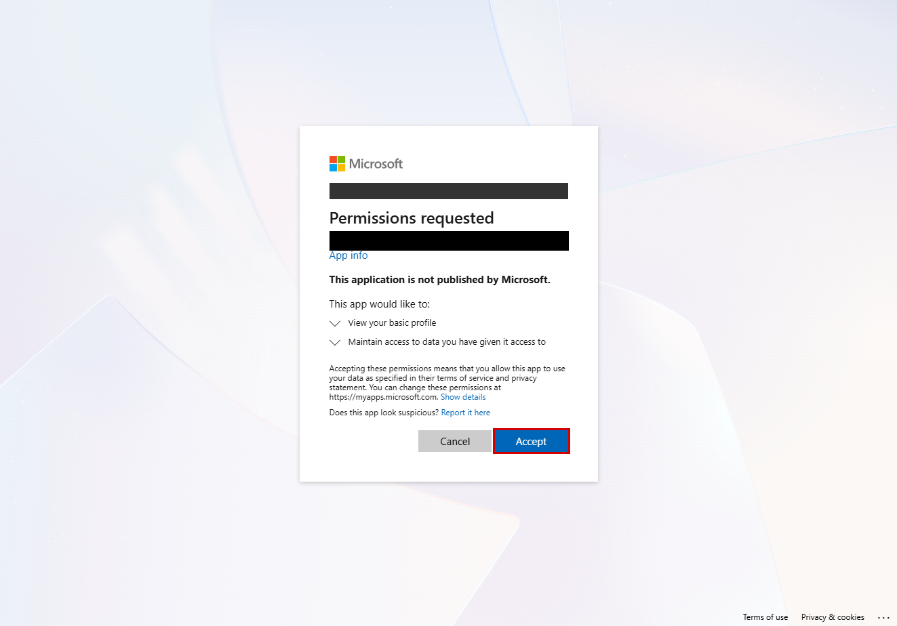
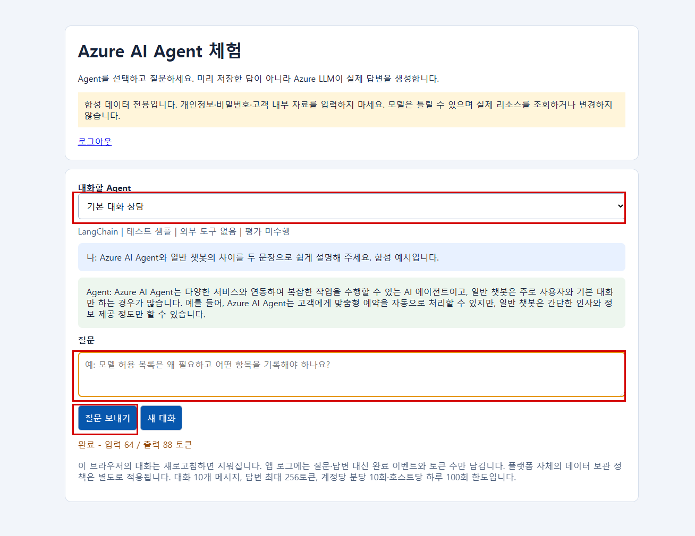
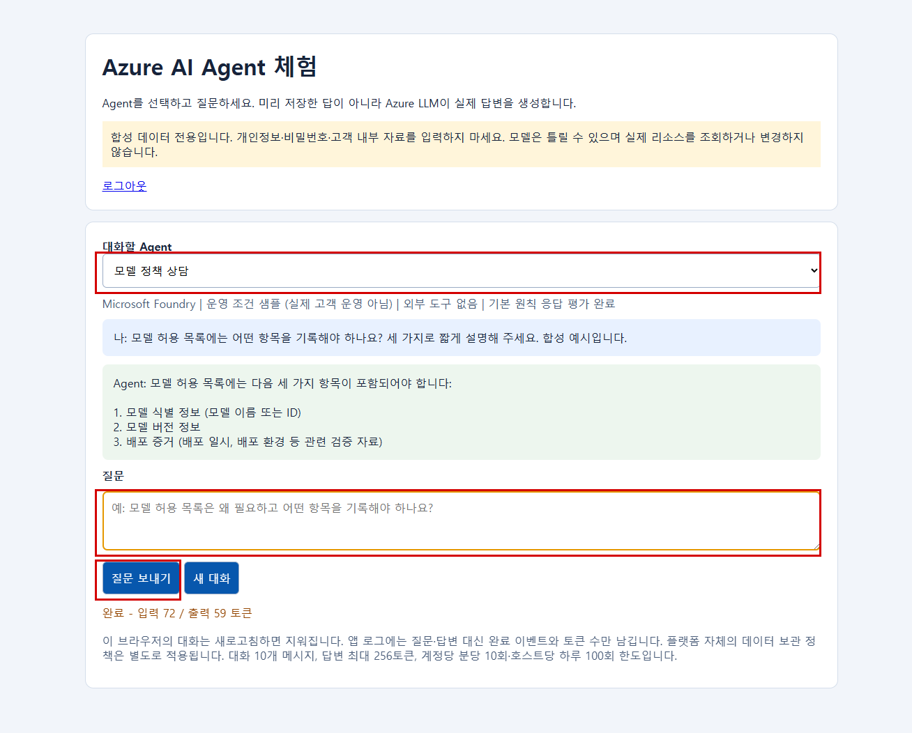

# 로그인해서 사용하는 10개 샘플 챗봇

- 기존 모델·Foundry 프로젝트·웹 앱 2개를 재사용합니다. 새 B1 플랜이나 모델 배포는 만들지 않습니다. 화면의 질문은 실제 Azure LLM이 답변합니다. 고객 데이터가 없는 합성 예시이며, 표의 운영/테스트는 진단 조건을 보여주기 위한 표시이지 실제 고객 업무 운영을 뜻하지 않습니다.

## Agent 구성

- **Foundry**
  - 이름: 거버넌스 길잡이
  - 환경 조건: 테스트
  - 평가 계획·도구: 평가하지 않는 비교군
- **Foundry**
  - 이름: 모델 정책 상담
  - 환경 조건: 운영 조건
  - 평가 계획·도구: 기본 원칙 응답 평가
- **Foundry**
  - 이름: 비용 이해 도우미
  - 환경 조건: 운영 조건
  - 평가 계획·도구: 기본 원칙 응답 평가
- **Foundry**
  - 이름: 장애 접수 도우미
  - 환경 조건: 운영 조건
  - 평가 계획·도구: 기본 원칙 응답 평가
- **Foundry**
  - 이름: 신규 담당자 안내
  - 환경 조건: 테스트
  - 평가 계획·도구: 평가하지 않는 비교군
- **Foundry**
  - 이름: 출시 점검 도우미
  - 환경 조건: 운영 조건
  - 평가 계획·도구: 기본 원칙 응답 평가
- **Foundry**
  - 이름: 개인정보 보호 안내
  - 환경 조건: 운영 조건
  - 평가 계획·도구: 평가하지 않는 비교군
- **Foundry**
  - 이름: 실험용 FAQ
  - 환경 조건: 테스트
  - 평가 계획·도구: 평가하지 않는 비교군
- **LangChain 호스트 02**
  - 이름: 도구 사용 범위 상담
  - 환경 조건: 운영 조건
  - 평가 계획·도구: 범위 안내 Python 도구 사용, 클라우드 평가 미수행
- **LangChain 호스트 03**
  - 이름: 기본 대화 상담
  - 환경 조건: 테스트
  - 평가 계획·도구: 외부 도구 없음, 클라우드 평가 미수행

- 평가는 실제 응답 3문항을 Foundry 평가 서비스의 정확 일치 검사에 제출합니다. 검사는 삭제 금지·모르는 값을 0으로 만들지 않기·생성/배포 시각 구분에 한정됩니다. **평가 완료는 전체 보안·품질 검증 통과라는 뜻이 아닙니다.** 통과/실패는 결과 파일에서 확인합니다. 계획표만으로 완료를 주장하지 않으며, 실제 결과는 `output/chatbot-expansion/`과 진단 보고서에 남습니다.

- **모델 정책 상담**
  - 통과: 3/3
  - 실패: 0
  - 해석: 기본 원칙 응답이 지정 답과 일치
- **비용 이해 도우미**
  - 통과: 2/3
  - 실패: 1
  - 해석: 실패 문항도 원본에 보존. 평가를 실행했다는 것과 전체 통과는 다름
- **장애 접수 도우미**
  - 통과: 2/3
  - 실패: 1
  - 해석: 실패 문항도 원본에 보존
- **출시 점검 도우미**
  - 통과: 3/3
  - 실패: 0
  - 해석: 기본 원칙 응답이 지정 답과 일치

- 위 결과는 최초 실행 당시 해당 버전의 합성 3문항 검사입니다. 삭제 후 재생성한 실행의 결과로 재사용하지 않습니다. 정확한 문구 비교이므로 문장부호·추가 설명 때문에 실패할 수도 있습니다. 실패를 위험 확정으로 단정하지 마세요.

## 어떻게 사용하나요?

- **도구 사용 LangChain + Foundry 8개**
  - 접속: `output/lab.json`에서 이름이 `-02`로 끝나는 호스트의 `chat_url` 확인.
- **기본 LangChain + Foundry 8개**
  - 접속: `output/lab.json`에서 이름이 `-03`로 끝나는 호스트의 `chat_url` 확인.

- `output/lab.json`의 각 호스트 `chat_url`을 브라우저로 엽니다.
- 허용된 Entra 계정으로 로그인합니다. 기본 허용자는 배포를 승인·실행한 관리자 1명입니다.
- Agent를 선택하고 질문을 입력한 뒤 **질문 보내기**를 누릅니다.
- 다른 Agent로 바꾸거나 **새 대화**를 누르면 이전 대화가 초기화됩니다.

- 각 호스트는 Foundry 8개와 자기 호스트의 LangChain 1개를 보여줍니다. 두 웹 화면에 Foundry 목록이 반복돼도 실제 Foundry Agent를 두 번 생성한 것이 아닙니다.

- 처음에는 기본 로그인 프로필 사용에 동의하는 화면이 나올 수 있습니다. 이것은 진단 SP에 Azure 쓰기 권한을 부여하는 화면이 아닙니다. 실제 캡처에서 계정과 앱 등록 식별자를 가렸습니다.



- 아래는 실제 로그인 후 LangChain Agent가 LLM으로 생성한 답변입니다. 빨간 네모 순서대로 Agent 선택 → 질문 입력 → 질문 보내기를 사용합니다.



- 같은 화면에서 Foundry Agent를 선택하면 해당 Foundry endpoint가 실제로 답변합니다. 아래의 평가 완료 표시는 서비스 평가 실행 이력에 근거하며 모든 문항 통과를 뜻하지 않습니다.



- **모델 허용 목록에는 어떤 정보를 기록해야 하나요?**
  - 볼 수 있는 차이: 정책 상담 Agent의 전문 프롬프트
- **비용이 조회되지 않았으면 0원으로 보고해도 되나요?**
  - 볼 수 있는 차이: 비용 Agent의 누락 데이터 설명
- **너의 도구로 어떤 작업을 할 수 있나요?**
  - 볼 수 있는 차이: LangChain 02의 범위 안내 도구
- **신규 담당자가 처음 준비해야 할 것은 무엇인가요?**
  - 볼 수 있는 차이: 온보딩 Agent의 순서 안내

## 안전 경계

- **로그인**
  - 내용: App Service 내장 Entra 인증, 동일 테넌트·허용 사용자만
- **비밀번호 없는 서버 인증**
  - 내용: 전용 User Assigned MI + 앱 등록 연합 신뢰. client secret 없음
- **모델 호출 주체**
  - 내용: 웹 앱 MI. 진단 Reader SP와 다름
- **호출 제한**
  - 내용: 한 번에 1개, 계정당 분당 10회·호스트당 하루 100회. 재시작 후에도 일일 카운트 유지
- **크기 제한**
  - 내용: 메시지당 2,000자·대화 8,000자·10개 메시지·응답 최대 256토큰
- **로그**
  - 내용: 질문·답변·사용자 ID는 앱 로그에 쓰지 않고 완료 이벤트·Agent ID·토큰 수만 기록
- **한계**
  - 내용: 하루 한도는 비용 예산을 보장하지 않음. 모델 라운드·플랫폼 비용·기존 사용은 별도

- Agent ID가 로그에 있어도 진단에 수집될지는 워크스페이스 권한과 연결 규칙에 달려 있습니다. Foundry의 공유 모델 메트릭을 임의 분배하지 않습니다.

## 승인된 테스트베드에서 관리자가 다시 적용하려면

- 고객의 일반 진단에는 필요 없는 **샘플 배포 명령**입니다.

```bash
source .venv/Scripts/activate
python -m pip install -e ".[dev,sample]"
python -m scripts.lab.run validate
python -m scripts.lab.expand --apply
bash scripts/lab/manage.sh collect
python -m scripts.lab.summarize
```

- 기존 샘플의 소유 태그를 검증합니다. 다른 고객 리소스를 챗봇으로 바꾸지 않습니다. 실패하면 `output/chatbot-expansion/state.json`과 각 평가 영수증을 보고 같은 명령으로 이어갈 수 있습니다. 평가 완료를 확인할 수 없는 Agent를 완료한 것으로 표시하지 않습니다.
