# 점검 항목 상세 (System Evidence 20개 + Azure 추가 제안 13개)

항목별 점검 내용, Azure Portal 기준 확인 경로, 확인 화면입니다. 요약표는 [README](../README.md#점검-항목-system-evidence-20개--azure-추가-제안-13개)에 있습니다.

- 구현 표기: ✅ 구현 / ⚠️ 일부 구현 / ⚠️ 읽기 전용 불가(구현했으나 읽기 전용 역할로는 조회 불가) / ❌ 미구현 (M365·Agent 365·Purview·Power Platform 영역)
- Azure Portal 기준(참고): 같은 값을 사람이 포털에서 확인하는 경로와 캡처이며 수집기 동작에는 영향이 없습니다
- 캡처의 빨간 네모는 확인 위치이고 식별자는 마스킹했습니다. 표시 값은 데모 환경 기준이며 고객 환경과 다를 수 있습니다

## DM-SY-01 Agent 제작 허용 사용자 범위 및 허용 Agent 유형 설정

- **진단 영역:** 1. Demand
- **제품/메뉴:** M365 Admin Center - Copilot > Agents 설정
- **구현:** ❌ 미구현
- **점검 내용:** Agent 제작을 허용한 사용자 범위(전체/특정 그룹), 허용 Agent 유형 설정값, 허용 그룹 구성원 수를 설정 화면에서 확인
- **Azure Portal 기준(참고):** 해당 없음 - Microsoft 365 관리 센터 > Copilot > 에이전트 설정

## DM-SY-02 Copilot Studio 제작 권한 보유자 수 및 환경 현황

- **진단 영역:** 1. Demand
- **제품/메뉴:** Power Platform Admin Center
- **구현:** ❌ 미구현
- **점검 내용:** 환경 목록과 환경별 Maker 권한 보유자 수, 권한 부여 방식 확인
- **Azure Portal 기준(참고):** 해당 없음 - Power Platform 관리 센터 > 환경

## DM-SY-03 최근 6개월 신규 생성 Agent 수 추이

- **진단 영역:** 1. Demand
- **제품/메뉴:** M365 Admin Center - Agent Registry
- **구현:** ❌ 미구현
- **점검 내용:** 월별 신규 Agent 생성 건수와 생성 요청 이력의 대사
- **Azure Portal 기준(참고):** 해당 없음 - Microsoft 365 관리 센터 > 에이전트 > 레지스트리

## DS-SY-04 커넥터 분류·차단 정책(데이터 정책) 적용 현황

- **진단 영역:** 2. Design
- **제품/메뉴:** Power Platform Admin Center - Data policies
- **구현:** ❌ 미구현
- **점검 내용:** 커넥터 분류(업무/비업무/차단) 정책 목록과 정책별 적용 환경 범위
- **Azure Portal 기준(참고):** 해당 없음 - Power Platform 관리 센터 > 정책 > 데이터 정책

## DS-SY-05 Agent ID 템플릿(Blueprint) 정의 여부 및 개수

- **진단 영역:** 2. Design
- **제품/메뉴:** Microsoft Entra Agent ID
- **구현:** ✅ 구현
- **점검 내용:** Graph로 Blueprint 수와 목록을 수집하고 Agent ID별 Blueprint 연결 여부로 적용 비율 산출. 대표 유형별 Blueprint 정의 여부는 고객 입력(`policy_facts`)이 있어야 L3 이상 판정
- **Azure Portal 기준(참고):** Azure Portal > Microsoft Entra ID > Agent ID > Blueprint 목록

## DS-SY-06 사용 중인 모델 배포 현황 및 허용 모델 목록

- **진단 영역:** 2. Design
- **제품/메뉴:** Microsoft Foundry
- **구현:** ✅ 구현
- **점검 내용:** 모든 구독의 모델 배포를 모델·버전·형식 기준으로 고객 `allowed_models`와 대조해 허용 비율 산출(L3: 90% 이상). 고객이 지정한 모델 제한 Azure Policy가 전 구독에 강제 할당되고 허용 외 배포가 0건이면 L4. 허용 목록 미입력 시 판정 보류
- **Azure Portal 기준(참고):** Azure Portal > Microsoft Foundry > (계정) > Go to Foundry portal > 모델 + 엔드포인트(배포 목록), 제한 정책은 Azure Portal > Policy > Assignments

## DS-SY-07 네트워크 경계와 공용 접근

- **진단 영역:** 2. Design
- **제품/메뉴:** Azure AI Services, App Service
- **구현:** ✅ 구현
- **점검 내용:** AI 계정의 공용 접근·기본 거부·프라이빗 엔드포인트 수, Agent 호스트의 HTTPS 전용·VNet 통합·IP 접근 제한 수. 실제 연결 차단과 앱 내부 우회는 확인 불가
- **Azure Portal 기준(참고):** Azure Portal > Microsoft Foundry > (계정) > Resource Management > Networking, App Service > (앱) > Networking

## DS-SY-08 도구 구성과 승인 모드

- **진단 영역:** 2. Design
- **제품/메뉴:** Microsoft Foundry Agent 정의
- **구현:** ✅ 구현
- **점검 내용:** Agent별 도구 유형(함수·MCP·코드 인터프리터 등)과 도구 보유 Agent 수, MCP 도구의 승인 모드(`require_approval`). 승인 우회 방지는 확인 불가
- **Azure Portal 기준(참고):** Azure Portal > Microsoft Foundry > (계정) > Go to Foundry portal > (프로젝트) > Agents > (Agent) > Tools

## DS-SY-09 외부 도구 엔드포인트

- **진단 영역:** 2. Design
- **제품/메뉴:** Microsoft Foundry Agent 정의
- **구현:** ✅ 구현
- **점검 내용:** MCP 등 외부 도구 엔드포인트의 호스트와 사용 Agent 수 (경로·쿼리·인증값 제외). 승인 목록 대조와 인증 방식은 확인 불가
- **Azure Portal 기준(참고):** Azure Portal > Microsoft Foundry > (계정) > Go to Foundry portal > (프로젝트) > Agents > (Agent) > Tools(MCP)

## BI-SY-07 환경 분리 및 관리형 환경 적용 여부

- **진단 영역:** 3. Build
- **제품/메뉴:** Power Platform Admin Center
- **구현:** ❌ 미구현
- **점검 내용:** 개발·운영 환경 분리, 관리형 환경 적용 여부, 파이프라인 이력 확인
- **Azure Portal 기준(참고):** 해당 없음 - Power Platform 관리 센터 > 환경 > 관리형 환경

## BI-SY-08 품질·안전성 자동 평가 수행 이력

- **진단 영역:** 3. Build
- **제품/메뉴:** Microsoft Foundry
- **구현:** ✅ 구현
- **점검 내용:** Foundry 프로젝트별 평가(Evaluation) 실행 이력을 Agent·버전과 대조해 `env=prod` 태그 Agent 중 평가 이력 보유 비율 산출(L3: 80% 이상). Foundry 프로젝트 읽기 역할 필요. 평가 파이프라인·지속 평가(L4/L5)는 `policy_facts`로만 반영
- **Azure Portal 기준(참고):** Azure Portal > Microsoft Foundry > (계정) > Go to Foundry portal > Build > Evaluations

## BI-SY-09 AI 워크로드 보안 태세 점검 결과

- **진단 영역:** 3. Build
- **제품/메뉴:** Microsoft Defender
- **구현:** ✅ 구현
- **점검 내용:** AI 리소스 연결 Defender 권고(심각도·상태·최초 평가일·상태 변경일)와 구독 보안 점수 수집. 미조치 권고의 30일 경과는 상태 변경일로, 보안 점수는 `internal_security_score_min`과 비교. 공격 경로 분석·정책 자동 적용은 수집하지 않음. 보안 점수는 Security Reader 필요 가능
- **Azure Portal 기준(참고):** Azure Portal > Microsoft Defender for Cloud > Recommendations(AI 리소스 필터), Security posture(보안 점수)

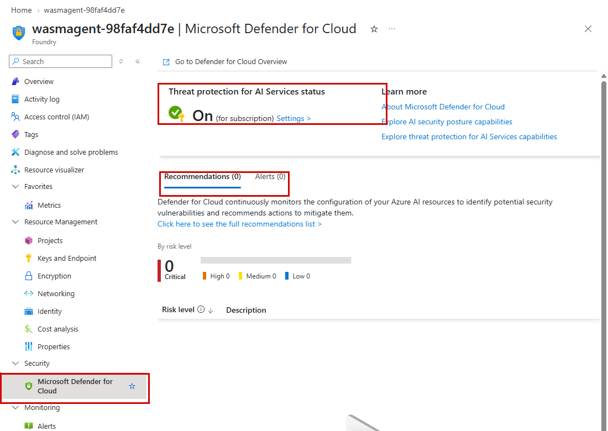

## BI-SY-10 Content Safety 정책 연결

- **진단 영역:** 3. Build
- **제품/메뉴:** Microsoft Foundry - 콘텐츠 필터
- **구현:** ✅ 구현
- **점검 내용:** 계정별 사용자 지정 콘텐츠 필터 정책 수와 필터 개수, 모델 배포별 정책 연결·사용자 지정 정책 연결 수. 필터의 실제 방어 효과는 확인 불가
- **Azure Portal 기준(참고):** Azure Portal > Microsoft Foundry > (계정) > Go to Foundry portal > Build > Guardrails(콘텐츠 필터)

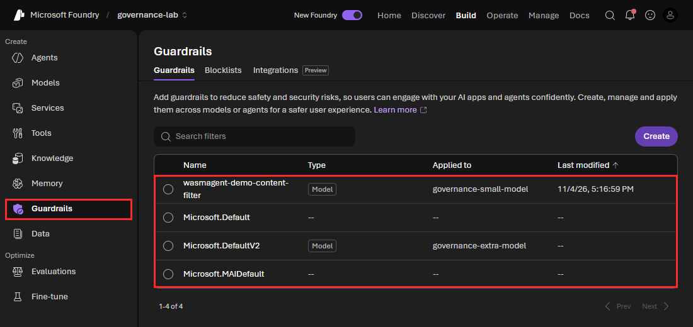

## BI-SY-11 적대적 시험(Red team) 이력

- **진단 영역:** 3. Build
- **제품/메뉴:** Microsoft Foundry - 평가
- **구현:** ⚠️ 읽기 전용 불가
- **점검 내용:** Foundry 프로젝트별 red team 실행 목록(beta, `Foundry-Features: RedTeams=V1Preview` 헤더 필요)의 실행·완료 건수. 서비스가 목록 GET에도 쓰기 데이터 작업 `evaluations/write`를 요구(HTTP 401)하므로 쓰기 권한을 요청하지 않는 읽기 전용 원칙상 권한 거부로 기록. 포털 확인은 현재 이력 없음
- **Azure Portal 기준(참고):** Azure Portal > Microsoft Foundry > (계정) > Go to Foundry portal > (프로젝트) > Build > Evaluations > Red team

## BI-SY-12 릴리스 버전 고정·런타임

- **진단 영역:** 3. Build
- **제품/메뉴:** Azure OpenAI 배포, App Service
- **구현:** ✅ 구현
- **점검 내용:** 모델 배포의 버전 업그레이드 옵션(자동 업그레이드 여부), 호스트 런타임, 컨테이너 이미지 다이제스트 고정 수. 소스·빌드 출처와 SDK 승인은 확인 불가
- **Azure Portal 기준(참고):** Azure Portal > Microsoft Foundry > (계정) > Go to Foundry portal > 모델 + 엔드포인트(버전 업데이트 정책), App Service > (앱) > Settings > Configuration > Stack settings

## BI-SY-13 Agent 자산 대장·책임 태그

- **진단 영역:** 3. Build
- **제품/메뉴:** Azure 리소스 태그
- **구현:** ✅ 구현
- **점검 내용:** 수집된 모든 Azure Agent의 소유자·후원자·환경·비용센터 태그 보유 개수. 승인된 자산 대장과의 대사, 업무 목적·변경 이력은 고객 자료 필요
- **Azure Portal 기준(참고):** Azure Portal > Microsoft Foundry 또는 App Service > (리소스) > Tags

## BI-SY-14 Azure 정책 준수 상태

- **진단 영역:** 3. Build
- **제품/메뉴:** Azure Policy
- **구현:** ✅ 구현
- **점검 내용:** Resource Graph 정책 상태에서 AI 관련 리소스의 준수·비준수 리소스 수. 예외 승인과 편차 검토 기록은 확인 불가
- **Azure Portal 기준(참고):** Azure Portal > Policy > Compliance

## DP-SY-10 전체 Agent 목록과 배포 범위·게시 상태·소유자

- **진단 영역:** 4. Deploy
- **제품/메뉴:** M365 Admin Center - Agent Registry
- **구현:** ❌ 미구현
- **점검 내용:** Registry 전체 Agent 목록과 배포 범위·게시 상태·소유자, 등록부 대사 (Azure 수집 Agent는 보조 정보일 뿐 대신하지 않음)
- **Azure Portal 기준(참고):** 해당 없음 - Microsoft 365 관리 센터 > 에이전트 > 레지스트리

## DP-SY-11 Agent 공유 허용 범위 및 사용자 설치 허용 설정

- **진단 영역:** 4. Deploy
- **제품/메뉴:** M365 Admin Center - Copilot > Agents 설정
- **구현:** ❌ 미구현
- **점검 내용:** Agent 공유 허용 범위와 사용자 직접 설치 허용 여부 설정값
- **Azure Portal 기준(참고):** 해당 없음 - Microsoft 365 관리 센터 > Copilot > 에이전트 설정

## DP-SY-12 고유 ID(Agent ID)가 부여된 Agent 수 / 전체 Agent 수

- **진단 영역:** 4. Deploy
- **제품/메뉴:** Microsoft Entra Agent ID
- **구현:** ⚠️ 일부 구현
- **점검 내용:** Blueprint 태그(agentName·projectName·accountName)로 Azure에서 수집한 Foundry Agent와 매칭해 Agent ID 부여율 산출. 분모는 Azure 수집 Agent이며 Registry 전체는 아님
- **Azure Portal 기준(참고):** Azure Portal > Microsoft Entra ID > Agent ID > 에이전트 ID 목록. 포털은 Foundry 프로젝트 관리 ID(`.../projects/<프로젝트>`)도 목록에 함께 표시하므로 수집 개수(Agent ID 9)보다 1개 많게(10) 보임

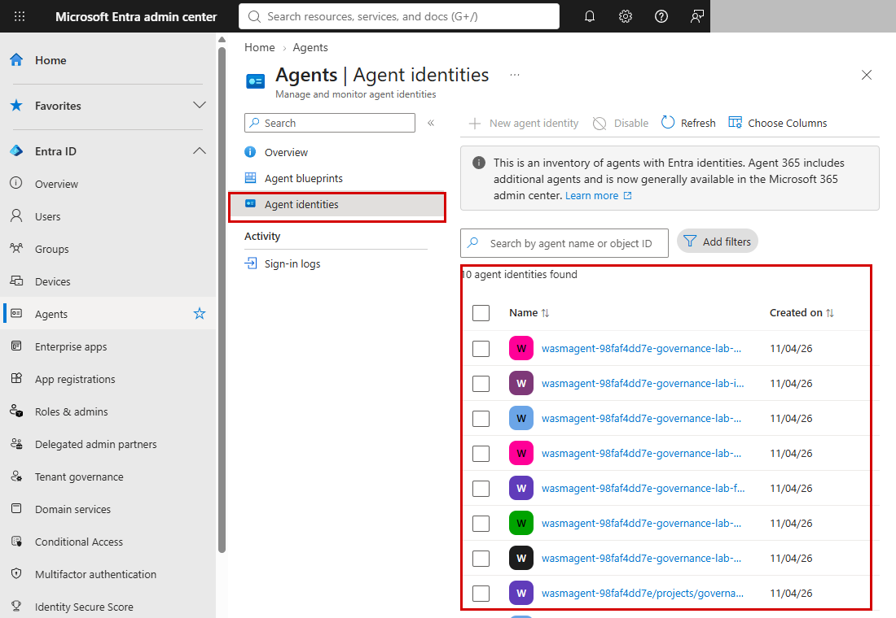

## OE-SY-13 소유자·후원자 미지정 Agent 및 고아 Agent 수

- **진단 영역:** 5. Operate
- **제품/메뉴:** Microsoft Entra Agent ID
- **구현:** ✅ 구현
- **점검 내용:** Agent ID별 소유자·후원자 수(이름·UPN 미저장)와 소유자 전원 비활성(고아) 여부, 미지정 비율 산출
- **Azure Portal 기준(참고):** Azure Portal > Microsoft Entra ID > Agent ID > (에이전트 ID) > 소유자/스폰서

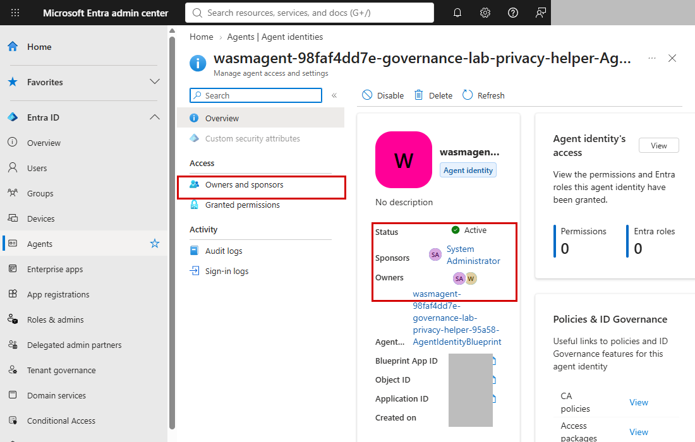

## OE-SY-14 Agent별 부여 권한 및 과다 권한 Agent

- **진단 영역:** 5. Operate
- **제품/메뉴:** Microsoft Entra - Agent ID, ID Governance
- **구현:** ✅ 구현
- **점검 내용:** Agent ID에 부여된 Graph 애플리케이션 권한 이름을 해석해 과다 권한 패턴(`*.ReadWrite.All` 등, 고객 설정 가능)에 해당하는 Agent 비율 산출. 위임 권한·접근 패키지는 수집하지 않음
- **Azure Portal 기준(참고):** Azure Portal > Microsoft Entra ID > Agent ID > (에이전트 ID) > 권한

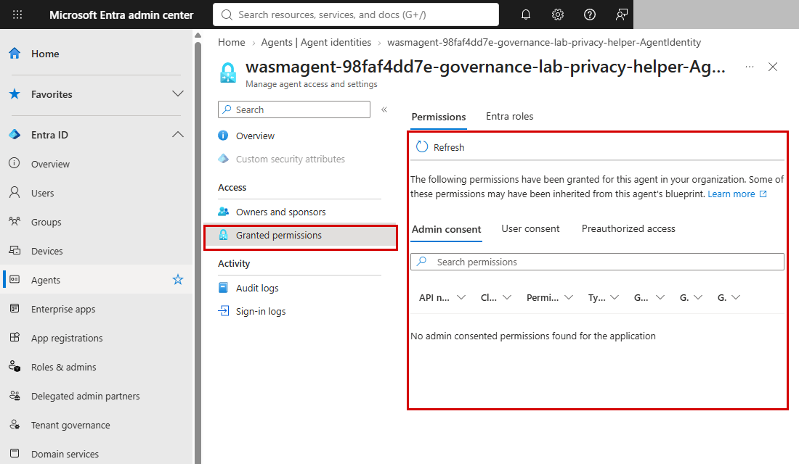

## OE-SY-15 Agent 대상 조건부 접근 정책 적용 및 위험 Agent 탐지 건수

- **진단 영역:** 5. Operate
- **제품/메뉴:** Microsoft Entra - Conditional Access, ID Protection
- **구현:** ✅ 구현
- **점검 내용:** Graph beta로 Agent 대상 조건부 접근 정책(전체 Agent 포함 여부·위험 수준 조건·차단 제어)과 위험 Agent 탐지 목록·미조치 건수 수집. Agent 365 또는 M365 E7 라이선스가 필요하며, 검증 테넌트는 위험 Agent 조회가 "tenant is not licensed"(HTTP 403)로 응답해 `license_missing`으로 기록
- **Azure Portal 기준(참고):** Azure Portal > Microsoft Entra ID > 보안 > 조건부 액세스 > 정책, ID Protection > 위험 에이전트

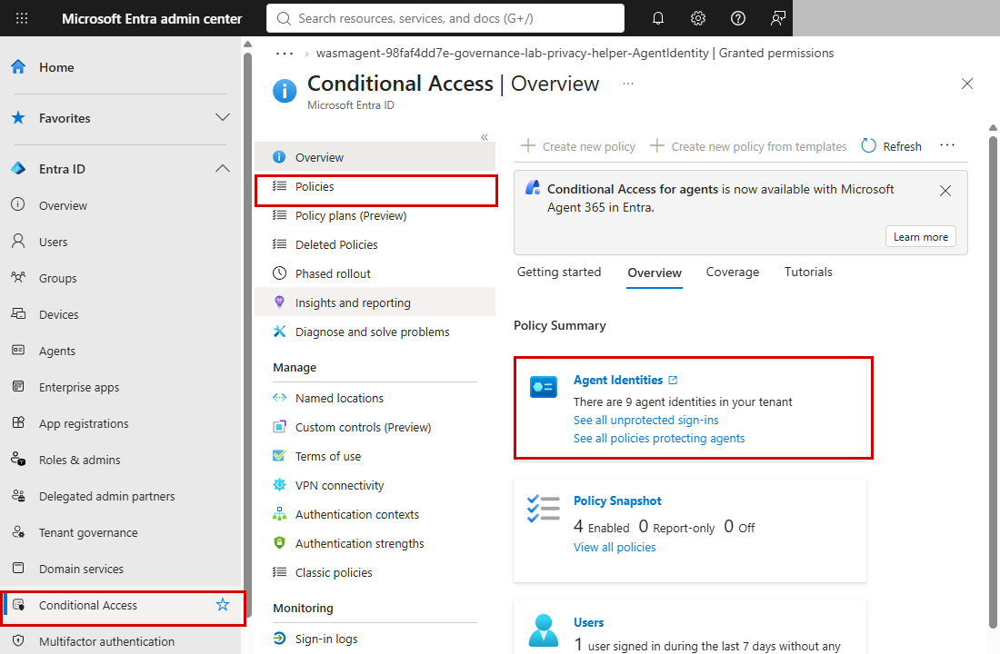

## OE-SY-16 Agent 활동 감사 로그 보관 여부 및 보관 기간

- **진단 영역:** 5. Operate
- **제품/메뉴:** Microsoft Purview - Audit
- **구현:** ✅ 구현
- **점검 내용:** Agent 관련 리소스의 진단 설정(로그 목적지)과 Log Analytics 보존일을 수집해 `required_retention_days`와 비교. Purview 감사와 동등하지 않은 Azure 대체 증적이며 중앙 workspace가 승인 구독 밖이면 권한 거부로 기록
- **Azure Portal 기준(참고):** Azure Portal > Microsoft Foundry > (계정) > Monitoring > Diagnostic settings, Log Analytics workspaces > (workspace) > Tables(보존 기간)

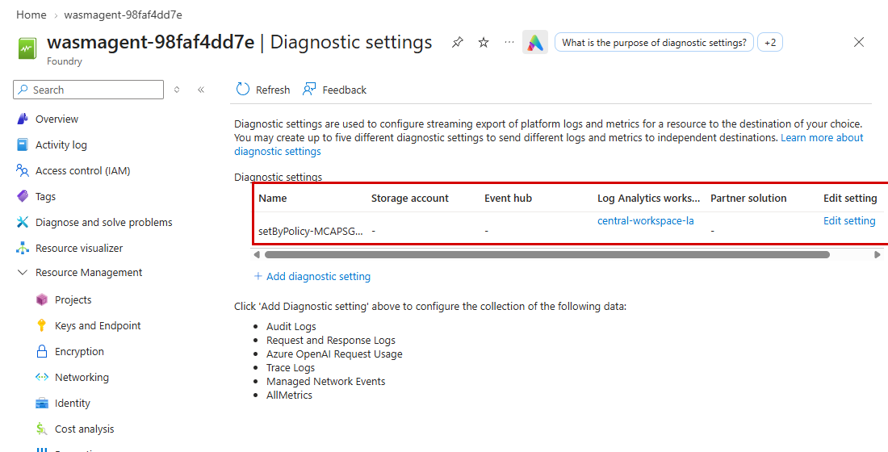

## OE-SY-17 관리 ID와 ARM 역할 범위

- **진단 영역:** 5. Operate
- **제품/메뉴:** Azure Resource Graph, Azure RBAC
- **구현:** ✅ 구현
- **점검 내용:** Agent 호스트와 Foundry 계정의 관리 ID(시스템·사용자 할당) 유무, 그 ID에 할당된 ARM 역할 수, Owner·Contributor·User Access Administrator 등 광범위 역할과 구독 범위 할당 수, 계정의 키 인증 비활성 여부. 실제 인증 사용·Graph 권한은 확인 불가
- **Azure Portal 기준(참고):** Azure Portal > Microsoft Foundry > (계정) > Resource Management > Identity, Access control (IAM) > Role assignments, Keys and Endpoint

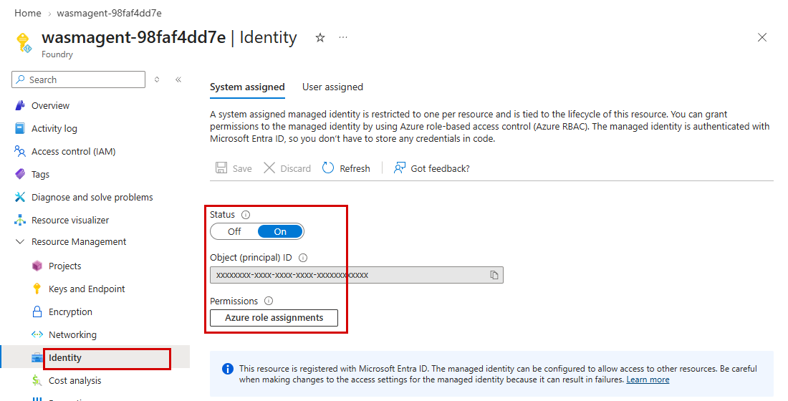

## OE-SY-18 관측·경보 구성

- **진단 영역:** 5. Operate
- **제품/메뉴:** Azure Monitor
- **구현:** ✅ 구현
- **점검 내용:** 경보 규칙(활성 여부, AI 리소스 대상 여부), Application Insights 수, 활성 진단 설정 수. 계측·샘플링·SLO 승인은 확인 불가
- **Azure Portal 기준(참고):** Azure Portal > Monitor > Alerts > Alert rules, Application Insights, Microsoft Foundry > (계정) > Monitoring > Diagnostic settings

## OE-SY-19 경보 전달 경로

- **진단 영역:** 5. Operate
- **제품/메뉴:** Azure Monitor - 작업 그룹
- **구현:** ✅ 구현
- **점검 내용:** 작업 그룹 수, 수신자 유형별 개수(주소·이름 미수집), 작업 그룹에 연결된 경보 수. SOC 수신과 중단·복구 훈련은 확인 불가
- **Azure Portal 기준(참고):** Azure Portal > Monitor > Alerts > Action groups

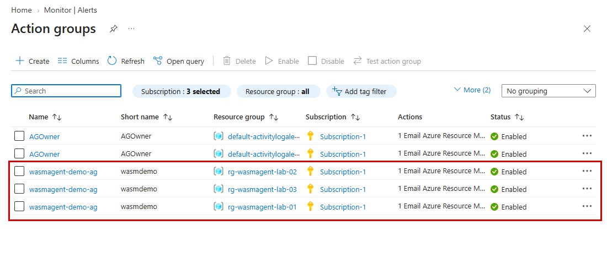

## OE-SY-20 지역과 보존 설정

- **진단 영역:** 5. Operate
- **제품/메뉴:** Azure 리소스 위치, Log Analytics
- **구현:** ⚠️ 일부 구현
- **점검 내용:** AI 계정·호스트·workspace의 사용 지역 목록과 로그·Application Insights 보존일. 중앙 workspace가 승인 구독 밖이면 일부 누락. 실제 처리 지역·삭제 검증은 확인 불가
- **Azure Portal 기준(참고):** Azure Portal > Microsoft Foundry > (계정) > Overview(Location), Log Analytics workspaces > (workspace) > Tables(보존 기간)

## OT-SY-17 승인되지 않은 Agent(Shadow AI) 탐지 결과

- **진단 영역:** 6. Optimize
- **제품/메뉴:** Agent 365 - Shadow AI Detection
- **구현:** ❌ 미구현
- **점검 내용:** Shadow AI 탐지 리포트와 미승인 Agent 목록 (Agent 365 라이선스 필요)
- **Azure Portal 기준(참고):** 해당 없음 - Agent 365 관리 화면 > Shadow AI

## OT-SY-18 Agent별 활성 사용자 수, 최근 사용일, 미사용 Agent 수

- **진단 영역:** 6. Optimize
- **제품/메뉴:** M365 Admin Center - Agent 사용 현황 / Agent 365
- **구현:** ✅ 구현
- **점검 내용:** Azure Monitor 호출·토큰 지표와 Log Analytics 사용 기록으로 Agent별 최근 사용일을 구해 90일 이상 미사용 Agent 수 산출. 활성 사용자 수는 수집하지 않음
- **Azure Portal 기준(참고):** Azure Portal > Microsoft Foundry > (계정) > Monitoring > Metrics, Logs

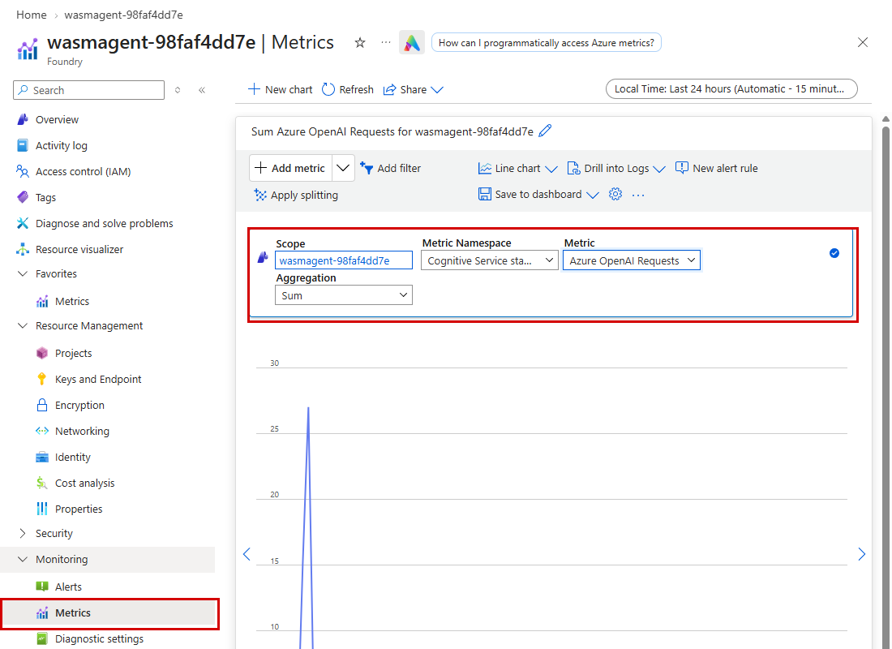

## OT-SY-19 사용량 기반 과금 정책 설정 여부 및 Agent별 소비 비용

- **진단 영역:** 6. Optimize
- **제품/메뉴:** M365 Admin Center - Billing policy / Azure Cost Management
- **구현:** ✅ 구현
- **점검 내용:** Cost Management 최근 30일 AI 비용 중 Agent 귀속 비율, 구독 예산·경보 설정, 모든 Agent의 비용센터 태그 보유(L4 조건) 확인. 공유 리소스 비용은 Agent별 귀속 불가
- **Azure Portal 기준(참고):** Azure Portal > Cost Management > Cost analysis, Budgets

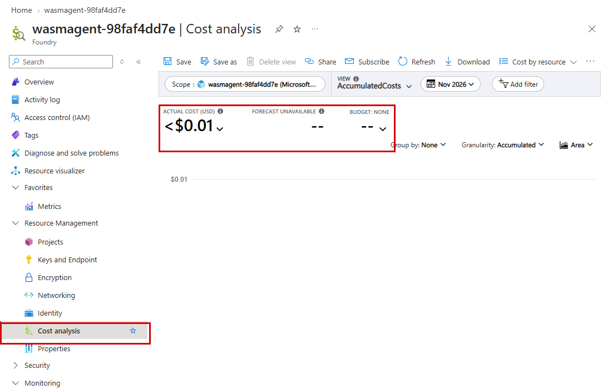

## OT-SY-20 Agent가 접근하는 민감 데이터 노출 현황

- **진단 영역:** 6. Optimize
- **제품/메뉴:** Microsoft Purview - DSPM for AI
- **구현:** ❌ 미구현
- **점검 내용:** DSPM for AI 리포트의 민감 데이터 노출 목록 (읽기 공식 API 미확인)
- **Azure Portal 기준(참고):** 해당 없음 - Microsoft Purview 포털 > DSPM for AI

## OT-SY-21 예산·예측 경보

- **진단 영역:** 6. Optimize
- **제품/메뉴:** Azure Cost Management
- **구현:** ✅ 구현
- **점검 내용:** 구독별 예산 수, 경보 설정 수, 예측(Forecasted) 임계값 경보 수. Agent 단위 비용 귀속과 통보 후 조치 이력은 확인 불가
- **Azure Portal 기준(참고):** Azure Portal > Cost Management > Budgets

