# 점검 항목 상세 (System Evidence 31개)

항목별 점검 내용, Azure Portal 기준 확인 경로, 확인 화면입니다. 요약표는 [README](../README.md#점검-항목-system-evidence-31개)에 있습니다.

- 구현 표기: ✅ 구현 / ⚠️ 보조 증거 부분 수집·점수 보류 / ❌ 미구현
- Azure Portal 기준(참고): 같은 값을 사람이 포털에서 확인하는 경로와 캡처이며 수집기 동작에는 영향이 없습니다
- 캡처의 빨간 네모는 확인 위치이고 식별자는 마스킹했습니다. 표시 값은 데모 환경 기준이며 고객 환경과 다를 수 있습니다
- 22개 등급 산정 항목은 [API 평가 기준](api-notes.md#심사기준-검토와-점수-반영-2026-11-05)을 따릅니다. 6개는 보조 증거만 수집하며, DM-SY-01·03·OT-SY-27은 미구현입니다. [관리자 읽기 내보내기](api-notes.md#관리자-읽기-내보내기)는 진단 앱 권한을 확대하지 않습니다.

| API 충족률 | Level |
| --- | --- |
| 0% | L1 |
| 0% 초과~80% 미만 | L2 |
| 80% 이상~90% 미만 | L3 |
| 90% 이상~100% 미만 | L4 |
| 100% | L5 |

조회 실패·필수 필드 미확인·분모 0은 `null`과 사유로 남기며 L1이나 0%로 바꾸지 않습니다. 구성·기록의 충족률은 조직 승인, 정책 실효성, 자동화 동작을 입증하지 않습니다. 고객의 정성 입력은 등급에 반영하지 않습니다.

보고서 6번 상단에는 전체 점검 범위와 보류 항목을, 7번에는 항목별 계산값·대상별 충족 여부·직접 증적·적용 기준 출처를 표시합니다. L5만으로 조직 전체의 거버넌스가 완성되었다고 판단하지 않습니다.

## Agent 365 등록부 교차 확인

| 순서 | M365 Admin Center 확인 위치 |
| --- | --- |
| 1 | [Microsoft 365 관리 센터](https://admin.microsoft.com/) 로그인 - **Agents > All agents > Registry** |
| 2 | 대상 Foundry Agent 선택 - **Details**에서 `Platform: Microsoft Foundry`, 패키지 버전·소유자·`Entra agent ID` 확인 |
| 3 | Entra agent ID를 기존 수집 ID와 대조. 패키지 버전은 Agent 실행 버전과 별개 |

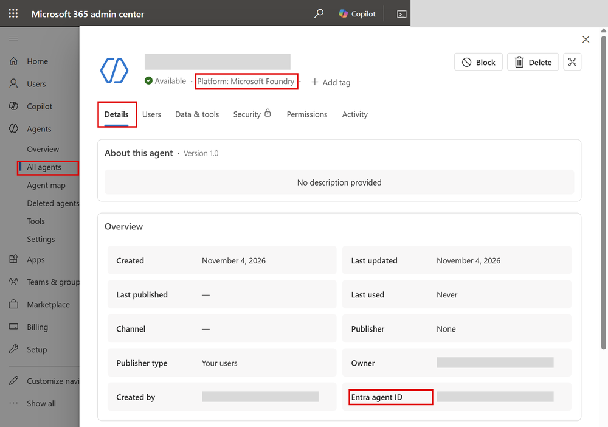

- 실제 테스트 화면이며 이름·계정·ID는 마스킹했습니다. 빨간 네모는 메뉴와 확인 위치입니다. 차단·삭제·동의 설정은 변경하지 않았습니다.
- 읽기 수집은 SDK 삽입 대신 공식 Graph 등록부 API를 사용합니다. DS-SY-05·DP-SY-19의 명시적 ID 연결만 일부 대조합니다. 나머지의 **동일 정보 미제공**은 Agent 365 등록부에 같은 판정 정보가 없다는 뜻이며, 기존 Azure/Graph API 평가는 그대로 수행합니다.
- 결과는 **7. 수집결과 근거 J~L열**과 **8. 수집 Raw 데이터**에 기록합니다. 일치 여부·라이선스·권한 실패는 기존 Level·점수를 변경하지 않습니다.

## DM-SY-01 Agent 제작 허용 사용자 범위 및 허용 Agent 유형 설정

- **진단 영역:** 1. Demand
- **제품/메뉴:** M365 Admin Center - Copilot > Agents 설정
- **구현:** ❌ 미구현
- **점검 내용:** 누가 어떤 종류의 Agent를 만들 수 있는지 설정 화면에서 확인합니다. 모든 사용자에게 허용하는지, 특정 그룹만 허용하는지와 해당 그룹의 인원수를 살펴봅니다. 현재 자동 수집하지 않는 항목으로 관리자가 직접 확인해야 합니다.
- **비율 평가 기준:** 자동 산정하지 않습니다. 제작 허용 설정과 사용자·그룹 범위를 수동으로 확인합니다.
- **Azure Portal 기준(참고):** 해당 없음 - Microsoft 365 관리 센터 > Copilot > 에이전트 설정

## DM-SY-02 Copilot Studio 제작 권한 보유자 수 및 환경 현황

- **진단 영역:** 1. Demand
- **제품/메뉴:** Power Platform Admin Center
- **구현:** ⚠️ 일부 구현
- **점검 내용:** 별도 관리자가 조회할 수 있는 Power Platform 환경 목록과, Dataverse를 사용하지 않는 환경의 역할 할당 건수를 수집합니다. 한 사람에게 여러 역할이 부여될 수 있으므로 역할 건수를 실제 제작자 수로 해석하지 않습니다. 테넌트 전체의 제작 권한을 확인한 결과는 아닙니다.
- **비율 평가 기준:** 보조 증거만 부분 수집하므로 분자·분모와 점수를 산정하지 않습니다. 환경·역할 할당 건수만 표시합니다.
- **Azure Portal 기준(참고):** 해당 없음 - Power Platform 관리 센터 > 환경

## DM-SY-03 최근 6개월 신규 생성 Agent 수 추이

- **진단 영역:** 1. Demand
- **제품/메뉴:** M365 Admin Center - Agent Registry
- **구현:** ❌ 미구현
- **점검 내용:** 최근 6개월 동안 매월 새로 만들어진 Agent 수를 확인하고, 사전에 접수·승인된 생성 요청과 비교합니다. 현재 자동 수집하지 않으며, 등록 패키지의 생성일을 실제 Agent 생성일로 대신 사용하지 않습니다.
- **비율 평가 기준:** 자동 산정하지 않습니다. 실제 Agent 생성 기록과 승인 요청 기록을 확보해 수동으로 비교해야 합니다.
- **Azure Portal 기준(참고):** 해당 없음 - Microsoft 365 관리 센터 > 에이전트 > 레지스트리

## DS-SY-04 커넥터 분류·차단 정책(데이터 정책) 적용 현황

- **진단 영역:** 2. Design
- **제품/메뉴:** Power Platform Admin Center - Data policies
- **구현:** ⚠️ 일부 구현
- **점검 내용:** 별도 관리자가 공식 조회 명령으로 확인한 데이터 손실 방지(DLP) 정책의 개수를 수집합니다. 각 커넥터가 업무용·비업무용·차단 중 어디에 속하는지, 모든 환경에 정책이 올바르게 적용됐는지까지 확인하지는 않습니다.
- **비율 평가 기준:** 보조 증거만 부분 수집하므로 분자·분모와 점수를 산정하지 않습니다. 정책 개수만으로 정책 적용률을 계산하지 않습니다.
- **Azure Portal 기준(참고):** 해당 없음 - Power Platform 관리 센터 > 정책 > 데이터 정책

## DS-SY-05 Agent ID의 Blueprint 연결

- **진단 영역:** 2. Design
- **제품/메뉴:** Microsoft Entra Agent ID
- **구현:** ✅ 구현
- **점검 내용:** Entra에서 조회한 각 Agent ID가 실제로 존재하는 에이전트 ID 청사진(Blueprint)에 연결되어 있는지 확인합니다. 청사진이 몇 개인지, 조직에서 승인한 표준인지까지 평가하지는 않습니다.
- **비율 평가 기준:** (존재하는 청사진에 연결된 Agent ID 수 / 조회한 전체 Agent ID 수) × 100.
- **Azure Portal 기준(참고):** Azure Portal > Microsoft Entra ID > Agent ID > Blueprint 목록

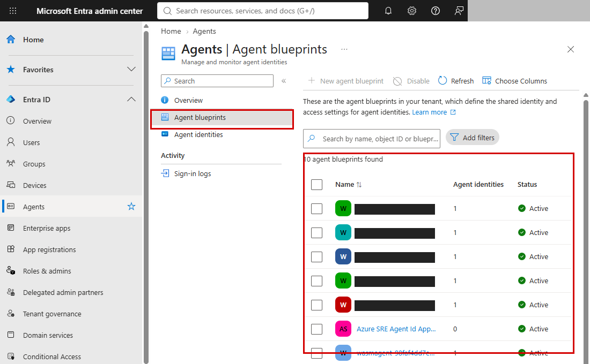

## DS-SY-06 모델 배포 버전·업데이트 구성

- **진단 영역:** 2. Design
- **제품/메뉴:** Microsoft Foundry
- **구현:** ✅ 구현
- **점검 내용:** 배포된 모델마다 모델명·버전·형식이 기록되어 있고, 업데이트 방식이 평가 기준에서 인식하는 옵션으로 설정되어 있는지 확인합니다. 회사에서 사용을 승인한 모델인지, 지원 종료에 대한 대응을 마쳤는지는 확인하지 않습니다.
- **비율 평가 기준:** (모델명·버전·형식과 업데이트 옵션이 모두 확인된 모델 배포 수 / 조회한 전체 모델 배포 수) × 100.
- **Azure Portal 기준(참고):** Azure Portal > Microsoft Foundry > (계정) > Go to Foundry portal > 모델 + 엔드포인트(배포 목록·업데이트 옵션)

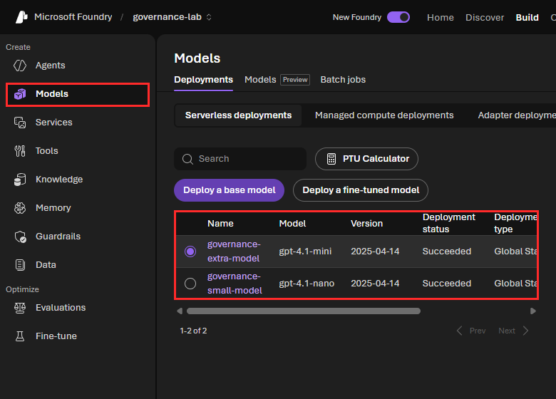

## DS-SY-07 AI 리소스 인바운드 경계 구성

- **진단 영역:** 2. Design
- **제품/메뉴:** Azure AI Services, App Service
- **구현:** ✅ 구현
- **점검 내용:** AI 계정은 공용 네트워크 접근이 꺼져 있고 승인된 프라이빗 엔드포인트 연결이 있는지 확인합니다. 자체 Agent 호스트는 공용 접근을 막거나, 허용한 접근 외에는 기본적으로 거부하도록 설정했는지 확인합니다. 모든 주소를 허용하는 규칙은 충족으로 인정하지 않으며, VNet 통합이나 HTTPS 설정만으로도 충족하지 않습니다. 실제 접속 차단 시험을 수행하는 항목은 아닙니다.
- **비율 평가 기준:** (위 네트워크 접근 제한 조건을 충족한 리소스 수 / 점검 대상 AI 계정·자체 Agent 호스트 수) × 100.
- **Azure Portal 기준(참고):** Azure Portal > Microsoft Foundry > (계정) > Resource Management > Networking, App Service > (앱) > Networking

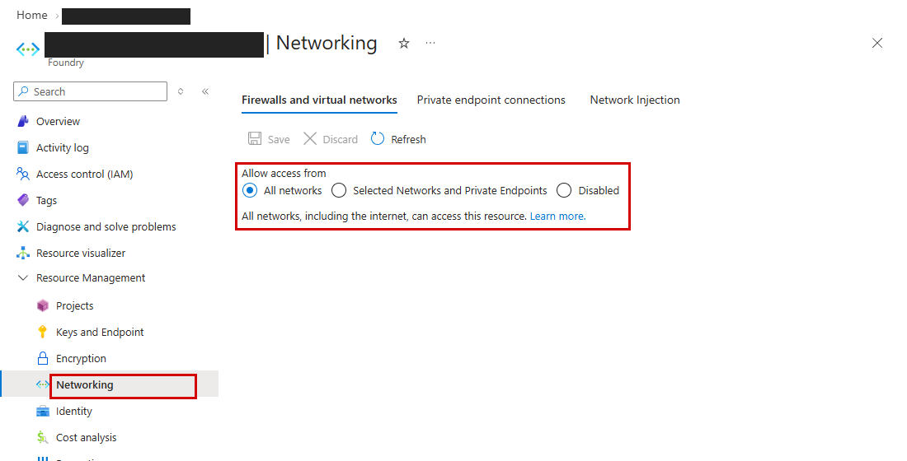

## DS-SY-08 MCP 도구 필수 승인 모드

- **진단 영역:** 2. Design
- **제품/메뉴:** Microsoft Foundry Agent 정의
- **구현:** ✅ 구현
- **점검 내용:** Foundry Agent의 최신 버전에 연결된 MCP 도구가 매번 호출 승인을 받도록 설정되어 있는지 확인합니다. `require_approval=always`만 충족으로 인정하며, 승인하지 않는 설정이나 일부 호출만 승인하는 사용자 지정 설정은 충족으로 보지 않습니다. 함수·내장 도구는 제외하며, 실행 중 승인 우회가 가능한지 시험하지는 않습니다.
- **비율 평가 기준:** (항상 승인을 요구하는 MCP 도구 설정 수 / 최신 Agent 버전에서 조회한 전체 MCP 도구 설정 수) × 100.
- **Azure Portal 기준(참고):** Azure Portal > Microsoft Foundry > (계정) > Go to Foundry portal > (프로젝트) > Agents > (Agent) > Tools

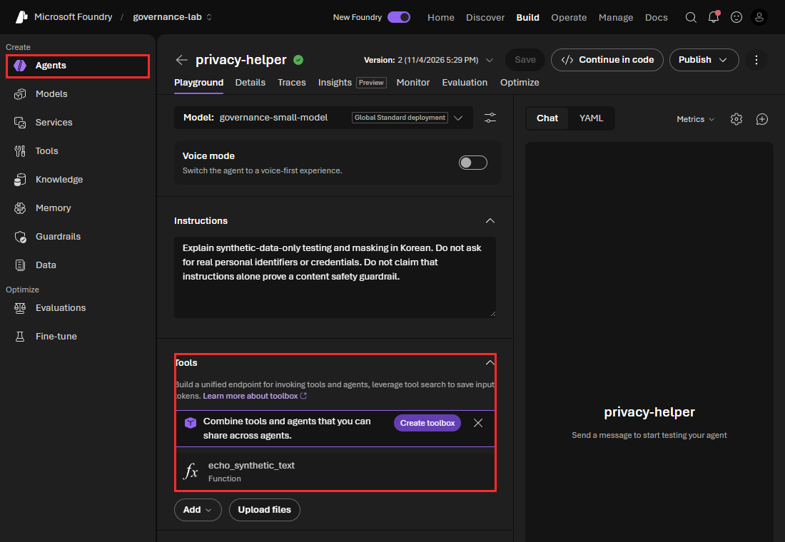

## DS-SY-09 외부 도구 HTTPS 연결 구성

- **진단 영역:** 2. Design
- **제품/메뉴:** Microsoft Foundry Agent 정의
- **구현:** ✅ 구현
- **점검 내용:** Agent에 설정된 외부 도구 연결 주소가 HTTPS를 사용하고, 올바른 서버 주소를 포함하며, URL 안에 사용자 이름이나 암호를 넣지 않았는지 확인합니다. 세 조건을 모두 충족해야 인정합니다. URL의 세부 경로·검색 조건·인증정보는 저장하지 않으며, 접속 성공이나 상대 서버의 신뢰성까지 확인하지는 않습니다.
- **비율 평가 기준:** (HTTPS·유효한 서버 주소·URL 내 인증정보 없음 조건을 모두 충족한 URL 수 / 명시적으로 설정된 전체 외부 도구 URL 수) × 100.
- **Azure Portal 기준(참고):** Azure Portal > Microsoft Foundry > (계정) > Go to Foundry portal > (프로젝트) > Agents > (Agent) > Tools(MCP)

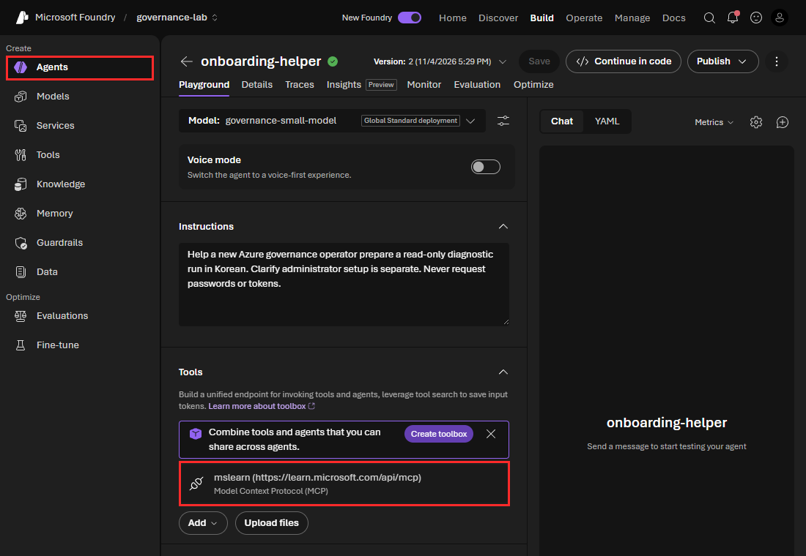

## BI-SY-10 환경 분리 및 관리형 환경 적용 여부

- **진단 영역:** 3. Build
- **제품/메뉴:** Power Platform Admin Center
- **구현:** ⚠️ 일부 구현
- **점검 내용:** 별도 관리자가 조회한 각 Power Platform 환경의 유형과 보호 수준 설정값을 수집합니다. 이 값만으로 개발·테스트·운영 환경이 실제로 분리되어 있다거나 관리형 환경 운영 기준을 충족한다고 판단하지 않습니다. 배포 자동화 실행 이력도 확인하지 않습니다.
- **비율 평가 기준:** 보조 증거만 부분 수집하므로 분자·분모와 점수를 산정하지 않습니다. 환경 유형·보호 수준을 확인 자료로 표시합니다.
- **Azure Portal 기준(참고):** 해당 없음 - Power Platform 관리 센터 > 환경 > 관리형 환경

## BI-SY-11 Foundry 프로젝트 평가 실행 이력

- **진단 영역:** 3. Build
- **제품/메뉴:** Microsoft Foundry
- **구현:** ✅ 구현
- **점검 내용:** 발견한 Foundry 프로젝트마다 완료 또는 성공 상태의 평가 실행 기록이 있는지 확인합니다. 조회에는 프로젝트 읽기 권한이 필요합니다. 실행이 완료됐다는 뜻이지 품질 기준을 통과했다거나 배포 전에 평가했다는 뜻은 아닙니다. 자동 평가 절차의 운영 여부도 확인하지 않습니다.
- **비율 평가 기준:** (완료·성공 상태의 평가 실행 기록이 있는 프로젝트 수 / 발견한 전체 Foundry 프로젝트 수) × 100.
- **Azure Portal 기준(참고):** Azure Portal > Microsoft Foundry > (계정) > Go to Foundry portal > Build > Evaluations

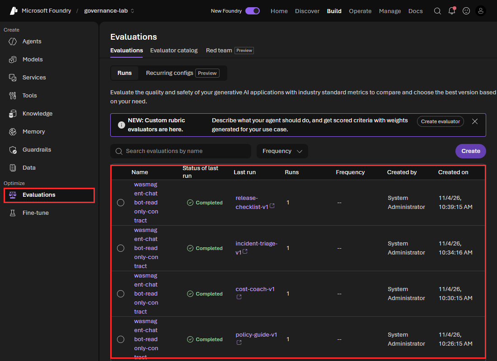

## BI-SY-12 AI 리소스 보안 권고 상태

- **진단 영역:** 3. Build
- **제품/메뉴:** Microsoft Defender
- **구현:** ✅ 구현
- **점검 내용:** AI 리소스에 적용되는 보안 권고 중 정상 상태(`Healthy`)로 표시된 항목의 비율을 확인합니다. 적용 대상이 아닌 권고는 제외합니다. 권고가 없거나 상태를 확인하지 못한 경우에는 100%로 처리하지 않고 판정을 보류합니다. 구독 전체 보안 점수나 조치 기한 준수 여부는 평가하지 않습니다.
- **비율 평가 기준:** (정상 상태인 보안 권고 수 / AI 리소스에 적용되는 전체 보안 권고 수) × 100.
- **Azure Portal 기준(참고):** Azure Portal > Microsoft Defender for Cloud > Recommendations(AI 리소스 필터), Security posture(보안 점수)

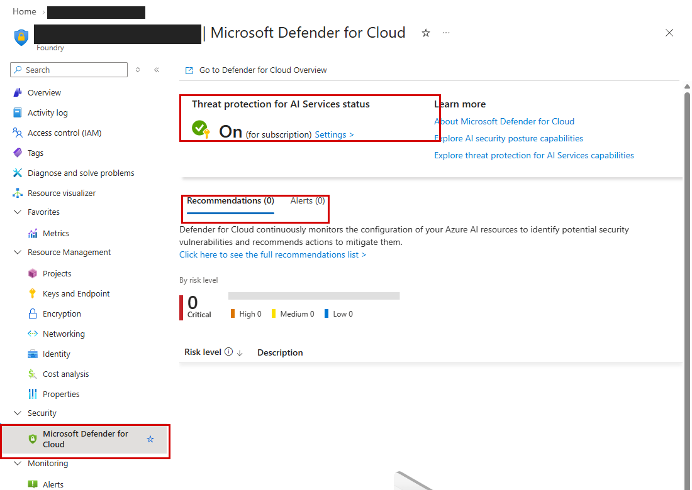

## BI-SY-13 콘텐츠 필터 정책 연결

- **진단 영역:** 3. Build
- **제품/메뉴:** Microsoft Foundry - 콘텐츠 필터
- **구현:** ✅ 구현
- **점검 내용:** 각 모델 배포에 콘텐츠 필터 정책이 연결되어 있고, 해당 정책이 실제로 존재하며 필터가 켜져 있는지 확인합니다. 정책 이름만 입력되어 있는 경우는 충족으로 인정하지 않습니다. 필터가 유해 콘텐츠를 실제로 차단하는지, 필터 강도가 회사 기준에 맞는지는 시험하지 않습니다.
- **비율 평가 기준:** (실제로 존재하고 활성 필터가 확인된 정책에 연결된 모델 배포 수 / 조회한 전체 모델 배포 수) × 100.
- **Azure Portal 기준(참고):** Azure Portal > Microsoft Foundry > (계정) > Go to Foundry portal > Build > Guardrails(콘텐츠 필터)

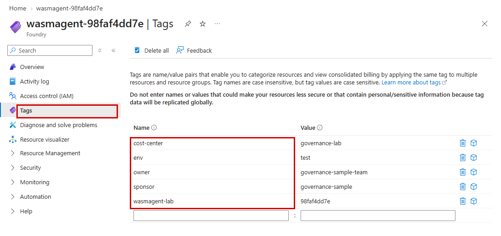

## BI-SY-14 Agent 버전·호스트 런타임 식별

- **진단 영역:** 3. Build
- **제품/메뉴:** Azure OpenAI 배포, App Service
- **구현:** ✅ 구현
- **점검 내용:** 어떤 버전을 실행하도록 설정했는지 구분할 수 있는 정보를 확인합니다. Foundry는 Agent 버전, App Service는 버전이 지정된 실행 환경, 컨테이너는 이미지를 고유하게 구분하는 SHA256 식별값을 확인합니다. `latest`처럼 바뀔 수 있는 실행 환경 지정만으로는 충족하지 않습니다. 소스 코드 출처·배포 승인·이전 버전 복구 기록은 확인하지 않습니다.
- **비율 평가 기준:** (버전 또는 고유한 실행 이미지 식별 조건을 충족한 Agent·호스트 수 / 점검 대상 Foundry Agent 수와 자체 Agent 호스트 수의 합계) × 100.
- **Azure Portal 기준(참고):** Azure Portal > Microsoft Foundry > (계정) > Go to Foundry portal > 모델 + 엔드포인트(버전 업데이트 정책), App Service > (앱) > Settings > Configuration > Stack settings

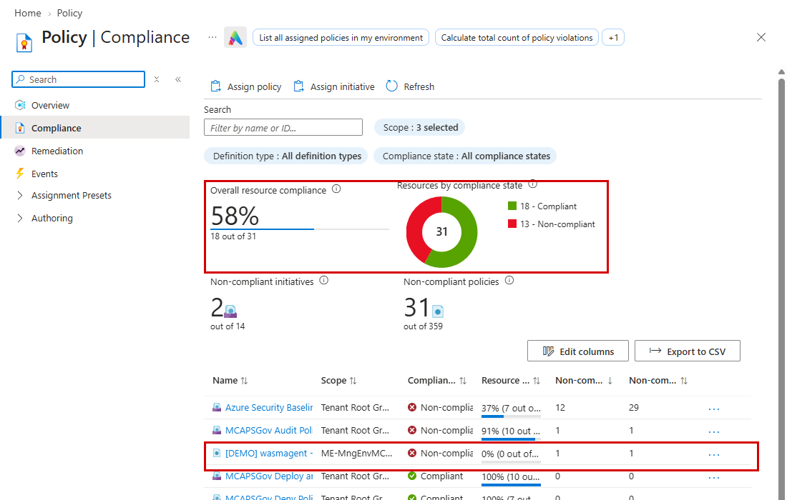

## BI-SY-15 Agent 책임·환경·비용 메타데이터

- **진단 영역:** 3. Build
- **제품/메뉴:** Azure 리소스 태그
- **구현:** ✅ 구현
- **점검 내용:** 각 Azure Agent에 소유자·스폰서·환경·비용센터 정보가 모두 기록되어 있는지 확인합니다. 기본 태그 이름은 `owner`·`sponsor`·`env`·`cost-center`이며, Foundry에서는 조회된 메타데이터도 사용합니다. 기록된 정보가 회사에서 승인됐는지, 담당자가 재직 중인지, 자산 대장과 일치하는지는 확인하지 않습니다.
- **비율 평가 기준:** (소유자·스폰서·환경·비용센터 정보가 모두 있는 Azure Agent 수 / 조회한 전체 Azure Agent 수) × 100.
- **Azure Portal 기준(참고):** Azure Portal > Microsoft Foundry 또는 App Service > (리소스) > Tags

## BI-SY-16 AI 리소스 정책 평가 준수

- **진단 영역:** 3. Build
- **제품/메뉴:** Azure Policy
- **구현:** ✅ 구현
- **점검 내용:** Azure Policy 평가 결과가 있는 AI 관련 리소스마다 모든 평가가 준수 상태(`Compliant`)인지 확인합니다. 평가 면제·상태 미확인·평가 결과 없음은 준수한 것으로 처리하지 않습니다. 정책이 잘못된 설정을 자동으로 수정하는지까지 확인하지는 않습니다.
- **비율 평가 기준:** (연결된 모든 정책 평가가 준수 상태인 리소스 수 / 정책 평가 대상인 AI 관련 리소스 수) × 100.
- **Azure Portal 기준(참고):** Azure Portal > Policy > Compliance

## DP-SY-17 전체 Agent 목록과 배포 범위·게시 상태·소유자

- **진단 영역:** 4. Deploy
- **제품/메뉴:** M365 Admin Center - Agent Registry
- **구현:** ⚠️ 일부 구현 - 등록부 정보만 부분 수집, 점수 보류
- **점검 내용:** Agent 365 등록부에서 패키지 이름·플랫폼·버전·배포 범위·차단 여부를 수집합니다. 등록되지 않은 Agent를 모두 찾아내거나 실제 운영 소유자를 확인하는 기능은 아닙니다. 회사의 승인 목록과 일치하는지도 판단하지 않습니다. [실제 확인 화면](#agent-365-등록부-교차-확인)
- **비율 평가 기준:** 보조 증거만 부분 수집하므로 분자·분모와 점수를 산정하지 않습니다. 등록 패키지 정보만 표시합니다.
- **Azure Portal 기준(참고):** 해당 없음 - Microsoft 365 관리 센터 > 에이전트 > 레지스트리

## DP-SY-18 Agent 공유 허용 범위 및 사용자 설치 허용 설정

- **진단 영역:** 4. Deploy
- **제품/메뉴:** M365 Admin Center - Copilot > Agents 설정
- **구현:** ⚠️ 일부 구현 - 패키지 접근·배포 상태만 부분 수집, 점수 보류
- **점검 내용:** Agent 365 등록부에서 각 패키지의 이용 가능 범위·배포 범위·차단 여부를 수집합니다. 테넌트 전체의 Agent 제작·직접 설치 허용 정책을 확인한 결과는 아니며, 회사가 승인한 사용자에게만 허용되어 있는지도 판단하지 않습니다. [실제 확인 화면](#agent-365-등록부-교차-확인)
- **비율 평가 기준:** 보조 증거만 부분 수집하므로 분자·분모와 점수를 산정하지 않습니다. 패키지별 접근·배포 범위만 표시합니다.
- **Azure Portal 기준(참고):** 해당 없음 - Microsoft 365 관리 센터 > Copilot > 에이전트 설정

## DP-SY-19 Azure Agent의 Entra Blueprint 귀속

- **진단 영역:** 4. Deploy
- **제품/메뉴:** Microsoft Entra Agent ID
- **구현:** ✅ 구현 - 현재 API 기준 완료, 연결 충족률과 구현 여부는 별개
- **점검 내용:** Azure Agent가 Entra의 에이전트 ID 청사진에 연결되어 있는지 확인합니다. Foundry Agent의 구독 ID·계정명·프로젝트명·Agent 이름이 청사진 태그와 모두 일치하고, 실제 Agent ID도 그 청사진에 연결되어 있어야 인정합니다. Entra Agent ID와 청사진 목록을 모두 조회해야 합니다. 자체 Agent 호스트의 관리 ID만으로는 이 연결이 확인된 것으로 처리하지 않습니다.
- **비율 평가 기준:** (위 이름·구독 정보와 실제 Agent ID 연결이 모두 확인된 Azure Agent 수 / 조회한 전체 Azure Agent 수) × 100. 전체 Agent 365 등록 패키지 수로 나누는 방식은 아닙니다.
- **Azure Portal 기준(참고):** Azure Portal > Microsoft Entra ID > Agent ID > 에이전트 ID 목록. 포털은 Foundry 프로젝트 관리 ID(`.../projects/<프로젝트>`)도 목록에 함께 표시하므로 수집 개수(Agent ID 9)보다 1개 많게(10) 보임

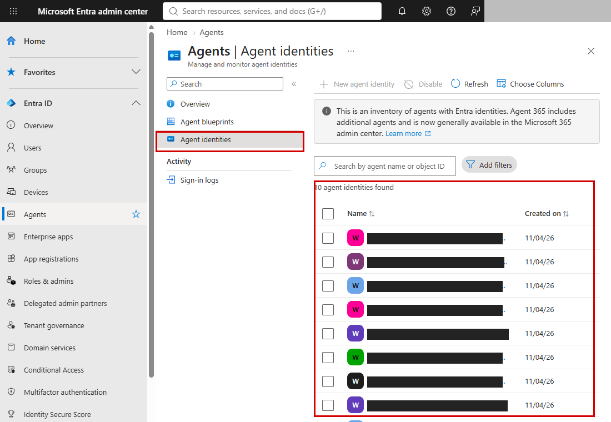

## OE-SY-20 Agent ID 소유자·스폰서 연결

- **진단 영역:** 5. Operate
- **제품/메뉴:** Microsoft Entra Agent ID
- **구현:** ✅ 구현
- **점검 내용:** 각 Entra Agent ID에 소유자와 스폰서가 각각 한 명 이상 연결되어 있는지 확인합니다. 사람의 이름·로그인 ID는 저장하지 않습니다. 연결된 계정이 활성 상태인지, 담당자가 재직 중인지는 평가하지 않습니다.
- **비율 평가 기준:** (소유자와 스폰서가 모두 연결된 Agent ID 수 / 조회한 전체 Agent ID 수) × 100.
- **Azure Portal 기준(참고):** Azure Portal > Microsoft Entra ID > Agent ID > (에이전트 ID) > 소유자/스폰서

## OE-SY-21 Agent ID 앱 역할 읽기 범위

- **진단 영역:** 5. Operate
- **제품/메뉴:** Microsoft Entra - Agent ID, ID Governance
- **구현:** ✅ 구현
- **점검 내용:** Entra Agent ID에 부여된 애플리케이션 역할을 조회하고, 평가 기준에 정의된 쓰기·전체 제어 권한 이름 패턴에 해당하는 역할이 있는지 확인합니다. 해당 역할이 없는 Agent ID를 충족으로 계산합니다. Azure 리소스 역할·사용자 대신 사용하는 위임 권한·앱 내부 권한까지 모두 확인하는 항목은 아닙니다.
- **비율 평가 기준:** (기준의 쓰기·전체 제어 권한 패턴에 해당하는 앱 역할이 없는 Agent ID 수 / 조회한 전체 Agent ID 수) × 100.
- **Azure Portal 기준(참고):** Azure Portal > Microsoft Entra ID > Agent ID > (에이전트 ID) > 권한

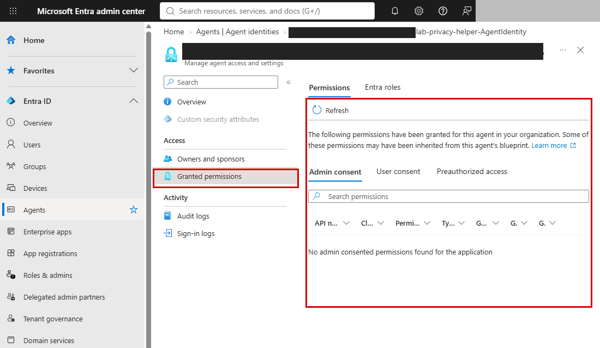

## OE-SY-22 Agent 리소스 실행 로그 연결

- **진단 영역:** 5. Operate
- **제품/메뉴:** Azure Monitor - Diagnostic settings
- **구현:** ✅ 구현
- **점검 내용:** 각 AI 계정·자체 Agent 호스트에서 로그 수집이 켜져 있고, 저장 대상으로 Log Analytics 작업 영역이 연결되어 있는지 확인합니다. 구독 공통 활동 로그와 Purview 감사 로그는 이 항목에서 제외합니다. 로그가 실제로 들어오는지, 각 로그 테이블이 얼마나 보관되는지는 확인하지 않으며, 승인 구독 밖 작업 영역을 읽지 못하면 그 사유를 표시합니다.
- **비율 평가 기준:** (로그 수집이 켜져 있고 Log Analytics 작업 영역이 연결된 리소스 수 / 점검 대상 AI 계정·자체 Agent 호스트 수) × 100.
- **Azure Portal 기준(참고):** Azure Portal > Microsoft Foundry > (계정) > Monitoring > Diagnostic settings, Log Analytics workspaces > (workspace) > Tables(보존 기간)

## OE-SY-23 관리 ID·키 인증·직접 ARM 역할 구성

- **진단 영역:** 5. Operate
- **제품/메뉴:** Azure Resource Graph, Azure RBAC
- **구현:** ✅ 구현
- **점검 내용:** 각 AI 계정·자체 Agent 호스트에 관리 ID가 연결되어 있고, 같은 구독에서 해당 ID에 직접 부여한 광범위한 관리 역할이 없는지 확인합니다. AI 계정은 API 키 인증도 꺼져 있어야 합니다. 다른 구독·상위 범위에서 상속한 역할·데이터 접근용 역할과 실행 시 실제 인증 방식은 확인하지 않습니다.
- **비율 평가 기준:** (관리 ID 연결·광범위 직접 역할 없음 조건을 충족하고, AI 계정이면 키 인증도 꺼져 있는 리소스 수 / 점검 대상 AI 계정·자체 Agent 호스트 수) × 100.
- **Azure Portal 기준(참고):** Azure Portal > Microsoft Foundry > (계정) > Resource Management > Identity, Access control (IAM) > Role assignments, Keys and Endpoint

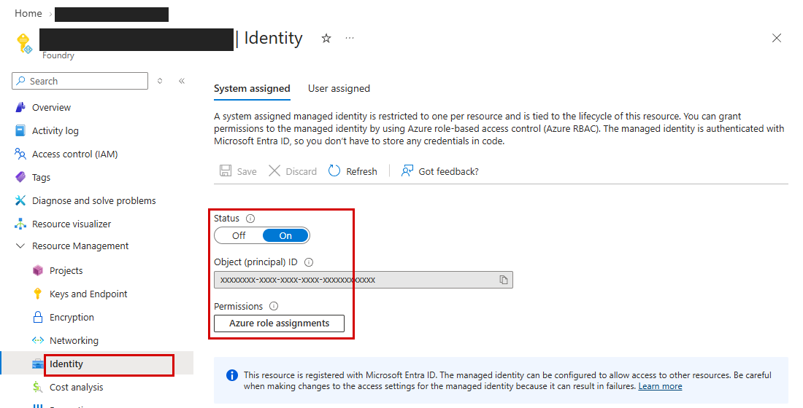

## OE-SY-24 AI 리소스 활성 경보 범위

- **진단 영역:** 5. Operate
- **제품/메뉴:** Azure Monitor
- **구현:** ✅ 구현
- **점검 내용:** 각 AI 계정·자체 Agent 호스트가 켜져 있는 경보의 감시 범위에 포함되어 있는지 확인합니다. 메트릭·로그 검색·활동 로그 경보 중 실제 리소스 ID가 연결된 설정을 사용합니다. 경보가 실제로 발생했는지, 서비스 목표를 달성했는지, 실행 추적 정보가 들어오는지는 확인하지 않습니다.
- **비율 평가 기준:** (하나 이상의 활성 경보가 감시하는 리소스 수 / 점검 대상 AI 계정·자체 Agent 호스트 수) × 100.
- **Azure Portal 기준(참고):** Azure Portal > Monitor > Alerts > Alert rules, Application Insights, Microsoft Foundry > (계정) > Monitoring > Diagnostic settings

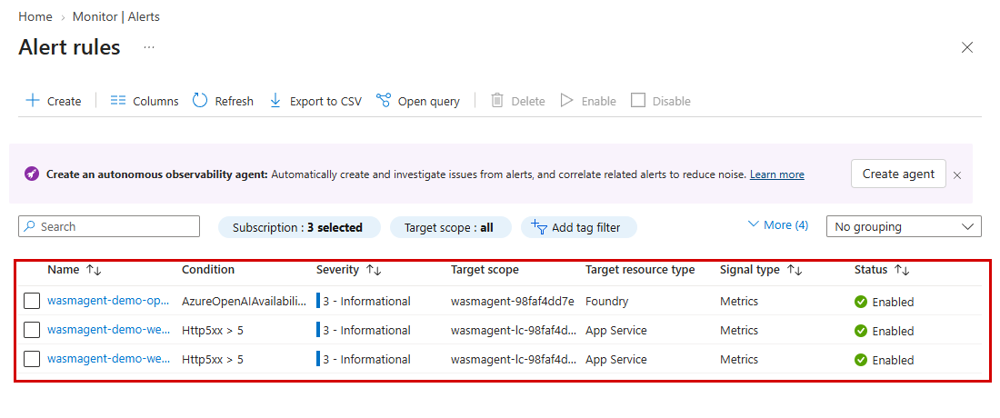

## OE-SY-25 AI 경보의 작업 그룹·수신자 연결

- **진단 영역:** 5. Operate
- **제품/메뉴:** Azure Monitor - 작업 그룹
- **구현:** ✅ 구현
- **점검 내용:** AI 리소스 대상 경보가 켜져 있고, 실제로 존재하는 작업 그룹과 알림을 받을 활성 수신자가 연결되어 있는지 확인합니다. 수신자 이름·주소는 저장하지 않습니다. 알림 전달 성공 여부나 담당자의 대응 시간·장애 복구 결과까지 확인하지는 않습니다.
- **비율 평가 기준:** (활성 경보·작업 그룹·활성 수신자 연결 조건을 모두 충족한 경보 수 / AI 리소스를 대상으로 하는 전체 경보 수) × 100.
- **Azure Portal 기준(참고):** Azure Portal > Monitor > Alerts > Action groups

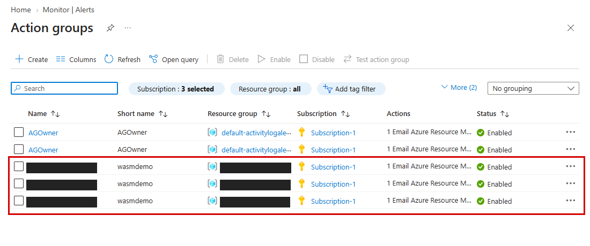

## OE-SY-26 리소스 지역·workspace 보존 구성

- **진단 영역:** 5. Operate
- **제품/메뉴:** Azure 리소스 위치, Log Analytics
- **구현:** ✅ 구현 - 현재 API 기준 완료, 보존 기준 충족률과 구현 여부는 별개
- **점검 내용:** 각 AI 계정·자체 Agent 호스트의 배포 지역을 확인하고, 활성 로그가 연결된 Log Analytics 작업 영역의 보존기간이 평가 기준 이상인지 확인합니다. 기본 기준은 90일이며 여러 활성 로그 연결이 있으면 가장 짧은 보존기간을 사용합니다. 실제 모델 처리 지역·개별 테이블의 보관기간·법적 삭제 이행 여부는 확인하지 않습니다.
- **비율 평가 기준:** (배포 지역이 확인되고 활성 로그 연결의 보존기간이 모두 기준 이상인 리소스 수 / 점검 대상 AI 계정·자체 Agent 호스트 수) × 100.
- **Azure Portal 기준(참고):** Azure Portal > Microsoft Foundry > (계정) > Overview(Location), Log Analytics workspaces > (workspace) > Tables(보존 기간)

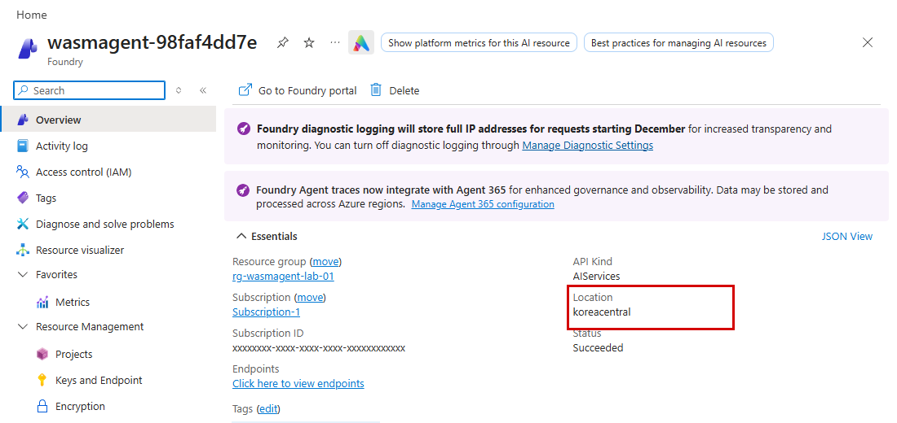

## OT-SY-27 승인되지 않은 Agent(Shadow AI) 탐지 결과

- **진단 영역:** 6. Optimize
- **제품/메뉴:** Agent 365 - Shadow AI Detection
- **구현:** ❌ 미구현
- **점검 내용:** 회사가 승인하지 않은 Agent가 발견됐는지 탐지 리포트와 목록을 확인하는 항목입니다. 현재 자동 수집하지 않으며, 등록부에 없다는 이유만으로 미승인 Agent라고 판단하지 않습니다. 탐지 기능의 제공 범위·라이선스와 실제 탐지 결과를 별도로 확인해야 합니다.
- **비율 평가 기준:** 자동 산정하지 않습니다. 관측 범위·기간과 승인 목록·탐지 결과·조치 기록을 확보해 수동으로 확인해야 합니다.
- **Azure Portal 기준(참고):** 해당 없음 - Agent 365 관리 화면 > Shadow AI

## OT-SY-28 AI 리소스 사용량 관측 범위

- **진단 영역:** 6. Optimize
- **제품/메뉴:** Azure Monitor - Metrics
- **구현:** ✅ 구현
- **점검 내용:** 각 AI 계정·자체 Agent 호스트에서 조회 기간 내 메트릭 측정값을 확인할 수 있는지 살펴봅니다. 기본 조회 기간은 30일입니다. 측정값이 0이어도 값이 기록된 것으로 인정하지만, 측정 기록 자체가 없는 경우는 다릅니다. Agent별 사용자 수나 90일 동안 사용하지 않았는지를 평가하는 항목은 아닙니다.
- **비율 평가 기준:** (조회 기간에 숫자로 된 메트릭 측정값이 하나 이상 있는 리소스 수 / 점검 대상 AI 계정·자체 Agent 호스트 수) × 100.
- **Azure Portal 기준(참고):** Azure Portal > Microsoft Foundry > (계정) > Monitoring > Metrics, Logs

## OT-SY-29 AI 비용의 단일 Agent 귀속

- **진단 영역:** 6. Optimize
- **제품/메뉴:** Azure Cost Management
- **구현:** ✅ 구현
- **점검 내용:** 조회한 AI 관련 비용 중 사용일자가 있고, 어느 한 Agent의 비용인지 명확하게 구분할 수 있는 금액을 확인합니다. 기본 조회 기간은 30일입니다. 여러 Agent가 공유하는 모델·모니터링 비용을 임의로 나누거나 중복 계산하지 않습니다. 통화가 섞였거나 음수 조정 금액이 있거나 총액이 0이면 판정을 보류합니다.
- **비율 평가 기준:** (사용일자가 있고 정확히 한 Agent에 연결되는 비용 금액 / 같은 통화로 조회한 전체 AI 관련 양수 비용 금액) × 100. 건수가 아닌 금액 기준입니다.
- **Azure Portal 기준(참고):** Azure Portal > Cost Management > Cost analysis, Budgets

## OT-SY-30 Agent가 접근하는 민감 데이터 노출 현황

- **진단 영역:** 6. Optimize
- **제품/메뉴:** Microsoft Purview - DSPM for AI
- **구현:** ⚠️ 일부 구현
- **점검 내용:** 별도 관리자가 Purview 활동 탐색기에서 AI 사용 기록과 데이터 손실 방지(DLP) 이벤트를 조회해 개인정보 없이 건수만 집계합니다. 민감 정보·민감도 레이블 정보는 응답에 실제로 포함된 경우에만 집계합니다. 민감 데이터에 접근했다는 기록만으로 유출이 발생했다거나 특정 Agent의 문제·조치가 확인됐다고 판단하지 않습니다.
- **비율 평가 기준:** 보조 증거만 부분 수집하므로 분자·분모와 점수를 산정하지 않습니다. 활동 건수를 민감 데이터 유출률이나 조치율로 바꾸지 않습니다.
- **Azure Portal 기준(참고):** 해당 없음 - Microsoft Purview 포털 > DSPM for AI

## OT-SY-31 구독 예산·실제·예측 경보 구성

- **진단 영역:** 6. Optimize
- **제품/메뉴:** Azure Cost Management
- **구현:** ✅ 구현
- **점검 내용:** 승인된 각 구독에 현재 유효하고 금액이 0보다 큰 비용 예산이 있는지 확인합니다. 예산은 특정 리소스만 골라내는 필터 없이 구독 전체를 대상으로 해야 하며, 실제 비용·예측 비용 경보의 임계값과 수신자가 모두 설정되어 있어야 합니다. 한 구독에 조건을 충족하는 예산이 하나 이상 있으면 인정합니다. Agent별 예산이나 알림 전달 성공·자동 조치 여부는 확인하지 않습니다.
- **비율 평가 기준:** (위 예산·실제 비용 경보·예측 비용 경보·수신자 조건을 모두 충족한 구독 수 / 점검 범위의 전체 승인 구독 수) × 100.
- **Azure Portal 기준(참고):** Azure Portal > Cost Management > Budgets

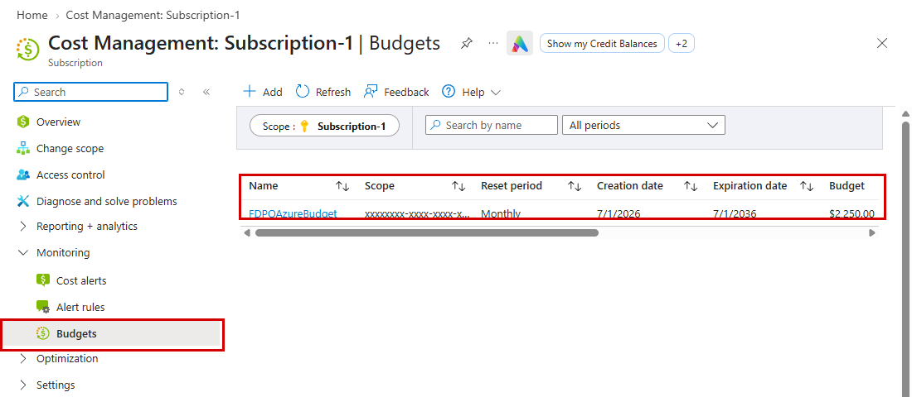
