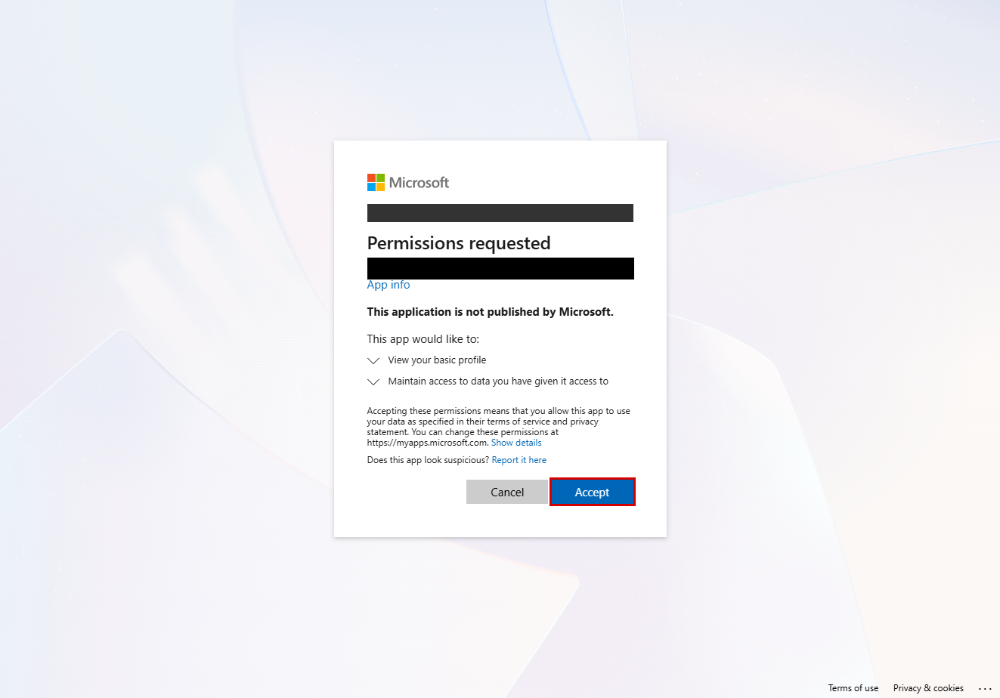
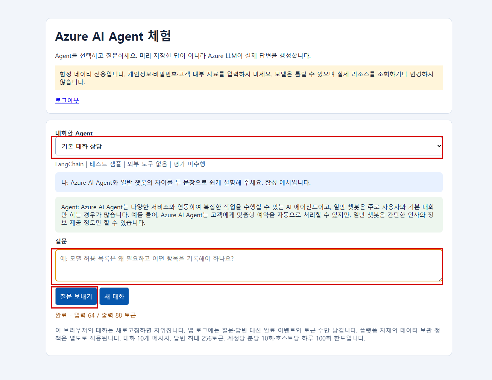
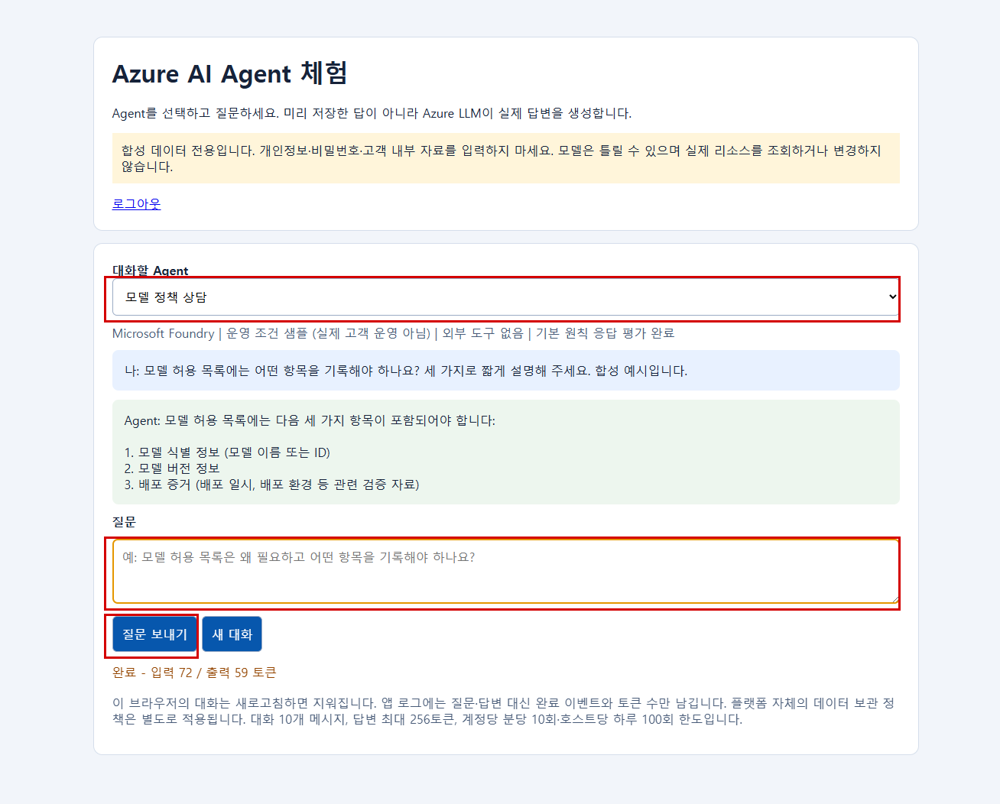

# 개발자용 샘플 배포, 챗봇과 결과 확인

- 고객 진단 설치/실행은 [README](../README.md)를 사용합니다. 이 문서는 승인된 관리자용 합성 샘플 배포와 개발 검증 전용이며 고객 진단에 샘플 배포가 필요한 것은 아닙니다.
- 관리자 계정/인증/권한은 [가이드](guide.md), 공식 API 계약/판정 범위는 [참조](api-notes.md)를 확인합니다.
- 기본 설정은 Git 제외 `.wasm-agent/setup.json`, 데모 runtime은 `.wasm-agent/demo/`를 사용합니다. 기존 `output/setup.json`은 호환 입력으로 지원합니다.

## 샘플 생성부터 실측까지

- 설정: [config/lab.yaml](../config/lab.yaml)과 `.wasm-agent/setup.json`.
- 승인 범위: Korea Central, 검증 USD 100, 합성 입력의 GlobalStandard 처리, 샘플 유지.
- 배포: 별도 소유 태그가 있는 데모 리소스 그룹. Foundry/자체 호스팅 Agent 분리.
- 권한: 관리자 bootstrap이 배포하며 진단 SP는 Reader와 필요한 제한적 읽기 역할만 사용.
- 인증: 비밀번호 없이 4시간 임시 인증서. 공개 인증서만 앱 등록, 개인키는 저장소 밖 사용자 전용 보호 경로.
- 정리: 종료 시 새 인증서만 삭제하고 기존 인증서/샘플 리소스는 보존.

```bash
export WASM_AGENT_PYTHON=python
bash scripts/lab/manage.sh plan
bash scripts/lab/manage.sh test
bash scripts/lab/manage.sh validate --prepare-providers
bash scripts/lab/manage.sh all --apply
# 이미 생성된 샘플을 로그인 보호 챗봇 10개로 확장:
python -m scripts.lab.expand --apply
# 인프라는 재사용하고 앱 배포와 진단만 재검증:
bash scripts/lab/manage.sh all --apply --reuse-infrastructure
# 샘플을 유지한 채 다시 실측:
bash scripts/lab/manage.sh collect
# 실제 결과를 독립 재검증하고 대시보드 갱신:
python -m scripts.lab.summarize
```

- `all --apply` 전에 `.azure/validation.json`의 passed=true 배포 전 검증이 필요합니다.
- validate는 Python 테스트/린트, 실제 Bicep 컴파일, 대상 구독 ARM validate/what-if와 정책 조회를 실행합니다. `--prepare-providers`는 승인 샘플에 필요한 공급자 등록만 하며 리소스를 배포하지 않습니다.
- 관리자 로그인이 만료되면 `bash scripts/setup/manage.sh login`의 디바이스 코드를 사용합니다. 수집기는 관리자 로그인으로 대체하지 않고 DefaultAzureCredential의 SP 인증서 인증을 사용합니다.

### 자동 처리와 안전 경계

- 전체 mock 테스트와 fixture Run-through.
- 필요한 공급자 등록, 샘플 그룹/Foundry/모델/웹 앱/로그 설정 생성 또는 재사용.
- 샘플 앱 Managed Identity로 합성 모델 호출. 공개 과금 유발 엔드포인트는 만들지 않음.
- 진단 SP 임시 인증과 실제 대상 구독 병렬 수집, HTML/XLSX 및 통합 데이터 포함 ZIP 생성.
- 실제 거부가 있을 때만 Cost Management Reader 또는 워크스페이스 Log Analytics Reader 추가 후 재수집.
- 실패 시에도 새 공개 인증서/개인키 정리. 강제 종료는 별도 점검.
- `auto_grant_needed_read_roles: false`로 추가 읽기 역할 자동 부여를 끌 수 있습니다. 이전 거부는 `.wasm-agent/demo/before-additional-read-roles/`에 보존합니다.
- Foundry 프로젝트에는 agents/read, evaluations/read, assets/read v2 사용자 지정 역할을 진단 SP에 부여합니다. 신규 평가 API가 assets/read를 실제로 요구해 v2를 추가했으며 기존 v1은 임의 수정/삭제하지 않습니다. 관리자/서비스 MI의 쓰기/추론 역할은 진단 주체와 구분합니다.
- App Service에는 Python 3.11 Linux x86_64 wheel을 사전 패키징합니다. 실제 실행에서 17개 Linux ELF 확장과 ZIP CRC를 확인했으며 Windows 바이너리를 올리지 않았습니다.
- 원격 Oryx 설치나 CLI 시작 추적을 성공 근거로 삼지 않고 해당 실행의 새 Kudu 배포 ID 완료와 실제 Agent health를 각각 확인합니다.

### 사용자 결과와 내부 runtime

- 사용자 전달은 `report.html`, `report.xlsx`, `results.zip` 3개입니다.
  - HTML: Agent 목록, 평가 결과, 지표, 판정 근거, 다음 조치.
  - XLSX: 진단 체크리스트와 상세 결과.
  - ZIP: `report.html`, `report.xlsx`, `data.json`만 포함. `data.json`은 raw + evidence + meta 통합.
- CSV/Markdown/분리 JSON을 사용자에게 별도 전달하지 않습니다. 내부 `data.json`, settings는 `.wasm-agent/`에 보존합니다.
- `.wasm-agent/demo/` 내부 관리 자료:
  - `mock/`: 가짜 fixture 결과이며 실제 Azure 증거 아님.
  - `lab.json`: 생성 리소스, endpoint, smoke 결과, 추가 읽기 역할.
  - `runthrough.json`: 성공/부분 성공/실패와 일회성 인증 정리 상태.
  - `runthrough.html`, `verification.json`: 테스트, 역할, HTTP health, 공개 인증서 잔여 수 재검증.
  - `chatbot-expansion/`: 합성 평가 문항, Agent 응답, 서비스 실행 ID, 개별 결과와 확장 상태.
- 마스킹된 API 증거는 저장 전 비밀/개인정보를 제거하며 사용자 ZIP에서는 통합 `data.json`의 evidence로 제공합니다.
- 유지되는 B1 2개 합계는 USD 0.036/시간이며 모델/로그는 별도입니다. USD 100은 검증 승인 예산이지 영구 하드 과금 상한이 아닙니다.
- 신규 리소스 생성으로 실제 30일 비용/90일 관측 기간을 만들 수 없습니다. 미지원 API, 권한 부족, 로그 유입 지연은 null과 사유로 남깁니다.
- `summarize`는 기존 샘플 결과를 읽고 테스트와 읽기 검증만 수행하며 배포/추론/역할 변경은 하지 않습니다. 현재 진단 앱 인증서가 0건이고 실제 smoke가 완료됐는지 확인한 뒤 결과를 생성합니다.
- `collect` 종료 코드 2는 일부 증거를 확보하지 못했다는 뜻이며 해당 사유를 보고서에 남깁니다.

## 로그인해서 사용하는 10개 샘플 챗봇

- 기존 모델·Foundry 프로젝트·웹 앱 2개를 재사용합니다. 새 B1 플랜이나 모델 배포는 만들지 않습니다. 화면의 질문은 실제 Azure LLM이 답변합니다. 고객 데이터가 없는 합성 예시이며, 표의 운영/테스트는 진단 조건을 보여주기 위한 표시이지 실제 고객 업무 운영을 뜻하지 않습니다.

## Agent 구성

- **Foundry**
  - 이름: 거버넌스 길잡이
  - 환경 조건: 테스트
  - 평가 계획·도구: 평가하지 않는 비교군
- **Foundry**
  - 이름: 모델 정책 상담
  - 환경 조건: 운영 조건
  - 평가 계획·도구: 기본 원칙 응답 평가
- **Foundry**
  - 이름: 비용 이해 도우미
  - 환경 조건: 운영 조건
  - 평가 계획·도구: 기본 원칙 응답 평가
- **Foundry**
  - 이름: 장애 접수 도우미
  - 환경 조건: 운영 조건
  - 평가 계획·도구: 기본 원칙 응답 평가
- **Foundry**
  - 이름: 신규 담당자 안내
  - 환경 조건: 테스트
  - 평가 계획·도구: 평가하지 않는 비교군
- **Foundry**
  - 이름: 출시 점검 도우미
  - 환경 조건: 운영 조건
  - 평가 계획·도구: 기본 원칙 응답 평가
- **Foundry**
  - 이름: 개인정보 보호 안내
  - 환경 조건: 운영 조건
  - 평가 계획·도구: 평가하지 않는 비교군
- **Foundry**
  - 이름: 실험용 FAQ
  - 환경 조건: 테스트
  - 평가 계획·도구: 평가하지 않는 비교군
- **LangChain 호스트 02**
  - 이름: 도구 사용 범위 상담
  - 환경 조건: 운영 조건
  - 평가 계획·도구: 범위 안내 Python 도구 사용, 클라우드 평가 미수행
- **LangChain 호스트 03**
  - 이름: 기본 대화 상담
  - 환경 조건: 테스트
  - 평가 계획·도구: 외부 도구 없음, 클라우드 평가 미수행

- 평가는 실제 응답 3문항을 Foundry 평가 서비스의 정확 일치 검사에 제출합니다. 검사는 삭제 금지, 모르는 값을 0으로 만들지 않기, 생성/배포 시각 구분에 한정됩니다. **평가 완료는 전체 보안/품질 검증 통과라는 뜻이 아닙니다.** 통과/실패는 결과 파일에서 확인합니다. 계획표만으로 완료를 주장하지 않으며 실제 결과는 내부 `.wasm-agent/demo/chatbot-expansion/`과 진단 보고서에 남습니다.

- **모델 정책 상담**
  - 통과: 3/3
  - 실패: 0
  - 해석: 기본 원칙 응답이 지정 답과 일치
- **비용 이해 도우미**
  - 통과: 2/3
  - 실패: 1
  - 해석: 실패 문항도 원본에 보존. 평가를 실행했다는 것과 전체 통과는 다름
- **장애 접수 도우미**
  - 통과: 2/3
  - 실패: 1
  - 해석: 실패 문항도 원본에 보존
- **출시 점검 도우미**
  - 통과: 3/3
  - 실패: 0
  - 해석: 기본 원칙 응답이 지정 답과 일치

- 위 결과는 최초 실행 당시 해당 버전의 합성 3문항 검사입니다. 삭제 후 재생성한 실행의 결과로 재사용하지 않습니다. 정확한 문구 비교이므로 문장부호·추가 설명 때문에 실패할 수도 있습니다. 실패를 위험 확정으로 단정하지 마세요.

## 어떻게 사용하나요?

- **도구 사용 LangChain + Foundry 8개**
  - 접속: `.wasm-agent/demo/lab.json`에서 이름이 `-02`로 끝나는 호스트의 `chat_url` 확인.
- **기본 LangChain + Foundry 8개**
  - 접속: `.wasm-agent/demo/lab.json`에서 이름이 `-03`로 끝나는 호스트의 `chat_url` 확인.

- `.wasm-agent/demo/lab.json`의 각 호스트 `chat_url`을 브라우저로 엽니다.
- 허용된 Entra 계정으로 로그인합니다. 기본 허용자는 배포를 승인·실행한 관리자 1명입니다.
- Agent를 선택하고 질문을 입력한 뒤 **질문 보내기**를 누릅니다.
- 다른 Agent로 바꾸거나 **새 대화**를 누르면 이전 대화가 초기화됩니다.

- 각 호스트는 Foundry 8개와 자기 호스트의 LangChain 1개를 보여줍니다. 두 웹 화면에 Foundry 목록이 반복돼도 실제 Foundry Agent를 두 번 생성한 것이 아닙니다.

- 처음에는 기본 로그인 프로필 사용에 동의하는 화면이 나올 수 있습니다. 이것은 진단 SP에 Azure 쓰기 권한을 부여하는 화면이 아닙니다. 실제 캡처에서 계정과 앱 등록 식별자를 가렸습니다.



- 아래는 실제 로그인 후 LangChain Agent가 LLM으로 생성한 답변입니다. 빨간 네모 순서대로 Agent 선택, 질문 입력, 질문 보내기를 사용합니다.



- 같은 화면에서 Foundry Agent를 선택하면 해당 Foundry endpoint가 실제로 답변합니다. 아래의 평가 완료 표시는 서비스 평가 실행 이력에 근거하며 모든 문항 통과를 뜻하지 않습니다.



- **모델 허용 목록에는 어떤 정보를 기록해야 하나요?**
  - 볼 수 있는 차이: 정책 상담 Agent의 전문 프롬프트
- **비용이 조회되지 않았으면 0원으로 보고해도 되나요?**
  - 볼 수 있는 차이: 비용 Agent의 누락 데이터 설명
- **너의 도구로 어떤 작업을 할 수 있나요?**
  - 볼 수 있는 차이: LangChain 02의 범위 안내 도구
- **신규 담당자가 처음 준비해야 할 것은 무엇인가요?**
  - 볼 수 있는 차이: 온보딩 Agent의 순서 안내

## 안전 경계

- **로그인**
  - 내용: App Service 내장 Entra 인증, 동일 테넌트·허용 사용자만
- **비밀번호 없는 서버 인증**
  - 내용: 전용 User Assigned MI + 앱 등록 연합 신뢰. client secret 없음
- **모델 호출 주체**
  - 내용: 웹 앱 MI. 진단 Reader SP와 다름
- **호출 제한**
  - 내용: 한 번에 1개, 계정당 분당 10회·호스트당 하루 100회. 재시작 후에도 일일 카운트 유지
- **크기 제한**
  - 내용: 메시지당 2,000자·대화 8,000자·10개 메시지·응답 최대 256토큰
- **로그**
  - 내용: 질문·답변·사용자 ID는 앱 로그에 쓰지 않고 완료 이벤트·Agent ID·토큰 수만 기록
- **한계**
  - 내용: 하루 한도는 비용 예산을 보장하지 않음. 모델 라운드·플랫폼 비용·기존 사용은 별도

- Agent ID가 로그에 있어도 진단에 수집될지는 워크스페이스 권한과 연결 규칙에 달려 있습니다. Foundry의 공유 모델 메트릭을 임의 분배하지 않습니다.

## 승인된 테스트베드에서 관리자가 다시 적용하려면

- 고객의 일반 진단에는 필요 없는 **샘플 배포 명령**입니다.

```bash
source .venv/Scripts/activate
python -m pip install -e ".[dev,sample]"
python -m scripts.lab.run validate
python -m scripts.lab.expand --apply
bash scripts/lab/manage.sh collect
python -m scripts.lab.summarize
```

- 기존 샘플의 소유 태그를 검증합니다. 다른 고객 리소스를 챗봇으로 바꾸지 않습니다. 실패하면 내부 `.wasm-agent/demo/chatbot-expansion/state.json`과 각 평가 영수증을 보고 같은 명령으로 이어갈 수 있습니다. 평가 완료를 확인할 수 없는 Agent를 완료한 것으로 표시하지 않습니다.

## 실행과 검증 결과 해석

- 평가 실행 완료와 모든 문항 통과는 다릅니다. 평가 이력 확인과 운영 배포 전 평가 확인도 다릅니다.
- 권한/자료/관측 기간이 부족하면 판정 보류입니다. 원본 API 응답의 필드가 없으면 값을 추정하지 않습니다.
- 개발 검증 명령:
  - `python -m pytest -q`: 가짜 API 응답으로 코드 동작 검사.
  - `python -m ruff check src scripts samples tests`: 코드 오류와 형식 검사.
  - 원문 보존 검사는 승인된 원본이 로컬에 있을 때만 수행.
- 실제 Azure 검증:
  - 관리자 준비와 진단 계정의 읽기 실행 구분.
  - 구독/Agent 수는 실행마다 결과에서 동적으로 확인.
  - 민감 식별자를 가린 실제 화면만 사용.
  - 실행하지 않은 인증/배포를 완료로 표시하지 않음.
- 이 문서의 최초 실행 기록/화면은 당시 확인 범위이며 새 실행의 완료 근거를 대신하지 않습니다.
- [수집 필드/읽기 권한](guide.md), [API 계약/한계](api-notes.md)를 함께 확인합니다.

## 나중에 샘플을 정리하려면

- 이번 문서 통합에서 샘플을 삭제하지 않습니다. 아래는 목록 확인만 하는 dry-run입니다.

```bash
python -m scripts.lab.cleanup
```

- 실제 삭제는 별도 승인 후 `--apply --confirm-lab-id '<lab_id>'`를 명시해야 합니다. 설정에서 계산한 그룹의 테넌트/소유 태그를 모두 검사한 뒤 해당 샘플 그룹만 삭제합니다.
- 기존 앱/SP, 역할 정의와 다른 고객 리소스는 삭제하지 않습니다.
