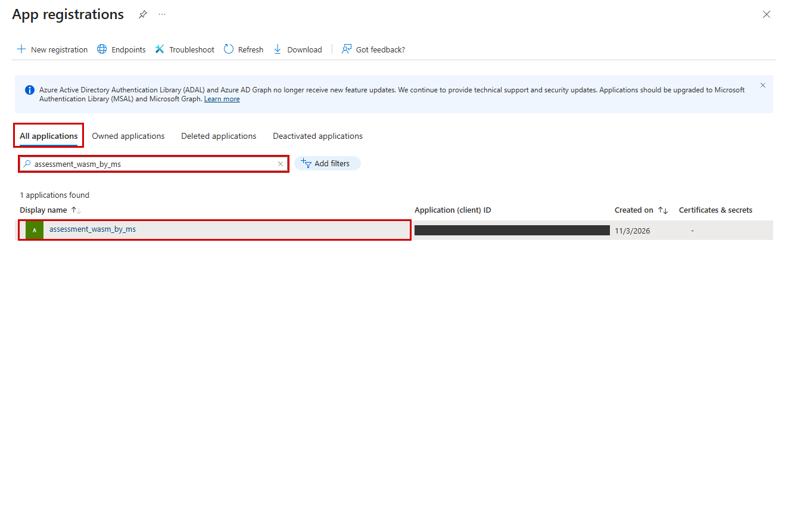
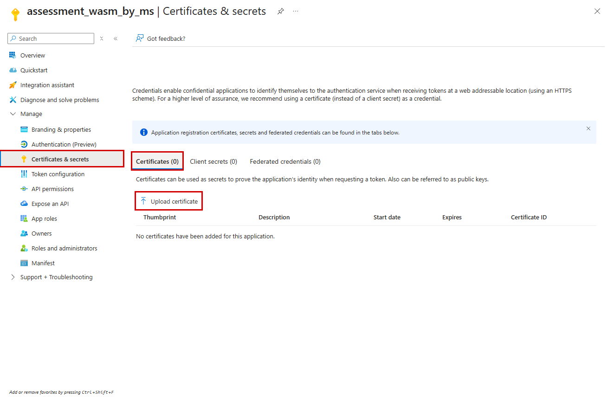
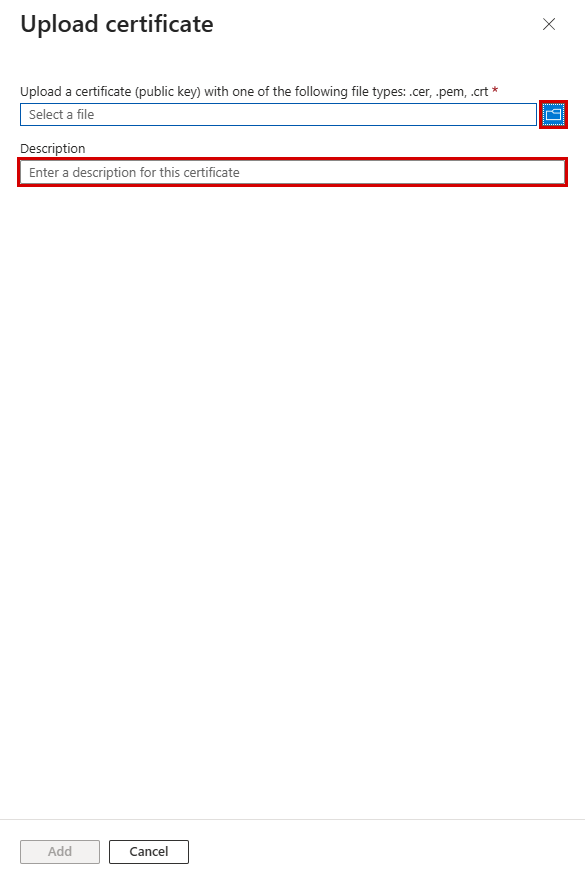
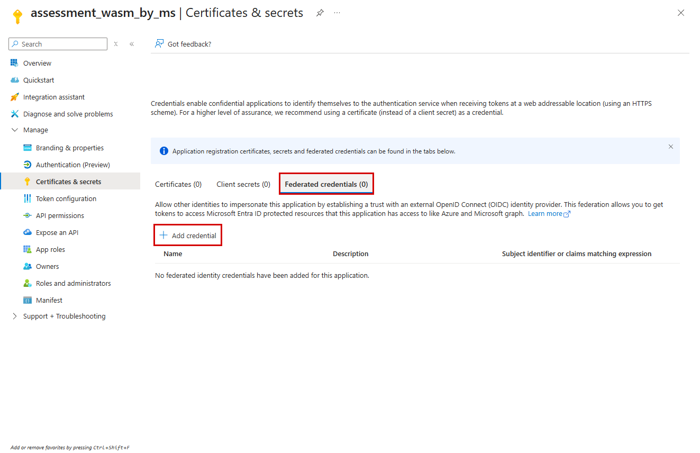
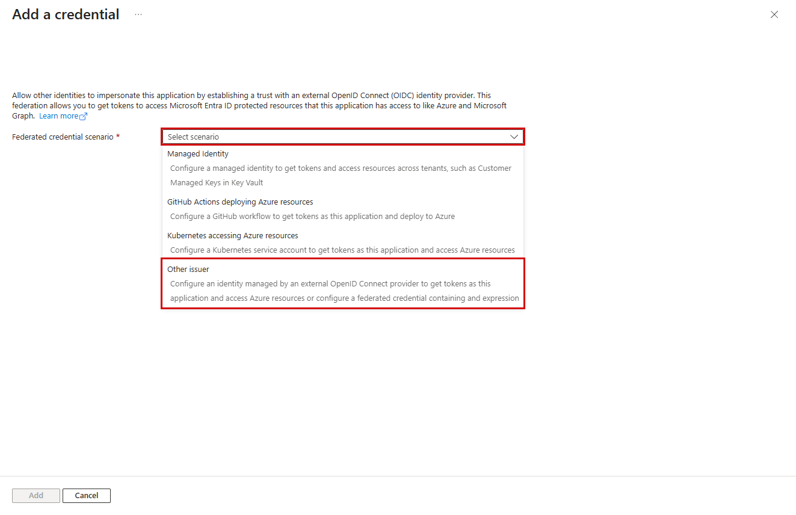
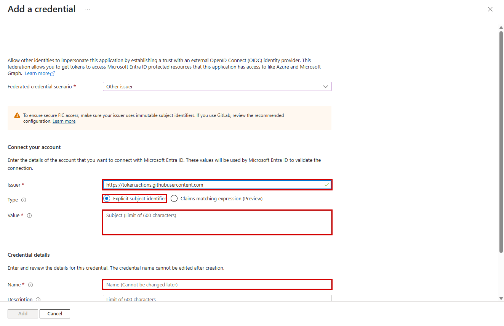

# 관리자 준비와 수집 항목 안내

- 고객 진단 설치와 실행은 [README](../README.md)를 기준으로 합니다. 이 문서는 관리자용 계정 준비, 인증서/연합 인증, 읽기 권한과 수집 필드 상세입니다.
- 설계와 API 근거는 [참조](api-notes.md), 개발자 샘플 배포는 [데모](demo.md)를 참고합니다.
- 사용자 전달 파일은 `report.html`, `report.xlsx`, `results.zip` 3개입니다. ZIP에는 `report.html`, `report.xlsx`, `data.json`만 포함하며 `data.json`은 raw + evidence + meta를 통합합니다.
- 중복 CSV, Markdown, 분리 JSON을 사용자 출력으로 안내하지 않습니다. 내부 연동용 `data.json`, settings 등은 `.wasm-agent/`에 보존합니다.
- 기본 설정은 `.wasm-agent/setup.json`, 데모 runtime은 `.wasm-agent/demo/`에 둡니다. 기존 `output/setup.json`도 호환 입력으로 지원합니다.

## 관리자 계정과 역할 준비

- `scripts/setup/`은 관리자 계정, 읽기 역할, 인증 준비 전용이며 수집기가 import하지 않습니다.
- `config/setup.example.json`을 Git 제외 `.wasm-agent/setup.json`으로 복사하고 고객 테넌트 ID, 허용 구독 목록, 계정 이름을 입력합니다. 기존 `output/setup.json` 입력도 호환 지원합니다.
- 계정 유형은 `user` 또는 `service-principal`입니다. 기존 계정은 재사용하고 새 SP가 필요할 때만 `--create-principal`을 사용합니다. 새 사용자는 고객 관리 절차로 먼저 준비합니다.
- 기본 진단 범위는 지정 테넌트의 접근 가능한 모든 구독이며 config/CLI로 제한할 수 있습니다. 설정과 적용 결과는 Git에 포함하지 않습니다.

```bash
bash scripts/setup/manage.sh login
bash scripts/setup/manage.sh plan --create-principal
bash scripts/setup/manage.sh apply --create-principal
```

- `login`: 관리자 디바이스 코드 로그인이며 진단 SP 인증을 대신하지 않습니다.
- `plan`: Azure API를 호출하지 않고 변경 계획만 표시합니다.
- `apply`: 계정 재사용, 필요한 읽기 역할 할당과 재조회를 수행합니다. 같은 계정/역할을 중복 생성하지 않으며 실패 원인을 해결한 뒤 같은 명령으로 이어갑니다.
- `verify`: 별도 진단 주체로 API 접근을 읽기만 확인합니다. 인증서/연합 설정이 없으면 관리자 로그인으로 대신하지 않고 중단합니다.
- 관리자는 구독 역할 할당과 앱/SP 준비 권한이 필요합니다. 사람은 디바이스 코드, SP는 인증서/연합 인증을 사용합니다.

## 읽기 권한과 한계

- 진단 계정은 대상 구독의 Reader가 기본입니다. 관리 그룹, 테넌트 루트, Owner, Contributor, User Access Administrator 권한으로 진단하지 않습니다.
- 관리자 역할 할당과 진단 수집은 별도 주체로 수행합니다. 관리자는 상속, 그룹, PIM 권한도 별도로 확인합니다.
- Reader로 먼저 확인합니다.
  - 구독, 리소스, Foundry 프로젝트와 모델 배포.
  - 진단 로그 전송과 워크스페이스 보존 설정, 일반 Azure Monitor 메트릭.
- 실제 거부 원인을 확인한 뒤 필요한 옵션만 선택합니다.
  - 비용: `--cost-reader`, Cost Management Reader. 청구 계약과 비용 공개 정책에 따라 가시성이 다릅니다.
  - 모니터링: `--monitoring-reader`, Monitoring Reader.
  - Agent별 로그: `--log-analytics-reader`, 지정 워크스페이스의 Log Analytics Reader 및 Agent 계측.
  - 보안 권고: `--security-reader`, Security Reader와 고객 보안 정책/기능 활성화 상태 확인.
  - Foundry Agent/평가: `--foundry-project-scopes '<project-resource-id>' --create-foundry-read-role`, 지정 프로젝트의 사용자 지정 읽기 역할.
- Foundry 역할의 DataActions는 `Microsoft.CognitiveServices/accounts/AIServices/agents/read`, `Microsoft.CognitiveServices/accounts/AIServices/evaluations/read`, `Microsoft.CognitiveServices/accounts/AIServices/assets/read`입니다.
  - `agents/read`는 서비스 권한 단위상 threads/messages 읽기를 포함하지만 수집기는 대화 본문을 조회하지 않습니다.
  - `assets/read`는 프로젝트 asset 메타데이터 읽기도 허용합니다. 수집기는 평가 관련 목록만 호출합니다.
  - 기존 승인 역할은 `--foundry-read-role-id '<role-id>'`로 지정할 수 있습니다.
  - Foundry User의 키 조회/쓰기까지 진단 계정에 허용하지 않습니다.
- 고객에게는 대상 구독 Reader와 실제로 필요한 프로젝트/워크스페이스의 읽기 권한만 요청합니다. 키 조회, Agent 변경, 추론, 평가 실행 권한은 요청하지 않습니다.
- 확인 결과는 내부 `.wasm-agent/`의 통합 데이터/설정으로 관리하며 고객 전달 파일과 구분합니다. 접근 성공은 데이터 완전성, 전체 관측 기간, 조직 성숙도 보장이 아닙니다.
- 공식 역할 근거와 API 한계는 [참조](api-notes.md#읽기-전용-foundry-역할-결정)를 참고합니다.

## 인증서 직접 만들기 - Codespaces Bash

- 조직 발급 인증서가 있으면 그것을 우선 사용하세요.
- 조직이 자체 서명 인증서를 허용한 경우만 아래 명령을 사용합니다.
- 암호는 OpenSSL 프롬프트에 입력하며 명령줄·로그·저장소에 기록하지 않습니다.
- 저장소 밖 보호 경로에 새 전용 폴더를 만들고 기존 인증서를 덮어쓰지 않습니다. 다음 명령은 고객이 승인된 호스트에서 실행할 예시입니다.

```bash
umask 077
cert_dir="$HOME/.config/wasm-agent/auth-$(date -u +%Y%m%dT%H%M%SZ)-$$"
mkdir -p "$HOME/.config/wasm-agent"
mkdir -m 700 "$cert_dir" || exit 1
openssl req -x509 -newkey rsa:3072 -sha256 -days 90 \
  -subj '/CN=wasm-agent-diagnostic' \
  -keyout "$cert_dir/private-key.pem" \
  -out "$cert_dir/public-cert.pem"
cat "$cert_dir/private-key.pem" "$cert_dir/public-cert.pem" > "$cert_dir/diagnostic.pem"
chmod 600 "$cert_dir/private-key.pem" "$cert_dir/diagnostic.pem"
openssl x509 -in "$cert_dir/public-cert.pem" -noout -dates -fingerprint -sha256
printf '공개 인증서 등록 파일: %s\n' "$cert_dir/public-cert.pem"
```

- 포털에는 `public-cert.pem`만 등록합니다. `private-key.pem`·`diagnostic.pem`은 업로드하지 않습니다.
- 인증서 등록 후 환경을 연결합니다.

```bash
export AZURE_CLIENT_CERTIFICATE_PATH="$cert_dir/diagnostic.pem"
read -r -s -p 'Certificate password: ' AZURE_CLIENT_CERTIFICATE_PASSWORD
printf '\n'
export AZURE_CLIENT_CERTIFICATE_PASSWORD
```

- 이 인증서는 자동으로 권한을 부여하지 않습니다. 앱의 공개 인증서 등록과 Reader 역할은 별도로 준비합니다.
- 만료 전에 교체하고 Codespace 삭제 전에 조직의 승인된 방식으로 인증서를 보관하거나 폐기하세요.

- 수집 대상: Microsoft Foundry, Azure 자체 호스팅 Agent, Azure Monitor, 비용·보안 권고.

- **인증서와 연합 인증 중 한 가지만 준비합니다.** 관리자 셋업에서 생성하거나 지정한 진단 앱을 사용합니다.

- **로컬 Git Bash**
  - 준비할 것: 조직에서 발급한 인증서: 공개 인증서는 앱 등록에, 개인키 포함 PEM/PFX는 보호 경로에 보관
- **CI/CD·Kubernetes 등**
  - 준비할 것: 해당 호스트의 OIDC 발급 기능 + 앱의 연합 신뢰 관계 + 실행 시 공급되는 토큰 파일

- 인증서가 없다면 조직의 인증서 관리자/PKI에 발급을 요청하세요. 일반 고객 셋업은 개인키를 생성하지 않습니다. 승인된 테스트베드 자동화만 별도 보호 경로에 임시 인증서를 생성하고 종료 시 정리합니다. 로컬 PC에서 연합 인증 메뉴만 추가해도 OIDC 토큰이 생기는 것은 아닙니다.

## 공통: 진단 앱 찾기

- [Azure portal](https://portal.azure.com)에서 **Microsoft Entra ID > App registrations > All applications**를 엽니다. 설정 파일의 `account_name`으로 검색해 앱을 클릭합니다. 아래 테스트베드의 앱 이름은 예시이며 다른 환경에서는 본인의 진단 앱을 선택하세요. Client ID는 이미지에서 가렸습니다.



## A. 인증서 방식

- **1**
  - 고객이 할 일: 앱의 **Certificates & secrets > Certificates > Upload certificate** 클릭
- **2**
  - 고객이 할 일: 파일 선택 아이콘에서 **공개 인증서만** 선택: `.cer`, `.pem`, `.crt`
- **3**
  - 고객이 할 일: 설명 입력 후 **Add**. 목록의 지문·만료일을 조직 인증서와 확인
- **4**
  - 고객이 할 일: 개인키 포함 PEM/PFX는 로컬 보호 경로에 두고 아래 `verify` 실행





- **포털에 개인키 포함 PEM/PFX를 올리지 마세요.** 같은 `.pem` 확장자라도 공개 인증서와 개인키 포함 파일은 다릅니다. 위 이미지는 파일 선택 전 상태이며, Add는 비활성입니다. 실제 등록은 고객 관리자가 수행합니다.

```bash
export WASM_AGENT_PYTHON=python
bash scripts/setup/manage.sh verify \
  --certificate-path "$HOME/.config/wasm-agent/diagnostic.pem"
```

- 테넌트, Client ID, Principal ID, 구독은 `.wasm-agent/setup.json`에서 자동 전달합니다. 기존 `output/setup.json`도 호환 입력으로 지원합니다.
- 암호화된 인증서는 실제 암호를 명령줄에 적지 말고 아래 프롬프트에 입력합니다. 입력 내용은 화면에 표시되지 않습니다.

```bash
read -r -s -p 'Certificate password: ' AZURE_CLIENT_CERTIFICATE_PASSWORD
printf '\n'
export AZURE_CLIENT_CERTIFICATE_PASSWORD
bash scripts/setup/manage.sh verify \
  --certificate-path "$HOME/.config/wasm-agent/diagnostic.pem"
unset AZURE_CLIENT_CERTIFICATE_PASSWORD
```

## B. 연합 인증 방식

- **Certificates & secrets > Federated credentials > Add credential**를 클릭합니다.



- 실행 호스트에 맞는 시나리오를 선택합니다. GitHub Actions와 Kubernetes는 전용 시나리오를 사용하고, 다른 OIDC 공급자는 **Other issuer**를 사용합니다. 아래는 Other issuer 양식을 검증한 예시입니다.



- **Issuer**
  - 입력 기준: 실행 호스트가 발급하는 OIDC 토큰의 `iss`와 정확히 일치
- **Type**
  - 입력 기준: 이 샘플은 **Explicit subject identifier** 기준. Preview 식은 사용하지 않음
- **Value**
  - 입력 기준: 토큰의 `sub`와 정확히 일치. 저장소·브랜치·서비스 계정 등 실제 호스트 값 사용
- **Name**
  - 입력 기준: 고객이 정한 고유 이름
- **Audience**
  - 입력 기준: Azure Public Cloud의 일반적인 기본값 `api://AzureADTokenExchange`; 호스트 토큰의 `aud`와 대조

- Issuer 입력 후 Type과 Value가 표시되는 것을 확인했습니다. 아래 Issuer는 **화면 테스트용 공개 예시**이며, 실제 고객 설정을 뜻하지 않습니다. Name·Value는 비워 두었고 Add를 누르지 않았습니다.



- 고객 관리자가 신뢰 관계를 저장한 뒤, **실행 호스트가 발급·갱신하는 토큰 파일**을 지정합니다. GitHub Actions의 토큰 발급이나 Kubernetes의 projected token 준비는 별도 호스트 설정이 필요합니다.

```bash
export AZURE_FEDERATED_TOKEN_FILE='<호스트가 공급하는 OIDC 토큰 파일의 절대 경로>'
unset AZURE_CLIENT_CERTIFICATE_PATH AZURE_CLIENT_SECRET
bash scripts/setup/manage.sh verify
```

- 토큰을 직접 문서에 붙여 넣거나 저장소에 복사하지 마세요. `verify`는 토큰을 발급하지 않습니다.

## 무엇을 검증했는가

- **화면**
  - 결과: 2026-11-03 실제 로그인된 Azure portal을 Playwright로 조작·캡처
- **클릭 표시**
  - 결과: 실제 요소 위치에 빨간 테두리 추가. 화면 내용·메뉴는 재구성하지 않음
- **비식별화**
  - 결과: 계정 배너 제외, 앱 목록의 Client ID 마스킹
- **테스트**
  - 결과: 앱 탐색, 인증서 업로드 패널, 연합 시나리오·필수 입력란, Add 비활성 및 취소 확인
- **변경 여부**
  - 결과: 파일 업로드·인증서 등록·연합 신뢰 저장 없음. 취소 후 인증서/시크릿/연합 자격증명 모두 0건 재조회
- **미검증**
  - 결과: 실제 인증서 로그인, OIDC 토큰 교환, 진단 SP의 API 사전 점검

- 포털 언어·버전에 따라 메뉴가 다를 수 있습니다. 빨간 네모는 클릭/입력 대상이며 미입력 상태의 Add 버튼을 활성 상태처럼 표시하지 않았습니다. 캡처 내역은 [manifest.json](images/setup/manifest.json)에 있습니다.

- 공식 근거: [인증서 등록](https://learn.microsoft.com/entra/identity-platform/howto-create-service-principal-portal#option-1-recommended-upload-a-trusted-certificate-issued-by-a-certificate-authority) · [연합 신뢰 관계](https://learn.microsoft.com/entra/workload-id/workload-identity-federation-create-trust).

## 수집 필드 상세

- 구현된 읽기 수집 항목이며 모든 고객 환경에서 모든 값이 나온다는 뜻은 아닙니다. 권한, API 응답, 계측, 관측 기간이 부족하면 `null`과 사유를 기록합니다.
- 수집 실패 사유는 `permission_denied`, `feature_unavailable`, `license_missing`, `not_found`, `error`로 구분하며 실패를 L1 또는 0으로 바꾸지 않습니다.

### Agent 공통 정보

- 수집 시각: `collected_at` - 실제 수집 실행 시각, UTC.
- 테넌트/구독/리소스 그룹: `tenant_id`, `subscription_id`, `resource_group` - Azure 구독과 Resource Graph.
- 플랫폼/호스팅: `platform`, `hosting_type` - Foundry 서비스, 태그, 이름 규약 또는 수동 입력.
- Agent ID/이름/버전: `agent_id`, `agent_name`, `agent_version` - Foundry Agent/버전 목록 또는 LangChain 호스트.
- 리소스 경로: `resource_id` - 해당 프로젝트/호스팅 리소스.
- 담당/후원 조직: `owner`, `sponsor` - 고객 태그. 식별 가능한 값은 가명/마스킹.
- 환경/비용센터 등: `tags` - 리소스/프로젝트/Agent 메타데이터.
- 탐지 근거: `detection_confidence` - 태그 확인, 이름으로 추정한 후보 또는 수동 등록.
- 생성 시각: `created_at` - API가 제공한 생성 시각.
- 배포 시각: `deployed_at` - 신뢰할 수 있는 배포 증거가 있을 때만. 생성 시각으로 대체하지 않음.
- 누락 사유/증거 참조: `field_status`, `evidence_refs` - 필드별 자료 없음/권한 부족 및 마스킹 원본 참조.
- 이름으로 추정한 LangChain 리소스는 확정 Agent가 아니라 후보입니다. 한 호스트에 여러 논리 Agent를 운영하면 별도 등록/계측이 필요합니다. 기본 수집기는 웹 앱 하나를 Agent 하나로 식별하며 프로세스 내부 개수를 추측하지 않습니다.

### 모델, 도구, 평가

- `model`, `model_version`: 실제 모델 배포와 Agent 배포명의 연결.
- `model_resource_id`, `cost_resource_ids`: 계정, 호스트, App Service 플랜 경로와 비용 연결.
- `tools`: Foundry 버전 정의의 도구 종류. 앱 내부 Python 도구는 태그만으로 확정하지 않음.
- `ModelDeployment`: 배포 이름, 모델, 버전, 형식, SKU, 용량, 배포 상태, 연결된 안전 정책명.
- `EvaluationRun`: 실행 ID, 상태, 프로젝트, Agent ID/버전, 완료 시각, 문항 전체/통과/실패/오류 수와 근거.
- `evaluated_before_deploy`: 같은 Agent/버전의 평가 완료와 배포 시각 비교. 하나라도 없으면 보류.
- `guardrail_applied`: 모델 배포의 정책 연결만 확인. 실제 차단 성능이나 조직 전체 가드레일 입증은 아님.
- 평가 실행 이력과 운영 배포 전 평가는 다릅니다. 메타데이터의 Agent 연결은 등록자가 제공한 정보이며 서비스가 자동 보증한 배포 lineage가 아닙니다. 평가 목록에는 프로젝트 데이터 평면의 추가 읽기 역할이 필요합니다.

### 사용량과 비용

- `usage_30d.calls`: 최근 30일 호출 수 - Azure Monitor 메트릭 또는 Agent ID가 있는 앱 로그.
- `usage_30d.tokens`: 최근 30일 입력/출력 토큰 - 필드가 빠졌다고 0으로 채우지 않음.
- `last_used_at`: Agent에 연결된 관측 증거가 있을 때만 마지막 사용 시각 기록.
- `calls_90d`, `usage_coverage_start`: 90일 호출과 관측 시작 - 실제 데이터 보존/계측 기간 필요.
- `cost_30d`, `currency`: 최근 30일 Agent 비용/통화 - 리소스가 정확히 한 Agent에 연결될 때만 귀속.
- `CostRecord`: 리소스별 구독, 리소스, 금액, 통화, 사용일과 증거.
- 월별 비용 합계: 통화별로 구분하여 보고서와 통합 데이터에 포함. 청구 반영 전 빈 결과는 0원 아님.
- `OT-SY-19`: 확인한 AI 비용 중 Agent에 유일하게 연결되는 비용 비율.
- 공유 모델/공유 플랜/모니터링 비용을 여러 Agent에 중복 배분하지 않습니다. 최근 사용이 보이지 않아도 90일 전체 관측이 없으면 장기 미사용으로 확정하지 않습니다. 로그 사용량에는 워크스페이스 데이터 읽기 권한과 Agent 계측이 필요합니다.

### 로그, 보안, 수집 신뢰도

- Azure Monitor `diagnosticSettings`: 로그 수집 범주 활성화와 전송 대상 워크스페이스 연결.
- 구독 Activity Log 전송/보관: 구독 진단 설정과 워크스페이스 - 기본 Activity Log 존재와 장기 보관 설정을 구분.
- Log Analytics ARM 설정: 보존 일수 - 고객 승인 범위 밖 중앙 워크스페이스는 추가 조회하지 않음.
- Defender for Cloud assessment: AI 연결 권고 ID, 대상, 심각도, 상태 - 빈 목록을 양호로 판단하지 않음.
- `Issue`: 실패한 구독/대상/API 구간, 사유, 추가 읽기 역할, 원본 참조.
- `Collection`: 전체/완료 구독 - 특정 구독 실패 때문에 전체 진단을 버리지 않음.
- `Finding`: 선택 입력한 인터뷰 수준과 실측 초안이 기준 이상 차이 나는지 표시.

### 진단 항목과 추가 자료

- `DS-SY-06`: 배포한 모델이 회사 허용 목록에 맞는지 - 승인 모델/버전 목록, 상위 단계는 실제 정책/운영 증거.
- `BI-SY-08`: 운영 Agent가 배포 전에 평가됐는지 - 운영 범위/버전, 평가 완료와 배포 시각.
- `BI-SY-09`: AI 보안의 중요한 위험 관리 - AI 기능/권고, 내부 점수 기준과 조치 증거.
- `OE-SY-16`: 규정에 맞는 로그 보관 - 실제 로그, 보존 기간과 내부 규정.
- `OT-SY-18`: 90일 미사용 Agent 비율 - 전체 대상의 장기 관측.
- `OT-SY-19`: Agent별 비용 식별 - 청구 반영, 유일한 비용 연결과 통화.
- [20개 원문 기준과 범위](api-notes.md#20개-항목)를 따르며 다른 제품의 항목을 Azure 증거로 대체 판정하지 않습니다.

### 수집하지 않는 것

- 키, 비밀번호, 토큰, 연결문자열, 앱 설정의 비밀값 - 진단에 불필요하며 조회 API도 호출하지 않음.
- 실제 사용자 질문/답변/대화 본문 - Agent 메타데이터와 집계 로그만 대상.
- 리소스 변경, Agent 생성, 추론, 평가 실행 - 읽기 진단 범위가 아니며 승인된 샘플 관리자 자동화에서만 별도 실행.
- Entra/M365/Purview/Power Platform/Agent 365 진단 - 다른 담당 범위. 관리자 앱 준비와 제품 진단은 구분.
- 허가되지 않은 다른 구독/중앙 로그 - 승인 범위를 넘어 자동 조회하거나 권한 확대하지 않음.

## 고객과 확인할 후속 자료

- 진단 실행만으로 모든 기준을 확정할 수 없습니다. 일반 실행은 [README](../README.md), 개발자 샘플 배포/재수집 명령은 [데모](demo.md)를 사용합니다.
- 고객 허용 모델: `config/allowed_models.yaml` 샘플을 고객 승인 모델/버전 목록으로 교체.
- 태그 규약: `config/tag_conventions.yaml`의 owner/sponsor/env/cost-center/agent-id 확정.
- 운영 Agent: 샘플 `env=test`는 운영 배포 전 평가 분모가 아님. 실제 운영 범위 확정.
- 배포 전 평가: 실제 Agent/버전, 평가 완료, 배포 시각 연결 자료 확보. 생성 시각으로 대체 금지.
- 로그: AppServiceConsoleLogs 유입 지연, 수집 시작/누락/토큰 필드와 보존 기간 확인.
- 90일 비활성: 실제 장기 관측 필요. 최근 사용이 없다는 이유만으로 비활성 판정 금지.
- 비용: 신규 샘플 청구 반영 지연, 공유 모델/App Service 플랜/모니터링 비용 분모 검토.
- Defender: AI 기능/라이선스와 실제 AI 리소스 연결 권고 표본 확보. 빈 권고를 양호로 단정 금지.
- 내부 기준: `required_retention_days`, `internal_security_score_min`에 고객 규정 입력.
- 상위 성숙도: `policy_facts`의 `value`와 `evidence_refs`로 정책 적용 여부와 근거 파일 제공. 비율만 높다고 상향하지 않음.
- 샘플 과금: 유지 승인 필요. B1 플랜 2개만 USD 0.864/일이며 모델/로그 비용 별도.
- 자격증명: 임시 인증서 정상 정리와 기존 인증서 보존 확인. 강제 종료 시 공개키 만료/정리 별도 확인.
- 비식별 원본 표본: Foundry 신규 Agent/버전, 프로젝트 endpoint, 모델 배포, 평가 run, Cost Management columns/rows, metrics definition/dimension, Log Analytics query, 진단 설정/워크스페이스 보존, Defender assessment 리소스 연결.
