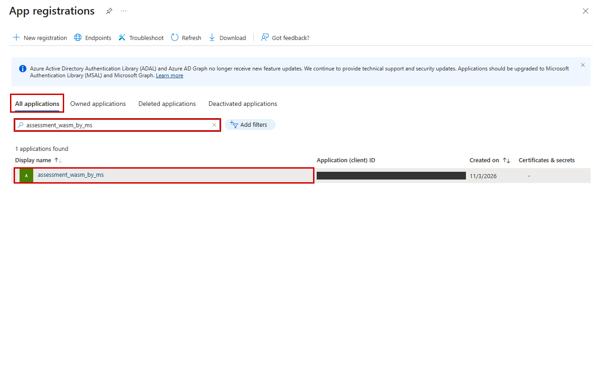
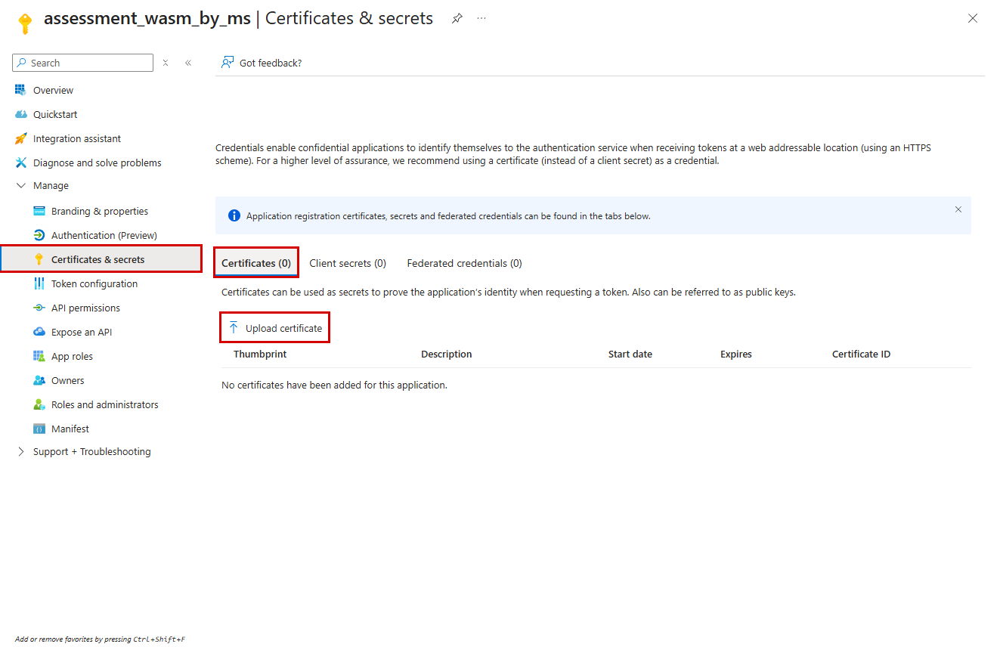
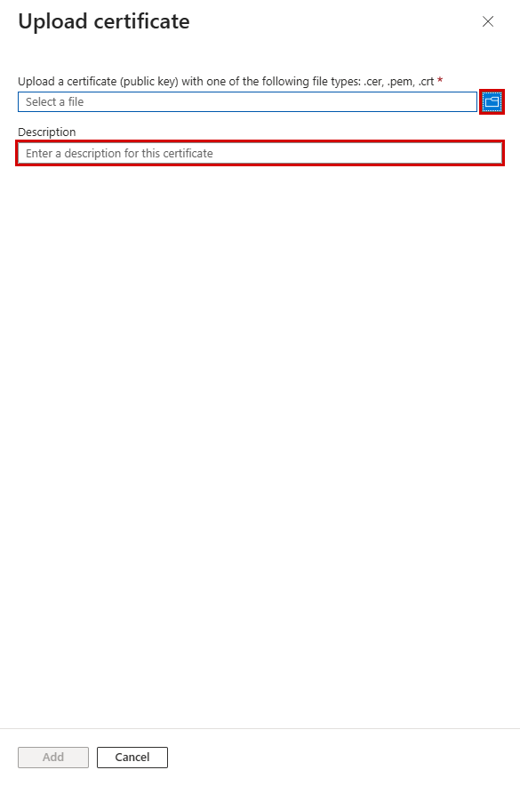
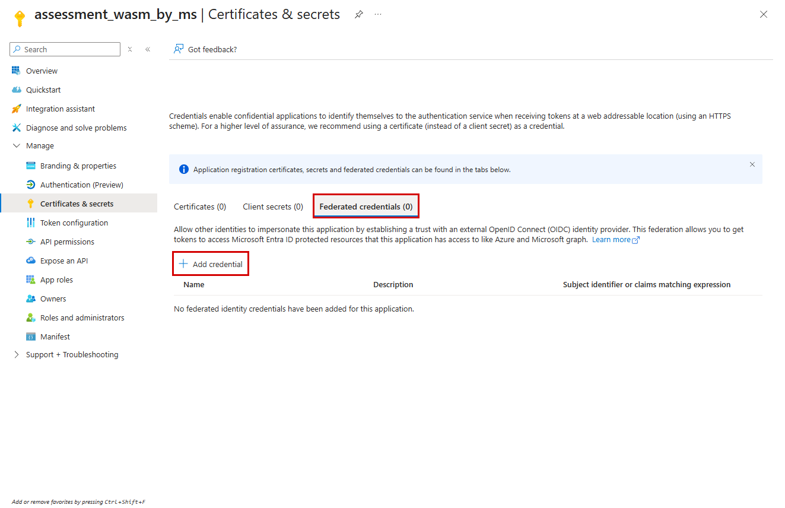
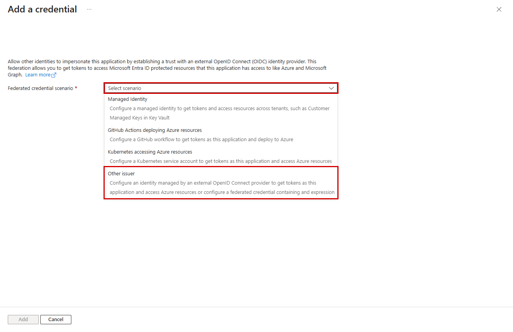
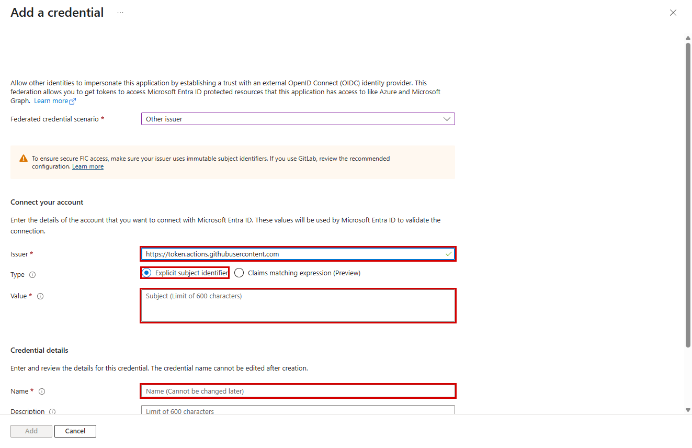

# SP 인증 준비 - 실제 화면 안내

- **인증서와 연합 인증 중 한 가지만 준비합니다.** 현재 앱/SP와 대상 구독 Reader는 이미 생성됐습니다.

- **로컬 Git Bash**
  - 준비할 것: 조직에서 발급한 인증서: 공개 인증서는 앱 등록에, 개인키 포함 PEM/PFX는 보호 경로에 보관
- **CI/CD·Kubernetes 등**
  - 준비할 것: 해당 호스트의 OIDC 발급 기능 + 앱의 연합 신뢰 관계 + 실행 시 공급되는 토큰 파일

- 인증서가 없다면 조직의 인증서 관리자/PKI에 발급을 요청하세요. 일반 고객 셋업은 개인키를 생성하지 않습니다. 승인된 테스트베드 자동화만 별도 보호 경로에 임시 인증서를 생성하고 종료 시 정리합니다. 로컬 PC에서 연합 인증 메뉴만 추가해도 OIDC 토큰이 생기는 것은 아닙니다.

## 공통: 진단 앱 찾기

- [Azure portal](https://portal.azure.com)에서 **Microsoft Entra ID > App registrations > All applications**를 엽니다. 설정 파일의 `account_name`으로 검색해 앱을 클릭합니다. 아래 테스트베드의 앱 이름은 예시이며 다른 환경에서는 본인의 진단 앱을 선택하세요. Client ID는 이미지에서 가렸습니다.



## A. 인증서 방식

- **1**
  - 고객이 할 일: 앱의 **Certificates & secrets > Certificates > Upload certificate** 클릭
- **2**
  - 고객이 할 일: 파일 선택 아이콘에서 **공개 인증서만** 선택: `.cer`, `.pem`, `.crt`
- **3**
  - 고객이 할 일: 설명 입력 후 **Add**. 목록의 지문·만료일을 조직 인증서와 확인
- **4**
  - 고객이 할 일: 개인키 포함 PEM/PFX는 로컬 보호 경로에 두고 아래 `verify` 실행





- **포털에 개인키 포함 PEM/PFX를 올리지 마세요.** 같은 `.pem` 확장자라도 공개 인증서와 개인키 포함 파일은 다릅니다. 위 이미지는 파일 선택 전 상태이며, Add는 비활성입니다. 실제 등록은 고객 관리자가 수행합니다.

```bash
export WASM_AGENT_PYTHON=python
bash scripts/setup/manage.sh verify \
  --certificate-path 'C:\secure\diagnostic.pem'
```

- 암호화 인증서의 암호 입력은 [셋업 안내](../scripts/setup/README.md#3-sp-인증---최초-1회-고객-작업)를 참고하세요. 테넌트·Client ID·Principal ID·구독은 `output/setup.json`에서 자동 전달합니다.

## B. 연합 인증 방식

- **Certificates & secrets > Federated credentials > Add credential**를 클릭합니다.



- 실행 호스트에 맞는 시나리오를 선택합니다. GitHub Actions와 Kubernetes는 전용 시나리오를 사용하고, 다른 OIDC 공급자는 **Other issuer**를 사용합니다. 아래는 Other issuer 양식을 검증한 예시입니다.



- **Issuer**
  - 입력 기준: 실행 호스트가 발급하는 OIDC 토큰의 `iss`와 정확히 일치
- **Type**
  - 입력 기준: 이 샘플은 **Explicit subject identifier** 기준. Preview 식은 사용하지 않음
- **Value**
  - 입력 기준: 토큰의 `sub`와 정확히 일치. 저장소·브랜치·서비스 계정 등 실제 호스트 값 사용
- **Name**
  - 입력 기준: 고객이 정한 고유 이름
- **Audience**
  - 입력 기준: Azure Public Cloud의 일반적인 기본값 `api://AzureADTokenExchange`; 호스트 토큰의 `aud`와 대조

- Issuer 입력 후 Type과 Value가 표시되는 것을 확인했습니다. 아래 Issuer는 **화면 테스트용 공개 예시**이며, 실제 고객 설정을 뜻하지 않습니다. Name·Value는 비워 두었고 Add를 누르지 않았습니다.



- 고객 관리자가 신뢰 관계를 저장한 뒤, **실행 호스트가 발급·갱신하는 토큰 파일**을 지정합니다. GitHub Actions의 토큰 발급이나 Kubernetes의 projected token 준비는 별도 호스트 설정이 필요합니다.

```bash
export AZURE_FEDERATED_TOKEN_FILE='<호스트가 공급하는 OIDC 토큰 파일의 절대 경로>'
unset AZURE_CLIENT_CERTIFICATE_PATH AZURE_CLIENT_SECRET
bash scripts/setup/manage.sh verify
```

- 토큰을 직접 문서에 붙여 넣거나 저장소에 복사하지 마세요. `verify`는 토큰을 발급하지 않습니다.

## 무엇을 검증했는가

- **화면**
  - 결과: 2026-11-03 실제 로그인된 Azure portal을 Playwright로 조작·캡처
- **클릭 표시**
  - 결과: 실제 요소 위치에 빨간 테두리 추가. 화면 내용·메뉴는 재구성하지 않음
- **비식별화**
  - 결과: 계정 배너 제외, 앱 목록의 Client ID 마스킹
- **테스트**
  - 결과: 앱 탐색, 인증서 업로드 패널, 연합 시나리오·필수 입력란, Add 비활성 및 취소 확인
- **변경 여부**
  - 결과: 파일 업로드·인증서 등록·연합 신뢰 저장 없음. 취소 후 인증서/시크릿/연합 자격증명 모두 0건 재조회
- **미검증**
  - 결과: 실제 인증서 로그인, OIDC 토큰 교환, 진단 SP의 API 사전 점검

- 포털 언어·버전에 따라 메뉴가 다를 수 있습니다. 빨간 네모는 클릭/입력 대상이며 미입력 상태의 Add 버튼을 활성 상태처럼 표시하지 않았습니다. 캡처 내역은 [manifest.json](images/setup/manifest.json)에 있습니다.

- 공식 근거: [인증서 등록](https://learn.microsoft.com/entra/identity-platform/howto-create-service-principal-portal#option-1-recommended-upload-a-trusted-certificate-issued-by-a-certificate-authority) · [연합 신뢰 관계](https://learn.microsoft.com/entra/workload-id/workload-identity-federation-create-trust).
