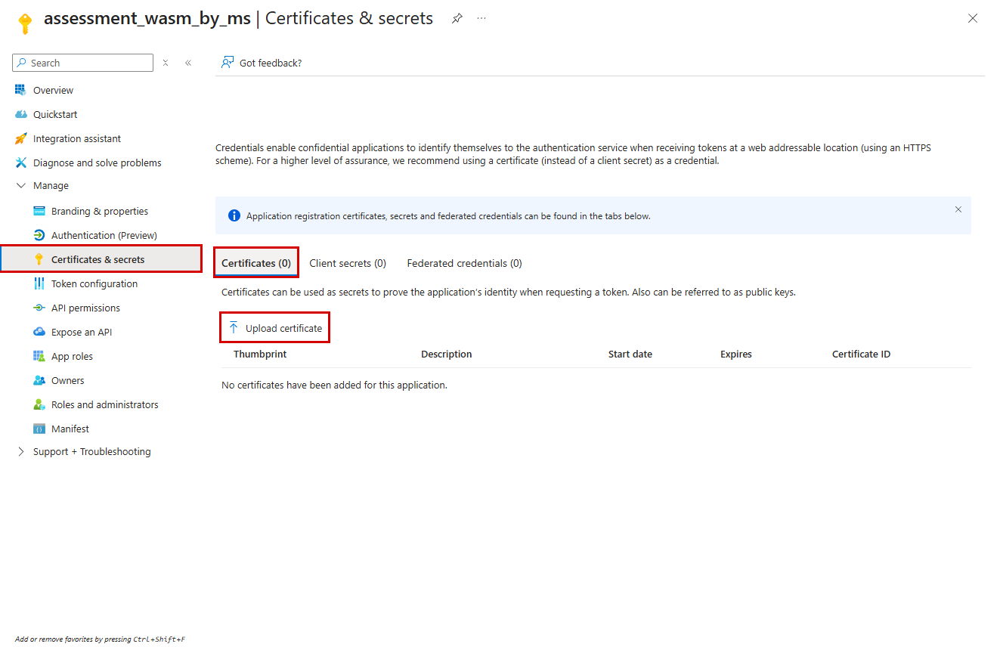

# 진단 계정 셋업 - Bash

- **전체 자동 Run-through는 [샘플 자동화 안내](../lab/README.md)를 사용하세요.** 승인된 임시 인증서를 자동 등록·사용·정리하므로 아래 수동 인증서 준비는 필수가 아닙니다.

## 현재 상태

- **진단 SP `assessment_wasm_by_ms`**
  - 상태: 생성 완료
- **대상 대상 구독**
  - 상태: Reader 부여·재조회 완료
- **추가 역할 / Foundry 역할**
  - 상태: 테스트베드는 프로젝트 읽기 v1/v2·샘플 workspace Log Analytics Reader 확인
- **SP 인증·접근 점검**
  - 상태: 테스트베드는 임시 인증서 자동 실행·정리 및 실제 점검 완료. 고객 환경은 별도 준비
- **실제 환경값**
  - 상태: [output/setup.json](../../output/setup.json) - Git 제외, 비밀 없음

## 1. 실행

- 저장소 루트의 **Git Bash**에서 실행합니다. Python 3.11과 Azure CLI가 필요합니다.

```bash
export WASM_AGENT_PYTHON=python
bash scripts/setup/manage.sh plan
```

- **`bash scripts/setup/manage.sh login`**
  - 자동으로 하는 일: 설정의 테넌트로 관리자 디바이스 코드 로그인
  - Azure 변경: 로그인 캐시만 변경
- **`bash scripts/setup/manage.sh plan`**
  - 자동으로 하는 일: 저장된 계정·대상 구독·예정 역할 표시
  - Azure 변경: 없음, API 호출도 없음
- **`bash scripts/setup/manage.sh apply`**
  - 자동으로 하는 일: 계정 재사용 → Reader 할당 → 재조회 → 결과 저장
  - Azure 변경: 누락된 역할만 추가
- **`bash scripts/setup/manage.sh verify`**
  - 자동으로 하는 일: 저장된 ID로 **진단 주체**의 접근 사전 점검
  - Azure 변경: 없음

- 기본 설정과 적용 결과는 `output/setup.json`을 사용합니다. ID를 다시 복사할 필요가 없습니다. 테스트베드는 계정·인증·실측까지 완료했습니다. 아래는 다른 고객 환경의 준비 절차입니다. `login`은 관리자용이며, 진단 SP의 인증을 대신하지 않습니다.

## 2. 추가 권한이 필요할 때

- 사전 점검의 거부 사유를 먼저 확인하고 **같은 옵션**으로 계획 확인 후 적용합니다.

```bash
bash scripts/setup/manage.sh plan  --cost-reader
bash scripts/setup/manage.sh apply --cost-reader
```

- **없음**
  - 추가 역할 / 범위: Reader / 입력한 구독
- **`--cost-reader`**
  - 추가 역할 / 범위: Cost Management Reader / 입력한 구독
- **`--monitoring-reader`**
  - 추가 역할 / 범위: Monitoring Reader / 입력한 구독
- **`--log-analytics-reader`**
  - 추가 역할 / 범위: Log Analytics Reader / 입력한 구독
- **`--security-reader`**
  - 추가 역할 / 범위: Azure Security Reader / 입력한 구독, Entra 역할 아님
- **`--foundry-project-scopes '<project-resource-id>' --create-foundry-read-role`**
  - 추가 역할 / 범위: 사용자 지정 읽기 역할 / 지정 프로젝트만

- Foundry는 [v2 역할 템플릿](foundry-reader.template.json)의 `agents/read`, `evaluations/read`, `assets/read`를 사용합니다. 신규 평가 API는 실제 인가에서 assets/read도 요구합니다. 이 권한은 프로젝트 asset 메타데이터 읽기를 포함합니다. `agents/read`에는 서비스 권한 단위상 대화 읽기도 포함되지만, 수집기는 대화 본문을 조회하지 않습니다. 기존 승인 역할은 `--create-foundry-read-role` 대신 `--foundry-read-role-id '<role-id>'`로 지정합니다. **Foundry User는 키 조회·쓰기 권한이 포함되어 사용하지 않습니다.**

## 3. SP 인증 - 최초 1회 고객 작업

- **[빨간 네모 스크린샷 안내](../../docs/sp-authentication.md)**에서 실제 클릭 순서를 확인하세요. Playwright로 실제 포털 화면을 열어 캡처했으며, 자격증명을 등록하거나 저장하지는 않았습니다.

- **인증서**
  - 고객이 준비할 것: Entra 앱 등록 → Certificates & secrets → Certificates에 **공개 인증서** 등록. 개인키는 승인된 보호 경로에 보관
  - 실행: 아래 명령
- **연합 인증**
  - 고객이 준비할 것: 실행 호스트에 맞는 연합 자격증명 구성 및 `AZURE_FEDERATED_TOKEN_FILE` 설정
  - 실행: `manage.sh verify`



```bash
bash scripts/setup/manage.sh verify \
  --certificate-path "$HOME/.config/wasm-agent/diagnostic.pem"
```

- Tenant ID·Client ID·Principal ID·구독은 결과 파일에서 자동 전달합니다. Codespaces에서는 저장소 밖의 보호된 Linux 경로를 사용하세요. 암호화 인증서만 다음 입력이 추가로 필요합니다. 실제 암호를 명령줄에 적지 마세요.

```bash
read -r -s -p 'Certificate password: ' AZURE_CLIENT_CERTIFICATE_PASSWORD
printf '\n'
export AZURE_CLIENT_CERTIFICATE_PASSWORD
# 위 verify 명령 실행 후:
unset AZURE_CLIENT_CERTIFICATE_PASSWORD
```

- **인증서/연합 설정이 없으면 명시적으로 중단**합니다. 관리자 로그인으로 대신 실행하지 않습니다. SP에는 디바이스 코드 로그인이 불가능합니다. 사람의 로그인만 `--use-device-code`를 사용합니다. 일반 고객 셋업은 개인키·시크릿을 자동 발급하지 않습니다. 승인된 테스트베드의 `scripts/lab`만 보호된 임시 인증서를 생성·사용·정리합니다.

## 다른 환경에서 처음 시작할 때

```bash
mkdir -p output
cp config/setup.example.json output/setup.json
# output/setup.json의 tenant_id, subscription_ids, account_name을 실제 값으로 수정
bash scripts/setup/manage.sh login
bash scripts/setup/manage.sh plan  --create-principal
bash scripts/setup/manage.sh apply --create-principal
```

- 다른 설정은 `--config-file '<file>'`, 다른 결과 파일은 `--result-file '<file>'`로 지정합니다. 후속 명령도 해당 결과 파일을 `--config-file`로 지정하세요. 사용자는 `account_type: "user"`, `account_name: "<기존 UPN>"`을 지정하며 새 사용자는 관리센터에서 생성합니다. 원래의 [setup-account.sh](setup-account.sh) 개별 인자 방식도 계속 지원합니다.

## 권한·안전·출력

- **실행 관리자**
  - 내용: 대상 구독 역할 할당 권한(예: Owner/UAA/RBAC Administrator), 앱/SP 생성·조회 권한. 사용자 지정 역할 생성 시 `roleDefinitions/write` 추가
- **진단 주체**
  - 내용: Reader 중심. Owner/Contributor/UAA 및 관리 그룹·테넌트 루트 할당 금지
- **재실행·실패**
  - 내용: 같은 계정·할당은 재사용. 실패 시 명시적으로 종료하며 자동 삭제/롤백 없음
- **확인 한계**
  - 내용: 할당 재조회는 전체 그룹·상속·PIM 감사가 아님. 부분 적용 후 동일 명령으로 재시도
- **`verify` 결과**
  - 내용: `output/permissions.json`, `output/permissions.md` 생성
- **종료 코드**
  - 내용: `verify`: 0 성공, 2 일부 거부/미제공/오류, 1 입력·인증 실패
- **판정 한계**
  - 내용: OK는 해당 API 접근 성공일 뿐 데이터 완전성·라이선스·성숙도 보장이 아님

- 고객 요청 문구: **“별도 진단 주체에 대상 구독 Reader와 확인된 추가 읽기 역할만 요청드립니다. 키 조회·Agent 변경·추론·평가 실행 권한은 요청하지 않습니다.”**

- 상세 근거: [RBAC](../../docs/rbac.md) · [API 메모](../../docs/api-notes.md).
